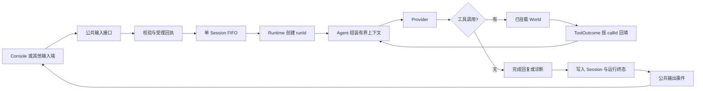

# M2 首批闭环设计与选型

状态：已完成设计，等待项目负责人选择。本文是 `2026-10-05-m2范围草案.md` 的具体设计附件；范围方向已确认，以下方案和数值为提案，尚未写入生产代码。

选型更新（2026-10-05）：负责人选择终端会话 + 受理回执/输出事件 + 标准容量，进入首批实现。上述原始提案与候选保留；最终选择与验证见 `agent-context/current-task/2026-10-05-m2终端闭环实现.md`。

## 推荐组合

采用“对话控制台 + 受理回执与输出事件 + 标准容量”。先实现并测试输入到终态的无界面闭环，再把独立 Console 接上。首个生产 World 仍另行确定，工具验证使用现有 FixtureWorld。

## 界面方案

| 方案 | 具体交互 | 对首批交付的影响 |
| --- | --- | --- |
| 对话控制台（推荐） | 轻量本地浏览器页面；主区显示用户输入与完整回复，旁边显示当前运行、队列与可展开的工具回执。输入可在模型运行时继续提交，支持取消指定输入与停止 Runtime。 | 同一 Node 进程提供 loopback HTTP 与静态页面；不引入前端框架、模型 token 流式输出或独立桌面安装包。先跑通底层再接页面。 |
| 终端会话 | Node readline 接收多行文本，输出回复和 callId 诊断；命令取消当前输入、查看队列与关闭 Runtime。输入命令由 Console 本地解析，不作为模型指令。 | 最少界面工作；同进程直接使用公共输入接口。适合优先缩短首批交付链路。 |
| 运行工作台 | 本地浏览器页面按会话、待处理输入、执行轨迹组织；每条输入可查看状态、当前阶段和工具结果。正文回复独立显示。 | 更便于定位复杂故障，但需要更多界面状态与布局。首版仍只有一个 Session，无多实例配置与恢复操作。 |

界面方案共享同一逻辑和输入契约，可独立替换。原型中的工具结果和回复均为模拟数据，不代表 Runtime 已接通界面。原型仅用于选型；图形 Console 的生产实现可作为独立组件，不承担 World 职责。

## 完整运行路径



Console 的每条输入要么被明确拒绝，要么收到受理标识，并在进程正常存活期间到达一个终态。受理是内存队列承诺，首批不保证进程崩溃后的重放或结果投递。

## 推荐输入契约：受理回执与输出事件

以下类型用于表达契约，字段实现位置是 `src/protocol/`，不绑定 Console 或 HTTP：

```ts
interface UserInput {
  inputId: string;                 // 输入端生成的不透明唯一 ID
  source: string;                  // 例如 console；不提供模型权限
  content: { kind: 'text'; text: string };
}

type InputReceipt =
  | { status: 'accepted'; inputId: string; queueSequence: number }
  | { status: 'rejected'; inputId: string; code: string; message: string };

interface InputChannel {
  submit(input: UserInput): Promise<InputReceipt>;
  cancel(inputId: string): Promise<CancelReceipt>;
  inspect(inputId: string): InputSnapshot | undefined;
  subscribe(listener: (event: OutputEvent) => void): () => void;
}
```

- Assembly 将通道绑定到唯一主 Session。输入端不选择任意 Session，接收时间由 Runtime 写入；首版只接收文本。
- Runtime 校验非空文本、ID/source 长度和输入大小；保留原始正文，不将来源字段拼成 system 指令。UserInput 与环境 Event 分开表示，通过通用输入联合类型进入 Agent。
- submit 校验并分配 queueSequence，按受理顺序 FIFO。队列满返回 queue_full，不等待隐藏排队；starting/stopping/stopped 返回 not_running。
- inputId 在当前 Runtime 生命周期内唯一；重复提交同一 ID 返回 duplicate_input，不重复执行。首批最多受理 4096 条输入；达到数量上限返回 admission_limit，避免去重集合无限增长。生命周期内重启不清空 ID 集合；进程重新创建不提供跨进程去重保证。
- runId 由 Runtime 在出队时生成，区分输入身份与执行实例；所有输出含 inputId、runId（尚未执行时为空）、sessionId、generation、seq 和 at。source 与 inputId 不具有权限语义。
- 输出采用 queued、run_started、tool_started、tool_finished、run_finished，以及独立 runtime_status。run_finished 包含 succeeded/failed/cancelled 终态、完整回复（如有）、错误或诊断。超时/超限属于 failed 的明确原因，不增加含混的完成状态。
- 无模型 token 流式输出；每次 Provider 返回后展示完整消息，工具进度独立报告。成功要求得到完整最终文本；error、length、轮数耗尽或空最终响应返回相应 failed 诊断，不伪装为成功。
- run_finished 在终态 Session 写入完成后发出；写入失败发出 failed/storage_error，并标记 persisted=false。首批拟追加 input/run_started/run_finished SessionEntry，既有 event/模型/工具记录保留，不重写旧 JSONL。
- 终态提交由 Runtime 的一次性 finalizer 拥有；取消/停止路径主动收束，不能依赖已经失效的普通模型回调写入终态。queued 输入尚无 runId，也必须有 inputId 对应的 cancelled/expired 终态。取消产生的生命周期记录在停止路径提交并加入写入屏障，stop 返回后不再提交；每条已受理输入只发布一次终态。存储持续挂起期间可显示 write_pending，不能先声称已持久化成功。
- 取消工具批次时，对已声明但未开始的调用记录 cancelled，对已开始且未确认的调用记录 unknown；均保留 callId。Agent 只回传配对完整的历史轮次。M1 旧日志中有调用无回执的记录只显示诊断，不作为有效模型上下文，也不据此自动执行工具。
- output seq 是当前进程单调序列；事件缓存同时限制为 256 条/4 MiB，输入快照同时限制为 128 条/4 MiB，先达到任一上限就逐条淘汰最旧记录。若快照被淘汰，inspect 返回 undefined，客户端显示“状态已过期”；重复 ID 仍被拒绝。完整会话记录由现有 JSONL 保存，首批不建设历史查询服务。
- 监听器异常不得中断执行。浏览器断开不取消已受理输入；重连通过 inspect 与事件游标获取当前状态，游标超出缓存返回明确 gap，不假装完整重放。

文本 ID/source 各不超过 128 个 UTF-8 字节；未定义的字段拒绝，以免暗中承担附件、权限或路由语义。输出快照只携带必要的正文、状态和轻量工具诊断，不向 Console 暴露 providerData、凭据或隐藏输出项。

## 输入契约替代：单次等待结果

精简方案为 `submit(input): Promise<RunResult>`，每次提交一直等待该输入终态，Console 只能显示本地“等待中”。仍需 inputId、FIFO、容量限制和取消契约；不公开阶段事件，只保留最终结果与查询。

优点是接口较少；代价是工具运行、队列状态和断开后的结果关联更难展示。推荐使用受理/事件方案，因为它让同一运行机制可服务终端与图形 Console。

## 默认容量与运行参数

| 参数 | 紧凑 | 标准（推荐） | 宽裕 |
| --- | ---: | ---: | ---: |
| 单次完整 Provider 请求体上限 | 32 KiB | 64 KiB | 128 KiB |
| 单条用户正文上限 | 4 KiB | 8 KiB | 16 KiB |
| 固定内容建议预留空间 | 8 KiB | 16 KiB | 32 KiB |
| 待执行队列容量（不含执行中） | 4 | 8 | 16 |
| 每条输入最多模型请求次数 | 4 | 8 | 12 |

共同参数：每次 Provider 请求 30 秒；每个工具 10 秒；一条输入执行总时限 120 秒；排队最多等待 120 秒；单次响应最多声明 8 个工具调用；单个 Provider 响应体最多 1 MiB；cleanup 沿用 M1 的 100 ms 可配置默认值。所有默认数值为首版提案，不是性能结论。

排队时限从受理开始计量，与出队后的执行时限分别计算；过期输入由 finalizer 提交 failed/queue_expired。工具调用数超限时在执行任何该批工具之前结束为 failed/tool_call_limit，避免执行半批后才发现限制。

标准的单条正文 8 KiB 约允许 2730 个三字节汉字；JSON 转义和工具声明也占请求预算。首版按字节计量，不把字节数宣称为模型 token 数，也不保证匹配任意模型的窗口。

### 容量计算与超限

- Provider 适配器提供无网络的 request measurement，使用与 complete 相同的请求序列化逻辑。计量整个请求 JSON 的 UTF-8 字节数，包括消息、工具 schema、原始输出项及协议字段，不包含凭据头。
- Agent 通过通用 RequestSizer 契约获得计量能力，拥有历史选择策略；Runtime 在每次调用 Provider 前再次验证实际请求预算。具体实现不能让 Agent 导入某个 Provider 类，也不能让 Runtime 解释模型专属输出项。
- 初始按“上限减固定内容预留”选取最近已完成的连续轮次，再精确计量实际 body。预留不减少硬上限，也不能代替真实计量；当前输入或固定工具内容超出预留时通过精确计量处理。
- 超限时，从最早已完成的轮次开始整体移除；一个轮次中的用户输入、模型响应、全部工具调用/回执与 Provider 输出项一起保留或移除。被移出的历史仍留在 JSONL，不做摘要。
- 当前活动轮次、system 内容、工具声明和未完成工具配对不得拆散。移除所有可移历史后仍超限，结束为 failed/context_limit，并报告需要与允许字节数。
- 工具已执行成功但结果使上下文超限时，成功回执如实保存；本轮以 context_limit 结束，不把已发生副作用改写成 failed/unknown，也不重试工具。
- 响应体过大时终止解析并报告 response_limit；若已经识别或开始了工具副作用，依真实确认结果给出诊断。不会静默截断工具结果后继续请求。

## 取消、停止与不确定工具结果

- 取消待执行输入：从队列移除，写入 cancelled 终态，未执行 World 工具。cancel 回执为 cancelled/already_finished/not_found；不自动创建替代输入。
- 取消执行中输入：立即使本次 run lease 失效并取消独立 run signal；Runtime 的根 signal 用于整体 stop。每个 run 的异步边界都检查 runId/lease/generation，旧结果不写入新代。
- stop：先拒绝新输入，取消待执行输入和当前 run，再执行独立 World cleanup，等待已提交 Session 写入；保留 M1 已验证的写入屏障。
- Provider 超时只结束本次运行；旧 Provider 结果永久无效。工具若无法确认副作用完成状态，标记 unknown，只显示原因与 callId。
- 工具在取消/超时后仍未收束时，首版自动停止 Runtime 并取消待执行输入，防止新工具与未收束工作重叠。展示 unknown 和停止原因，不提供恢复、重试或重放按钮；正常生命周期启停不能被描述成撤销已发生副作用。
- World 必须遵守取消和 cleanup 信号。M1 仅阻止迟到逻辑写入，无法替不配合的 World 撤销外部操作。Session 写入永久挂起仍阻塞 stop，并持续显示 stopping/write_pending 诊断。

## 浏览器方案的传输边界

推荐图形 Console 由同一进程在 127.0.0.1 随机端口提供静态文件。浏览器使用 POST 提交/取消和 GET 查询，SSE 接收完整消息与运行状态；Runtime 不直接依赖 HTTP。服务关闭时停止接受传输请求，业务 stop 与连接生命周期分别处理。

提交 POST 使用进程启动时生成的短期 Console 会话标识，检查同源请求；不启用跨域，不对外网监听。标识不作为模型输入。首版不建设远程用户、账号或多租户权限产品。

## 实现批次

1. 公共输入/输出契约、FIFO 和每条输入终态；用无界面测试证明“输入 → Agent → Provider → 完整工具往返 → 最终输出”，包括重复 ID、队满、轮数耗尽和失败。
2. 生产 Agent、完整轮次边界、request measurement、容量预设与所有时限；验证移动历史不破坏配对，工具副作用后的超限不重放。
3. 接入所选 Console，验证连续输入、同一输入的回复关联、取消、整体停止和界面断开；提供离线可交互样例。
4. 对增量变更独立 Review，再由负责人验收首批闭环。后续持久化、恢复与生产 World 另行确定。

## 本次待选

负责人可选择界面、输入契约和容量预设，也可以直接采用推荐组合：对话控制台 + 受理/事件契约 + 标准容量。选择后再冻结实现参数；功能边界沿用已经确认的下一阶段范围。

## 2026-10-05 首批实现状态

负责人选择的终端 Console + 受理/事件契约 + 标准容量已实现，62 项无网络测试、类型检查和 M1 样例通过。新增 run_status/write_pending 用于显示未完成的终态写入；输入与环境 Event 在 AgentContinuation.input 中保持类型区别。生产代码、参数、终端用法与验证证据见 current-task/2026-10-05-m2终端闭环实现.md 和 docs/使用说明/终端Console.md。

本次状态为首批实现完成、等待独立 Review 与负责人验收；首个生产 World、真实 Provider 工具往返与后续持久化/恢复尚未验收。计划保持活动状态。

## 2026-10-05 独立审查修复状态

独立审查已完成，发现两处 unknown 收束 P1 与诊断缺口。本轮已修复并新增六项回归，68/68 测试、类型检查、M1 样例及离线终端通过；原审查探针均不再执行下一条输入。生产代码保留异常/取消/超时/回执错配的 unknown 原因，回执写入失败不解除停止，公共事件及终端增加模型轮次与轻量工具错误字段。

修复记录见 current-task/2026-10-05-m2终端闭环实现.md，原报告见 current-task/2026-10-05-m2独立审查.md。当前为修复完成、等待修复复核与负责人验收；M2 整体保持活动，不归档。真实 Provider 联网往返仍未验收；生产 World、持久化增强、恢复和长期 Memory 继续延后。
