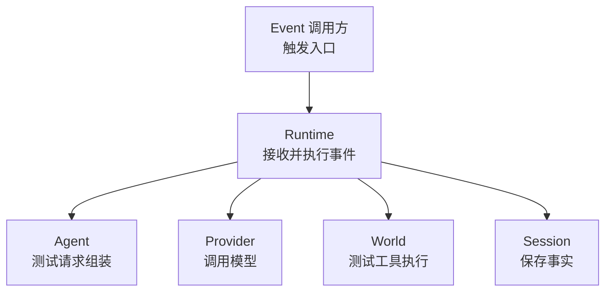
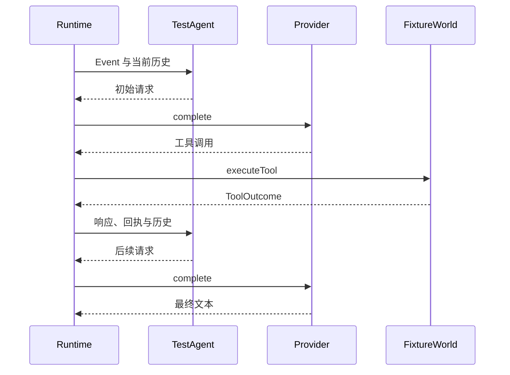
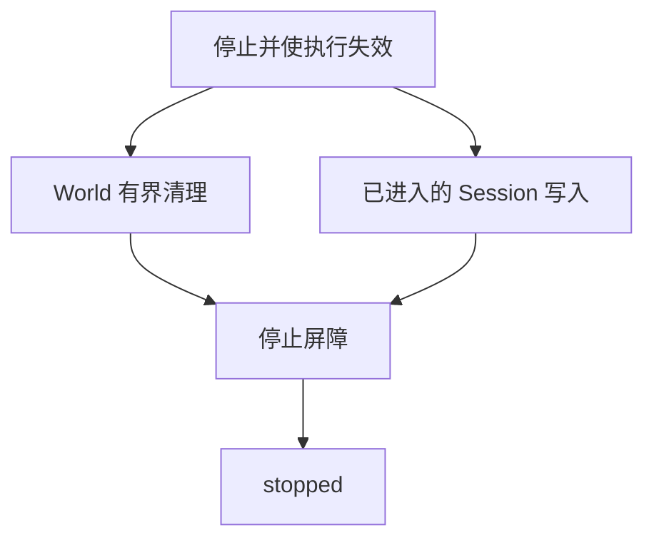
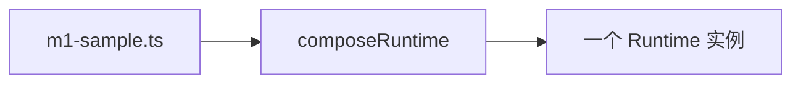

Owner: `src/protocol/index.ts`, `src/runtime/runtime.ts`, `src/runtime/compose.ts`, `src/providers/`, `src/state/`, `scripts/m1-sample.ts`, `tests/fixtures/`, `tests/integration/m1-vertical.test.ts`, `tests/integration/lifecycle-races.test.ts`, `tests/integration/provider-roundtrip.test.ts`

# M1 进度与架构图

基线日期：2026-10-04；复核附记：2026-10-05。本页依据当时计划、实现记录与后续纠正整理 M1，不将 M2 能力倒写进基线。M1 基线已实现，负责人确认此前独立 Review 已完成；补充竞态/工具往返修复的复审与真实工具往返验收分别记录。后续实现见 [M2 进度与架构图](2026-10-05-M2进度与架构图.md)。

## 交付范围

交付通用 Agent 的最小运行基座：单 Runtime、单 Session、单 FixtureWorld，验证结构化事件经模型请求、工具执行和回执进入会话记录。运行生命周期与一次事件处理分别管理，事件处理结束后仍可接收下一次事件。

- 建立 Node/TypeScript 单包基线、离线自动化测试、真正的类型检查和最小脚本样例。
- 定义 Event、Agent、Provider、World、ToolCall/ToolOutcome、SessionStore 和 StateStore 公共契约，组合根注入具体实现。
- 实现 Runtime 启停、代次与租约失效、Event 工具循环、参数形状校验和结构化失败记录。
- 实现 JSONL Session、内存 State 和 Runtime trace；TestAgent/FixtureWorld 作为测试基础设施。
- 提供脚本 Provider 和 Responses 兼容适配器；自动化不联网，真实请求独立人工验证。

M1 是首个实现基线，没有上一实现阶段的组件增量图；P0 的冻结职责与验收要求见 [M1 交接计划](agent-context/history/plans/1002bot-m1-work-handoff.md)。

## 简化总图

六个功能块，箭头表示接入或调用，返回和写入细节在局部图展开。Agent 与 World 在本阶段使用测试实现。

## 组件关系

| 组件 | M1 实现位置 | 所有权与协作边界 |
| --- | --- | --- |
| Runtime | `src/runtime/runtime.ts` | 持有注入的契约实现，管理生命周期、Event 循环、代次隔离与已进入的写入 |
| Agent | `tests/fixtures/test-agent.ts` | 声明 Session、构造初始与续轮请求；通过请求声明工具调用，不直接执行 World |
| World | `tests/fixtures/fixture-world.ts` | 提供工具声明、领域校验、效果与回执；查询、写入、失败工具分别为 fixture.get/set/fail |
| Provider | `src/providers/` | 处理模型协议和传输，脚本响应或 Responses 兼容 HTTP；不拥有 Session 或调用 World |
| Session | `src/state/jsonl-session.ts` | 串行追加 JSONL，读回交互事实；通过 SessionStore 与 Runtime 协作 |
| State | `src/state/memory-state.ts` | 实例内键值存储，完成装配注入；主循环尚未深入使用，没有长期 Memory 流程 |
| Protocol | `src/protocol/index.ts` | 各层的事件、模型、工具、存储与取消契约，保持可序列化边界 |
| Assembly / 样例 | `src/runtime/compose.ts`、`scripts/m1-sample.ts` | 选择实现并构造一个 Runtime；样例驱动启动、事件处理和停止 |

测试 Agent 和 World 位于 `tests/fixtures/`，实际 MemoryState 位于 `src/state/`。此处按实现记录描述，不把计划中的测试 Memory 位置写成最终事实。Provider、Agent 和 World 都通过契约协作，具体平台语义不进入 Runtime。

## 详细关系

### 事件到模型与工具续轮

以一次工具调用后得到最终文本为例，存储不叠加在这张调用图中。

Runtime 解析参数并检查工具是否声明，World 校验具体领域语义。Agent 不再提供下一请求、模型没有工具调用或达到轮次上限时，本次 Event 处理结束；这些条件不自动停止 Runtime。

### 事实写入与历史读取

每个事件开始时由 Runtime 读历史；模型与工具续轮使用已追加的事实重建请求。会话事实和 Runtime trace 的可见时机见专项报告。

### 停止与清理

普通执行在停止后不启动新调用；World 清理和已进入的写入分别收束，避免一个任务失败提前放过其余写入。

### 样例装配

样例注入 TestAgent、FixtureWorld、ScriptedProvider、JsonlSessionStore 和 MemoryState，直接调用 start、handleEvent、stop；没有交互 Console 或输入队列。

## 专项报告

### 生命周期与代次边界

状态为 new → starting → running → stopping → stopped，启动失败经 failed 清理到 stopped。每次启动创建 generation、根取消信号与 lease；停止立即使旧执行失效。异步边界后重查代次、租约和取消状态，旧启动成功/失败、迟到历史读取和模型/工具返回不能推进新一代。

启动与停止分别复用操作 Promise；重复停止不重复清理。World cleanup 使用独立信号，默认 100 ms，期限到达后 abort；忽略信号的底层资源或效果不能由 Runtime 撤销。M1 仅清理 World，没有多组件清理顺序实现。Event 的模型循环受 SessionDecl.maxTurns 和运行取消约束，没有 M2 的逐输入、逐 Provider/工具期限。

### Session 提交与 trace 可见性

Event、provider_request、provider_response、tool_call 和 tool_outcome 随发生过程追加。样例的一个事件、两次模型请求/响应和一对工具记录共 7 条。trace 为实例内观察记录，不是独立的持久化事件库。

进入 append 的写入不因停止而撤销；stop 等所有这些写入完成，失效代完成的普通写入不再加入活动 trace。一项写入失败仍等待其余写入收束后报告错误。Session 挂起会阻塞停止，不使用 World cleanup 期限截断。

JSONL 可读回已完成记录，保持实例内追加顺序；没有 fsync、多记录事务、崩溃后执行恢复或自动损坏修复。读回记录不等同于恢复未完成外部动作。State 仅在内存保留，不与会话记录自动转换为长期 Memory。

### 工具回执与 Provider 往返

ToolOutcome 保留 callId，表达 succeeded、failed、cancelled 和 unknown。参数无法解析、工具未声明以及 World 确定的领域失败有结构化回执；Provider 异常记录为 finishReason=error 并结束本次模型路径。

M1 验证 World 明确返回 unknown 后按原 callId 记录，没有通用输入路径的 unknown 关闭受理与自动停止保证；也没有把执行后普通异常统一提升为 unknown 的 M2 收束规则。

复核后的通用消息携带 toolCalls 与不透明 providerData。Agent 从事件、模型响应和回执重建消息，不重复展开已记录的 provider_request；Responses 适配器保留原始 output，并以 function_call_output/call_id 回填结果。协议替身验证包含连续两轮工具、成功/失败回执及最终文本，不代表真实端点工具往返已经验收。

## 验证记录

| 时点与验证类型 | 结果 | 覆盖与证据 |
| --- | --- | --- |
| 2026-10-04 早期自验 | 9 项测试通过；曾仅完成语法检查，随后安装依赖完成真正类型检查 | [基线记录](agent-context/current-task/2026-10-04-m1-p1-baseline.md) 保留 Node 测试替代 Vitest、类型兜底移除与后续 Update；最终实现不采用原先的降级状态 |
| 2026-10-04 基线收尾 | 10 项测试、真正类型检查和 M1 样例通过；样例 stopped、value=1、entries=7 | [收尾记录](agent-context/current-task/2026-10-04-m1-p2-acceptance-cleanup.md)：追加真实 World unknown 配对验证、生命周期/失败/JSONL 与架构边界 |
| 2026-10-04 真实服务文本 | 人工请求通过，finishReason=stop，无工具调用 | [基线记录](agent-context/current-task/2026-10-04-m1-p1-baseline.md) 的 Manual verification；仅证明文本请求，不扩大为工具验收 |
| 此前独立 Review | 负责人于 2026-10-05 确认已完成 | [复核记录](agent-context/current-task/2026-10-05-m1复核与下一阶段规划.md)；审查人、原日期和详细结论未记录，不补写 |
| 2026-10-05 补充修复自验 | 25/25 测试、类型检查与样例通过 | [复核记录](agent-context/current-task/2026-10-05-m1复核与下一阶段规划.md)：14 项生命周期竞态和 1 项两轮协议往返新增验证；此前 Review 不自动覆盖此次修复 |
| 补充修复复审 | 本页引用记录中尚无独立通过证据 | 后续审查发生后按日期补齐，不将自验视为复审 |
| 负责人最终验收 | 引用记录未提供单独的最终确认结论 | 不凭独立 Review 完成推定负责人验收；发生后补充证据 |
| 真实工具往返 | 尚未验收 | `scripts/manual-provider-tools.ts` 为单独手动入口 |

历史计划和原记录保留；本文整理没有新执行代码测试，不用当前 M2 测试数替代 M1 时点结果。

## 范围边界

M1 基线的结构交付已完成，本页不保留“尚未完成的整体结构”章节；待复审和人工验证列在验证记录。后续实现范围按阶段单独管理。

M1 不交付生产 Agent、生产 World、用户输入 FIFO、独立 Console、心跳、长期 Memory、事件投递与未完成轮次恢复、unknown 重放、多组件清理、逐调用时限或请求字节容量。VRChat OSC/OSCQuery、视觉、实时控制、多 Bot/Session/World、插件市场和云部署均不进入本阶段。

依据见 [P0 裁定](agent-context/history/plans/1002bot-p0-decision-questions.md)、[M1 交接计划](agent-context/history/plans/1002bot-m1-work-handoff.md) 和后续 [持续运行 Agent 设计约束](../scratch/Off-topic%20discussion/持续运行Agent设计约束.md)。规划能力不写为已实现组件；新增阶段不覆盖 M1 历史结论。
