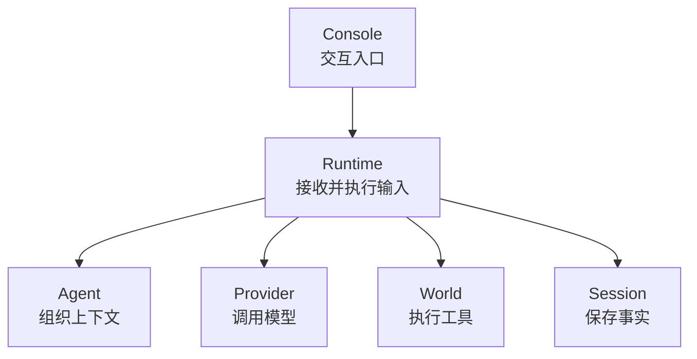
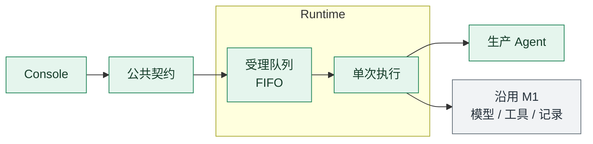
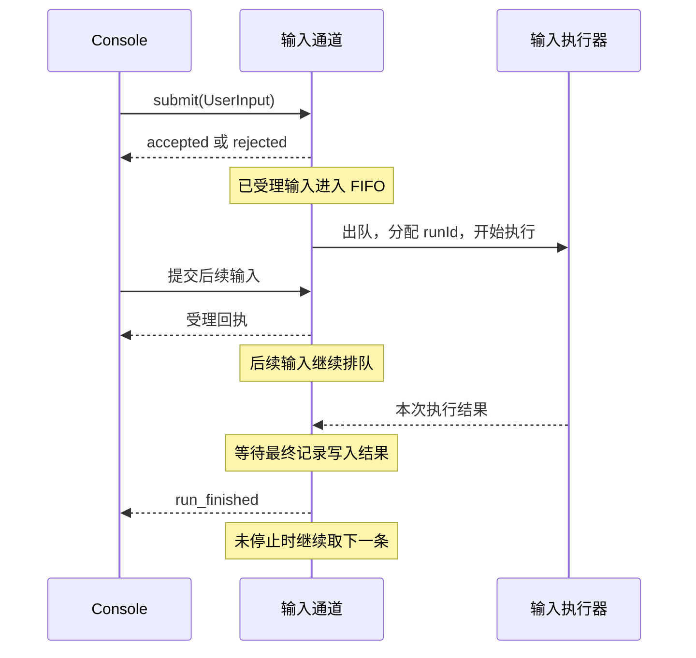
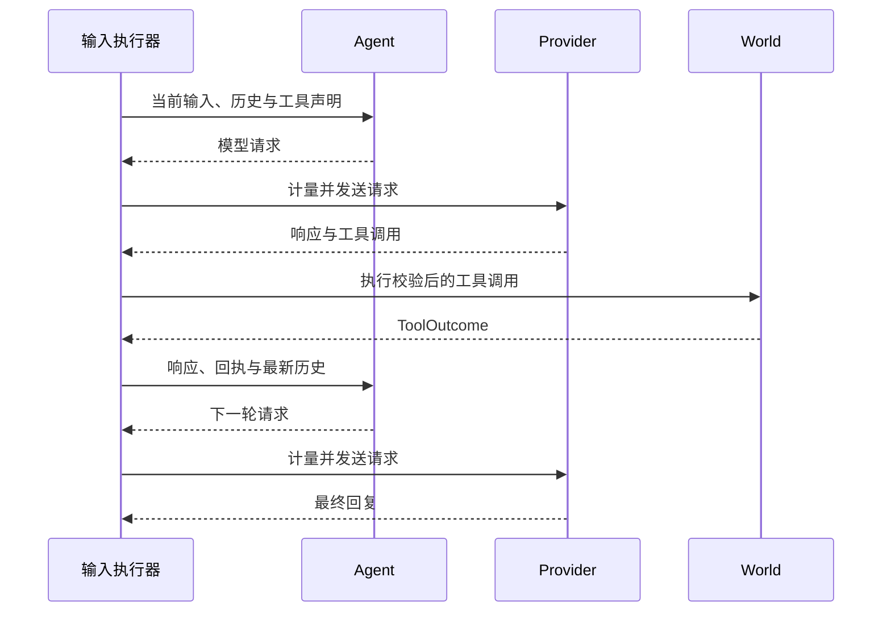
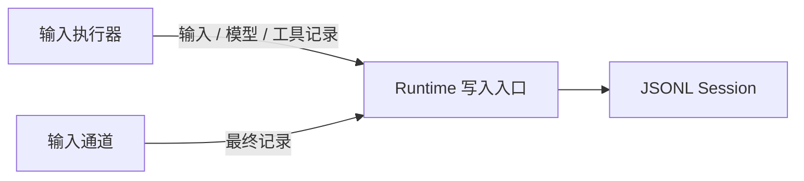
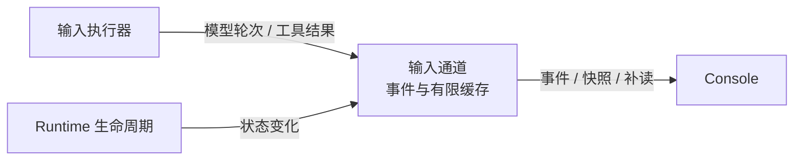
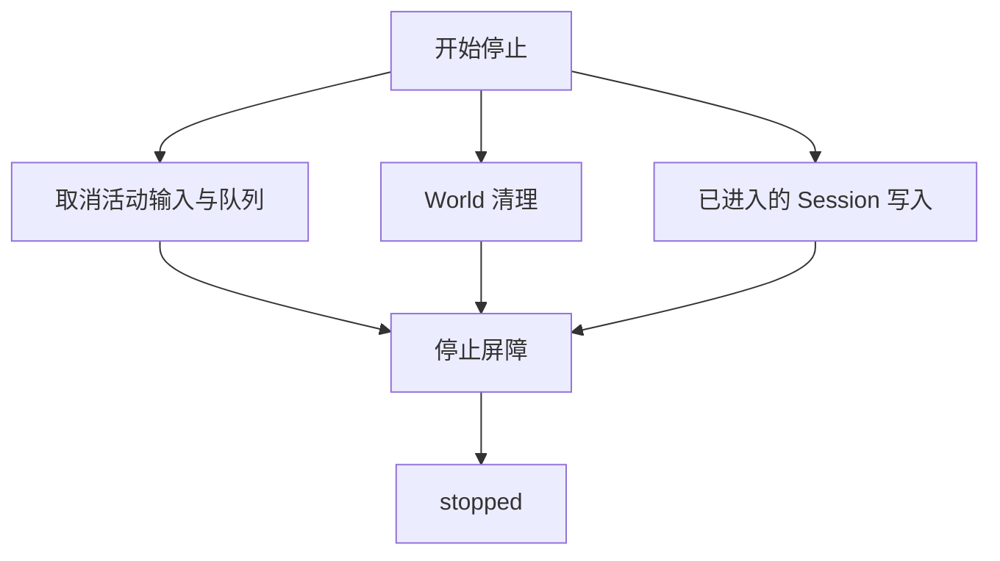
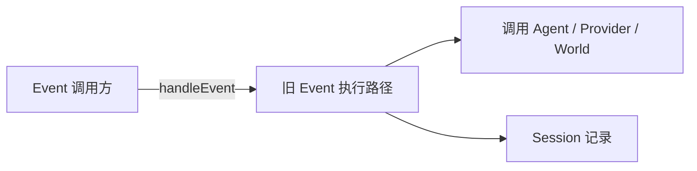
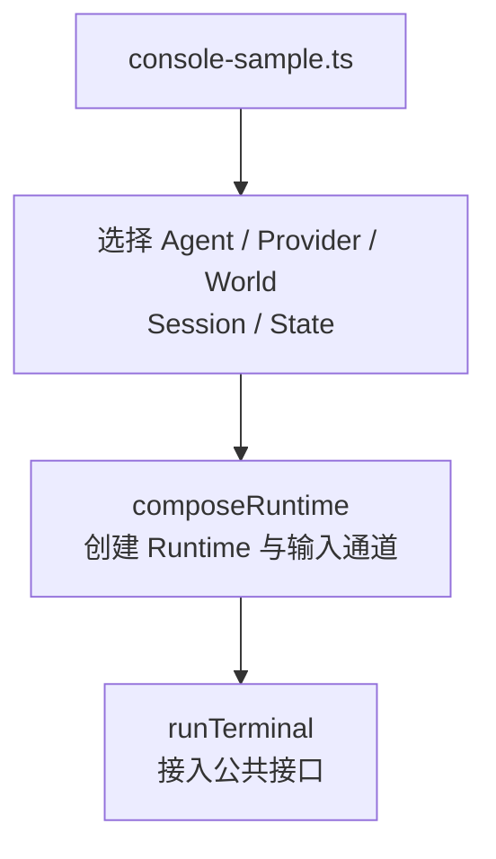

Owner: `src/protocol/`, `src/runtime/`, `src/agent/`, `src/console/`, `src/providers/`, `src/state/`, `scripts/console-sample.ts`, `tests/integration/`

# M2 进度与架构图

日期：2026-10-05。范围：独立终端 Console、通用用户输入通道、生产 ConversationAgent 和明确容量的可交互闭环。M1 基线另见 [2026-10-04 M1 进度与架构图](2026-10-04-M1.0进度与架构图.md)。

M2 首批可交互闭环于 2026-10-06 完成验收：修复复核、真实 Provider 工具往返通过，负责人确认终端交互已验证。后续拆为 [Console 终端交互](agent-context/plans/2026-10-06-console终端交互计划.md) 与 [链路逻辑推进](agent-context/plans/2026-10-06-链路逻辑推进计划.md) 两部分。持续世界链路与生产 World 尚未完成；证据见 [复核记录](agent-context/current-task/2026-10-06-m2修复复核.md)。

Console 全屏 TUI 增量单独见 [M2.1 进度与架构图](2026-10-06-M2.1进度与架构图.md)。本页继续保留 M2 基线。

2026-10-08 实现迁移附记：当前源码已在 [M3](2026-10-08-M3.0进度与架构图.md) 将 UserInput、World Event 与 Heartbeat 接入共享队列；本页两条执行路径与未接入心跳的描述属于 M2 历史基线。

## 交付范围

交付独立终端 Console、通用受理/事件契约、单 Session FIFO、生产 ConversationAgent 和明确容量的可交互闭环。用户可以连续输入，跨输入使用容量内的成功历史；需要工具时通过 Runtime 调用已挂载 World，并回填结果。单次输入完成后 Runtime 继续运行。

- Console 负责文本编辑、本地命令与诊断展示，使用 Runtime 公共接口接入，不承担 World 职责。
- 输入通道负责受理、去重、排队、取消、最终结果与有限缓存；输入出队后分配独立 runId、信号和执行期限。
- Agent 选择完整轮次上下文，Provider 按实际请求体计量；Runtime 执行器校验容量、轮次、工具声明和回执配对。
- Session 沿用 JSONL，State 沿用内存实现；旧 Event 保留兼容入口，离线样例使用 FixtureWorld。
- unknown 只提供诊断和停止收束，不提供恢复、重试或重放。

## 简化总图

先看六个功能块之间的协作。箭头只表示接入或调用关系，响应回传在后面的局部图展开。

Console 接入 Runtime 的公共契约；Runtime 协调 Agent、Provider、World 和 Session。Console 的具体界面、Provider 协议和生产 World 可分别选择。MemoryState 当前只完成注入，其使用状态见后文的结构断点。

## 组件关系

| 组件 | 当前实现位置 | 所有权与协作边界 |
| --- | --- | --- |
| Console | `src/console/terminal.ts` | 文本编辑、本地命令和公开诊断；不组装模型请求或执行 World 工具 |
| Runtime 生命周期 | `src/runtime/runtime.ts` | 启停、代次与写入屏障，拥有输入通道；不解释具体环境语义 |
| 输入通道 | `src/runtime/input-channel.ts` | 受理去重、FIFO、活动输入、取消、终态与缓存；不承诺跨进程投递 |
| 单次输入执行器 | `src/runtime/input-run.ts` | 调用期限、提交顺序、参数形状、回执配对与 unknown 收束；效果确认由 World 负责 |
| Agent | `src/agent/conversation-agent.ts` | 指令、Session 声明与上下文选择；使用公共计量接口，保留但不解释原生项 |
| Provider | `src/providers/` | 请求序列化、传输、响应转换与自身原生项重放；不持有 Session 或直接调用 World |
| World | World 契约；样例为 `tests/fixtures/fixture-world.ts` | 环境语义、工具声明、领域校验、执行与回执；生产实现尚未选定 |
| Session / State | `src/state/jsonl-session.ts`、`memory-state.ts` | 追加事实历史 / 实例内键值状态；上下文裁剪不删除 Session，State 没有长期 Memory 流程 |
| Protocol | `src/protocol/index.ts`、`input.ts` | 跨层契约、受理与输出身份、结果和容量，保持输入端与具体实现解耦 |
| Assembly / 样例 | `src/runtime/compose.ts`、`scripts/console-sample.ts` | 选择依赖、创建 Runtime 并将其公共接口传给终端 |

Console 与 Runtime 当前在同一 Node 进程。独立性体现在职责、目录与公共接口；InputChannel 为 Runtime 的实例内组件，没有独立服务或进程。

## 相比 M1 增加了什么

### 结构修改点：总图中的 Runtime 接入与执行边界

总图仍保留 Runtime 与 Agent、Provider、World、Session 的协作。这里展开 Runtime：M1 由调用方直接进入 Event 循环；M2 为用户接入增加公共契约、受理/FIFO 和单次输入执行。原生命周期与写入屏障继续由 Runtime 负责，旧 Event 路径保留而未并入 FIFO。

修改前的局部结构（M1）：

M1 协作者包括 TestAgent、Provider、World 与 Session。下面在同一 Runtime 边界展开 M2 的新增输入路径，收起未改变的模型、工具和记录模块。

修改后的局部结构（M2）：

绿色表示 M2 新增的组件或契约，灰色表示沿用 M1 的协作者。Runtime 框表示所有权：输入通道和单次输入执行器都归 Runtime 管理。

生产 Agent 替代用户输入路径里的测试请求组装，拥有指令和跨输入上下文策略。Runtime 从生命周期与 Event 循环，扩展出输入受理/调度和单次输入执行。单次回复结束后继续等待输入，Runtime 生命周期单独管理。旧 Event 入口仍保留，尚未并入这条 FIFO。

| 结构维度 | M1 基线 | M2 当前实现 |
| --- | --- | --- |
| 外部接入 | 调用方直接 `handleEvent(event)` | Console 通过 `runtime.inputs` 提交 UserInput；旧 Event 入口保留 |
| 公共协议 | Event、模型请求/响应、工具调用/回执、Session/State | 增加 InputReceipt、CancelReceipt、RunResult、InputSnapshot、OutputEvent 和 InputLimits |
| Runtime 内部职责 | 生命周期与 Event 工具循环位于 `runtime.ts` | `runtime.ts` 管生命周期与写入屏障；`input-channel.ts` 管受理、FIFO 与终态；`input-run.ts` 执行单条输入 |
| Agent 实现 | `tests/fixtures/test-agent.ts` 验证请求组装 | `src/agent/conversation-agent.ts` 提供生产上下文策略，测试 Agent 仍用于 M1 验证 |
| 运行身份 | Runtime generation/lease 与 Event 标识 | 增加 inputId、受理序号、runId 和 round；单次输入结束后 Runtime 继续接收输入 |
| 取消与期限 | Event 路径使用运行代次的信号，World 清理有期限 | 输入独立取消与整轮期限；Provider/工具使用该输入的子信号；停止统一等待输入收束和存储写入 |
| 上下文 | 测试 Agent 重建事件和工具往返 | 生产 Agent 选择完整成功历史轮次，保留当前轮及原生响应，按实际请求体字节数裁剪 |
| 输出边界 | 调用返回、Session 记录和 Runtime trace | 输入端得到受理回执、实时执行诊断、有限快照/补读与最终结果 |
| 装配 | 注入 Agent、Provider、World、Session 和 State | 样例选择生产 Agent，并将独立 Console 接到装配后的 Runtime 公共接口 |

## 详细关系

每张局部图只表达一种关系，节点沿用上述组件名称。

### 输入受理与调度

这张图说明受理回执与执行结果的时间区别。一次只执行一条输入；等待期间仍能接收后续输入。

取消排队输入会移出队列并写入终态；取消活动输入会向其 controller 发出 abort，随后等待执行器收束。`inspect`、`eventsSince` 和订阅都通过同一公共输入通道提供。

### 模型与工具往返

以一次工具调用后生成回复为例。这张图只展开执行器与三个协作者之间的请求和返回，存储与诊断另画。

Agent 组织请求；执行器直接调用 Provider 和 World。工具按 callId 配对，Provider 原生输出项由 Agent 保留、由所属 Provider 重放。回执为 unknown 时停止续轮，先锁定停止决定，再尝试记录。

### 事实记录的写入

这张图只展示写入方向。输入执行器写过程记录，输入通道写最终记录，两者共用 Runtime 的写入入口。

执行器另从 Session 读取已追加历史，交给 Agent 组装上下文。`appendLifecycle` 跟踪进入存储的写入，停止期间继续允许收束记录；JSONL 实例内部串行追加。终态写入未返回时显示 write_pending，失败后最终结果为 storage_error/persisted=false。

### 公开诊断的交付

这张图只展示公开事件的发布方向；诊断缓存与 Session 事实记录有各自的职责。

输入通道还发布排队、执行开始、write_pending 和最终结果。tool_finished 可以先于回执存储发布；run_finished 必须等终态写入成功或明确失败。公开错误只保留 code/message，不暴露请求体或 Provider 原生项。

### 生命周期停止

这张图只展示停止需要收束的三类工作。箭头表示等待条件，不表示新启动一次存储写入。

停止先使代次和旧 Event 租约失效，再由通道 shutdown 取消输入。输入取消信号通过各自的调用期限传给 Provider/World；它不直接继承旧 Event controller。World 清理默认 100 ms 后取消，Session 写入没有该截断期限。工具 unknown 会先关闭受理，完成本次收束后请求 Runtime 停止。

### 旧 Event 兼容路径

这张图将保留路径单独展开，避免与用户输入图交叉。

旧 Event 不经过输入 FIFO，也没有逐输入的受理回执和 run_finished。两类入口通过忙状态互斥；World 事件订阅和统一触发调度尚未接入。

### 装配关系

装配只在启动入口选择对象，不参与每轮数据往返。

当前 Console 与 Runtime 在同一 Node 进程。Console 的独立性体现在职责、目录和公共接口；InputChannel 也是 Runtime 的实例内组件。离线样例选择 FixtureWorld 与 ScriptedProvider，首个生产 World 尚未选定。

## 专项报告

### 运行周期与身份

运行身份分成三层：Runtime generation 表示生命周期代次；inputId 与受理序号表示一次接入；runId 表示出队后的执行，round 表示该输入内的模型请求轮次。排队期间尚无 runId。回复完成只结束这条输入，不结束整个 Runtime。

逐输入的取消和超时结束本次执行，正常完成后继续等待后续输入。停止 Runtime 才关闭接入并收束队列；工具效果不明是需要停止的特殊条件，不能当作普通失败继续处理。

### 上下文与调用容量

Session 记录随输入、模型请求/响应和工具调用/回执逐步追加。Agent 从这些事实按 runId 重建上下文，只携带配对完整的成功历史轮次；当前轮整体保留。64 KiB 限制作用于实际序列化请求体，包含工具声明和 Provider 原生项，不限制 JSONL 文件累计大小。16 KiB 预留用于旧历史的软目标，当前轮仍可使用完整硬容量；当前轮无法容纳时返回 context_limit。

其他标准边界：正文 8 KiB、待执行 8 条、单输入最多 8 次模型请求、每批最多 8 个工具；Provider 30 秒、工具 10 秒、执行与排队各 120 秒、响应体 1 MiB。参数和终端命令详见 [终端 Console](使用说明/终端Console.md)。

### 提交保证与外部效果

过程记录随调用逐步提交，最终记录由输入通道提交；活动输入和队列取消的 finalizer 都纳入停止屏障。已经取得的工具回执不能因存储等待期间收到取消而重新分类。World 执行后抛异常、超时、取消或回执错配导致效果无法确认时保留 unknown；写入失败不解除停止决定。

JSONL 保持实例内追加顺序，没有 fsync、多记录事务和自动损坏恢复。

### 受理与公开输出

受理回执、执行诊断与终态提交分别有自己的时点：

- accepted 表示内存受理；不表示执行成功或已经持久化。
- provider/tool 事件报告模型轮次、callId、结果和 code/message；tool_finished 不确认回执已经写入。
- write_pending 表示等待最终记录写入；run_finished 在写入成功或明确失败后发布。失败为 storage_error/persisted=false。
- unknown 先关闭受理、锁定停止决定并发布原因，再尝试保存回执。存储失败不解除停止，未开始的同批调用及队列输入被取消，无重试或重放入口。

公开输出采用有限缓存，仅用于诊断。默认事件 256 条/4 MiB，快照 128 条/4 MiB；eventsSince 可返回 gap。受理 ID 上限为 4096，诊断淘汰和同一实例正常重启不释放去重标识。

## 尚未完成的整体结构

首批用户交互路径已验收。下列整体结构断点归属后续链路工作，按 [链路逻辑推进计划](agent-context/plans/2026-10-06-链路逻辑推进计划.md) 跟踪：

| 结构断点 | 当前事实 | 后续需要另行设计的内容 |
| --- | --- | --- |
| 触发调度尚未统一 | UserInput 走 FIFO；Event 仍直接 handleEvent，两条入口通过忙状态互斥 | World 事件接入、统一触发队列、来源间顺序和背压 |
| 心跳调度缺失 | 没有定时触发源，也没有事件与心跳的优先级或合并规则 | 持续运行触发策略及与活动执行的协调 |
| Memory 路径缺失 | Session 支持当前轮与成功历史重建；State 只完成注入，没有实时 Memory 更新流程 | Memory 的读写所有权、提交时机、可见性、持久化与产品语义 |
| 生命周期组件有限 | Runtime 清理 World；输入收束和 Session 写入纳入停止屏障 | 新组件接入后的清理协议和错误处理 |
| 外部效果恢复缺失 | unknown 只报告原因并停止；没有恢复操作 | 根据后续范围确定诊断增强，恢复/重放不属于首批 |
| 生产环境未确定 | 实际离线装配使用 FixtureWorld | 首个生产 World 的事件来源、工具清单和验收场景 |

这些断点不画作当前已实现组件，也不因新增了 InputRun 文件就视为完成。后续运行模型受 [持续运行 Agent 设计约束](../scratch/Off-topic%20discussion/持续运行Agent设计约束.md) 约束；先验收可交互闭环，再确定后续拆分交付。

2026-10-06 方向澄清：以上总图描述 M2 当前输入闭环。持续世界 Agent 的目标还要求 World 感知事件与心跳接入统一调度；Console 作为调试与运维入口。源码断点与后续方向见 [M2 目标偏差讨论](../scratch/Off-topic%20discussion/2026-10-06-M2目标偏差与持续运行方向.md)。

## 验证记录

| 时点与验证类型 | 结果 | 覆盖与证据 |
| --- | --- | --- |
| 2026-10-05 首批自验 | 62 项无网络测试、类型检查、M1 样例和离线终端通过 | [实现记录](agent-context/current-task/2026-10-05-m2终端闭环实现.md)：FIFO、取消/停止、容量、原生项往返、连续/多行输入及 EOF 收束 |
| 2026-10-05 独立审查 | 发现两处 unknown 收束 P1 与诊断缺口 | [原报告](agent-context/current-task/2026-10-05-m2独立审查.md)：工具副作用后异常、unknown 回执写入失败继续执行、模型轮次/工具错误缺失；当时 62 项通过不代表这些故障路径通过 |
| 2026-10-05 修复自验 | 新增六项回归，68/68、类型检查、样例与离线终端通过 | [修复结果](agent-context/current-task/2026-10-05-m2终端闭环实现.md)：两原探针均 requests=1、后续输入 cancelled；补齐 unknown 原因、轮次与私有元数据隔离 |
| Provider 协议替身 | 两轮原生响应、工具回填与最终提交离线通过 | 同一实现记录及集成测试；真实 JSONL/FixtureWorld 配合注入传输，不扩大为联网验收 |
| 2026-10-06 修复复核 | 通过，未发现新的首批阻塞 | [复核记录](agent-context/current-task/2026-10-06-m2修复复核.md)：68/68、类型检查、M1 样例、原故障探针和真实 PTY 交互通过 |
| 2026-10-06 负责人首批验收 | 通过 | 负责人明确终端交互已验证；首批完成，后续拆为 Console 与链路两份计划 |
| 2026-10-06 真实 Provider 工具往返 | 通过 | 负责人提供手动脚本输出：passed、requests=2、工具 callId 与最终 fixture_value_7；仅验证 Provider/本地只读工具往返，不经过完整 Runtime/Console |

2026-10-05 文档整理没有重新执行代码测试；2026-10-06 复核已实际复跑，证据见上表。负责人首批验收已确认，历史审查记录保留。

原始证据保留在 [首批实现及审查修复记录](agent-context/current-task/2026-10-05-m2终端闭环实现.md) 和 [独立审查报告](agent-context/current-task/2026-10-05-m2独立审查.md)。范围和选择见 [M2 范围](agent-context/plans/2026-10-05-m2范围草案.md)、[闭环设计与选型](agent-context/plans/2026-10-05-m2闭环设计与选型.md)，源码注释入口见 [代码阅读与注释](开发指南/代码阅读与注释.md)。

## 范围边界

本批固定为终端 Console + 受理/事件契约 + 标准容量，先验收交互闭环，再拆分后续交付。首个生产 World 另行确定；Console World 从未冻结为生产环境选型。

- 延后统一 World 事件投递与心跳调度、持久化增强、恢复、摘要/handoff 和长期 Memory 产品语义。
- unknown 仅诊断并停止，不承诺外部副作用恰好执行一次，不提供恢复、自动重试或重放。
- 不承诺跨进程受理去重、崩溃后的输入重投递、多记录事务或断电持久化。
- 本批没有图形 Console、模型 token 流式输出、多 Bot/Session/World 调度、插件市场、子进程沙盒或云部署；VRChat OSC/OSCQuery、视觉与实时控制继续延后。

具体范围和后续候选以 [M2 范围草案](agent-context/plans/2026-10-05-m2范围草案.md) 为准；实现完成与自验通过不自动代表修复复核或负责人验收通过。

