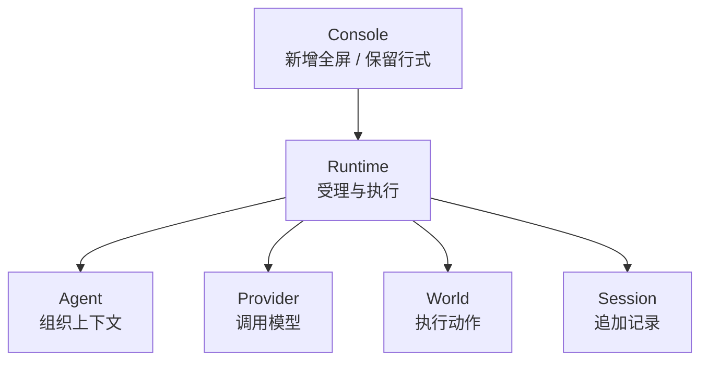
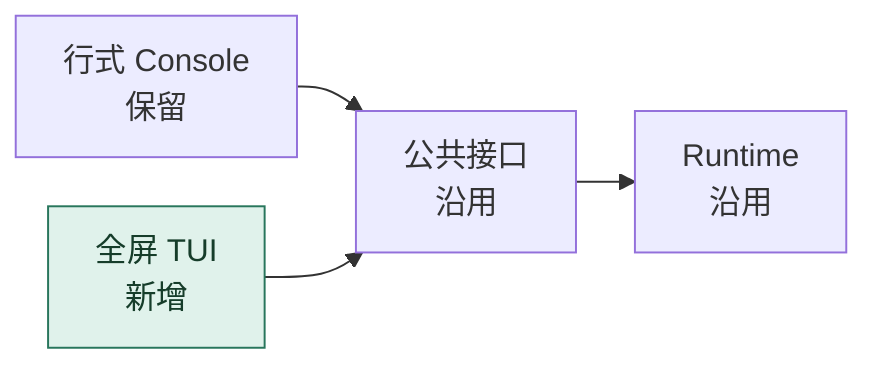
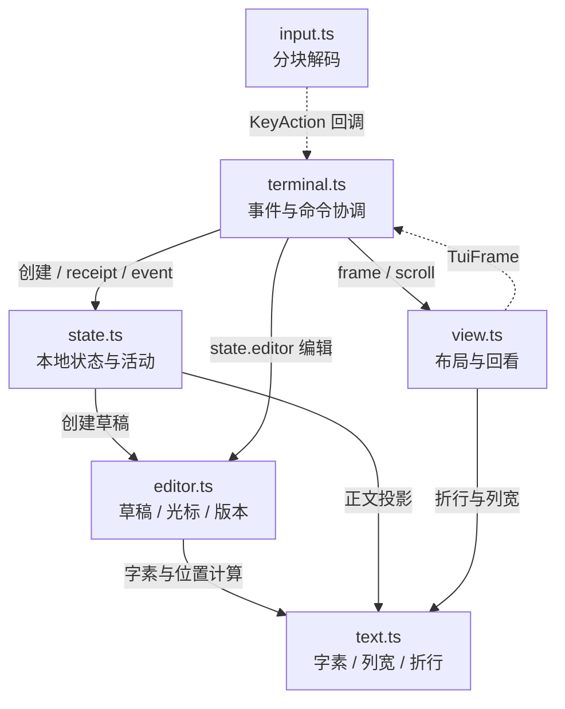
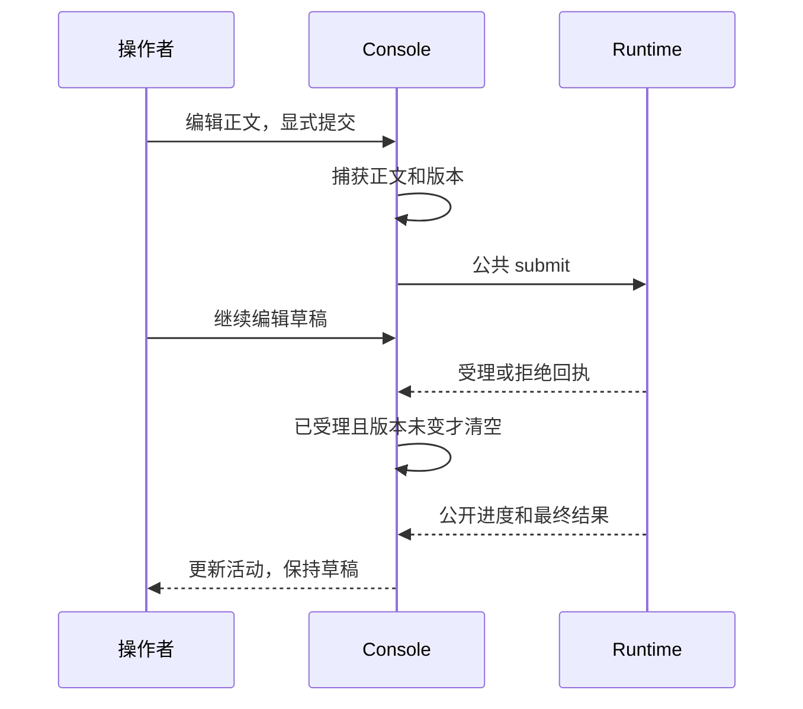
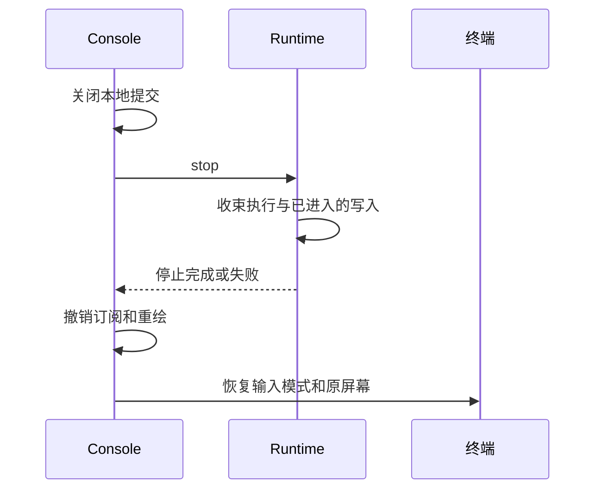

Owner: `src/console/tui/`, `src/console/terminal.ts` 的 `ConsoleRuntime`、`scripts/tui-sample.ts`、`scripts/tui-probe.ts`、`tests/integration/tui.test.ts`

# M2.1 进度与架构图

2026-10-08 主线迁移附记：当前 Runtime 的共享调度见 [M3](2026-10-08-M3进度与架构图.md)。TUI 对非用户诊断补充种类、ID 与来源，本页保留 M2.1 当时结构和验收证据。

日期：2026-10-06。基线：[M2 首批输入闭环](2026-10-05-M2进度与架构图.md)。本页记录同进程 Console 全屏 TUI 的 M2.1 交付与验收。

主线已实现并验收至 M2 首批。M3 统一触发调度目前是候选设计与待决策讨论，尚未实现或验收。Console 工作按当前实现基线记为 M2.1，后续独立补充使用 M2.2；主线实现进入 M3 后再使用 M3.1。

当前状态：**M2.1 当前同进程原型人工验收通过。** 负责人于 2026-10-06 确认，并要求将本轮提交推送远端、同步 `main` 基线。后续前端目标、框架与依赖拆分仍待讨论；独立审查和修复复核未单列结论。历史撤销与后续修订保留在开发记录中。

## 交付范围

新增全屏状态与活动展示、固定多行草稿、显式提交、回看、详情和终端恢复。Console 输入通过 M2 的 `ConsoleRuntime` / `InputChannel` 接入，执行时仍可编辑后续正文。

继承 M2 的受理/FIFO、取消、模型与工具往返、终态写入和生命周期。行式 Console 保留，非 TTY 使用原入口。离线样例在同一进程装配真实 Runtime、ConversationAgent、FixtureWorld、JSONL 和 MemoryState，Provider 使用脚本；MemoryState 仍仅注入。

随原型交付英文结构锚点与中文接口/边界注释，模块单元测试位于 `src/console/tui/__tests__/`；跨 Console 与 Runtime 的测试保持在 `tests/integration/`。本次验收状态修订没有增加可执行功能。

## 简化总图

箭头表示接入或调用，绿色 Console 是本次增量所在位置，其他组件沿用 M2。

该图只表示已存在的调用。World 感知订阅、Heartbeat 和统一触发调度尚未接入；State 已装配，其持续更新与 Memory 语义仍归主线后续设计。

## 组件关系

| 组件 | 实现位置 | 所有权与协作边界 |
| --- | --- | --- |
| 终端驱动 | `src/console/tui/terminal.ts` | 按键意图分发、公共接口调用、输出背压、进程信号、终端模式与退出恢复 |
| 输入解码 | `input.ts` | UTF-8 分块、Escape 序列、标准粘贴边界；只产生本地操作意图 |
| 草稿编辑 | `editor.ts` | 正文、字素光标、正文版本与跨行目标列；诊断不修改草稿 |
| 文本布局 | `text.ts` | 原文索引与列宽映射、控制字符投影、折行和截取 |
| 界面状态 | `state.ts` | 有限活动、本端未完成 ID、诊断消费位置、焦点、选中项与回看锚点 |
| 屏幕布局 | `view.ts` | 生成一屏文本与光标坐标，按条目和宽度缓存折行 |
| 公共接口 | 既有 `ConsoleRuntime`、`InputChannel` | Runtime 拥有执行和生命周期事实，TUI 只调用和展示 |
| 离线组合根 | `scripts/tui-sample.ts` | 创建并启动 Runtime，再将公共能力交给 TUI；夹具 World 只用于验证 |
| 终端探针 | `scripts/tui-probe.ts` | 检查实际按键和尺寸，不创建 Runtime 或调用模型 |

这些组件与 Runtime 在同一 Node 进程。独立入口和模块不表示后台服务、远程连接或独立进程。TUI 源码不直接导入 Agent、Provider、World 或 Session 的实现；组合根负责选择依赖。

## 相比 M2 增加了什么

### 结构修改点：总图中的 Console

M2 行式入口同时消费文本行与诊断输出。M2.1 增加本地草稿、回看状态和屏幕布局，使新输出与输入编辑分别保存。公共受理和执行边界沿用 M2。

修改前（M2）：

修改后（M2.1）：

### 就地展开：新增全屏 TUI 的内部逻辑

上图中的“全屏 TUI”当前由以下 6 个模块协作。图展开主要方法调用与返回；实线表示调用或对象创建，虚线表示回调或返回。文件路径均在 `src/console/tui/`，输入 feed 等具体步骤见图下表格。

`TuiState` 创建并持有 `DraftEditor`。`terminal.ts` 通过 `state.editor` 操作草稿，调用 `view.frame(state, columns, rows)` 时将整份本地状态作为参数传入。`view.ts` 读取草稿与活动；翻页方法只调整本地锚点和显示位置。`text.ts` 是共享文本工具，驱动不直接导入它；`input.ts` 另复用草稿容量常量，不调用草稿编辑方法。

| 当前路径 | 方法与数据 | 这一步改变什么 |
| --- | --- | --- |
| 输入解码 | `onData → decoder.feed → action(KeyAction)` | 缓冲不完整的 UTF-8/控制序列，完整粘贴生成一次 insert；不提交正文 |
| 草稿编辑 | `action → state.editor.insert/left/right/vertical/...` | 按焦点修改正文或光标；正文改变才递增 revision，活动输出不进入此路径 |
| 正文提交 | `submit → runtime.inputs.submit → state.receipt` | 捕获正文和版本，显示受理/拒绝回执；仅已受理且版本未变时清空草稿 |
| 本地命令 | `submit → inspect/cancel/start/stop` | 调用现有公共能力并显示结果；本地命令不作为模型正文 |
| 诊断消费 | `subscribe / eventsSince → state.event` | 按 seq 排重、标记缺口，更新已知活动 ID、公开结果和本端统计 |
| 活动回看 | `action → view.pause/scroll/reveal`、`state.select/follow` | 调整选中项、条目/折行锚点及跟随状态；不改变 Runtime 执行 |
| 屏幕绘制 | `schedule → draw → view.frame → output.write` | 从最新本地状态生成一屏文本和光标位置；输出背压时等待 drain |
| 退出清理 | `requestExit → idle/stop → finally` | 关闭本地提交、等待公共生命周期收束，再撤销监听并恢复终端 |

一次普通编辑只经过输入解码和草稿；Ctrl+S 才进入公共受理。Runtime 后续通知经过 `state.event` 更新活动，再由 `view.frame` 计算可见区域。16 ms 定时器合并一次待绘屏幕，100 ms 等待只用于未完整的 Escape 序列；两者不触发业务执行。

屏幕计算同时使用三类位置：草稿光标是原文 UTF-16 偏移，编辑边界是字素，最终光标是终端显示列。回看位置使用本地条目 ID 与折行号，窗口变宽后原折行消失时仍寻找同一条目。当前复杂度主要集中在这些位置转换，以及 `terminal.ts` 中编辑、回执、重绘和退出的交错；此处先保留实际模块粒度，抽象方案留待后续逻辑优化。

TUI 的新增状态只影响草稿、视口和反馈。Runtime 继续拥有真实队列、模型请求、工具执行和记录写入。非 TTY 回退到行式入口；全屏中 Enter 换行、Ctrl+S 提交，替代原多行 `/begin` / `/send` 编辑操作。

| 增量 | 用户可见变化 | 边界 |
| --- | --- | --- |
| 草稿版本 | 回执不会清掉受理期间的新编辑 | 只协调本地正文，拒绝时保留草稿 |
| 活动锚点 | 回看不被新输出带回底部 | 淘汰与缩放只调整显示位置 |
| 公开详情 | 查看完整关联 ID、轮次、工具结果与写入状态 | 显示公开诊断，长内容可截断 |
| 终端恢复 | 等待 Runtime 停止后恢复输入模式和屏幕 | 沿用停止写入屏障，无本地强制写入超时 |

## 详细关系

### 提交回执与草稿

`submitting` 只抑制回执未到时的重复本地提交，没有第二套业务队列。成功受理后允许继续提交，由 Runtime 的 FIFO 决定执行顺序。本端未完成数量不表示全局队列；诊断有缺口时不能声称统计完整。

### 退出与终端恢复

Ctrl+D / EOF 先等待 `idle()`，再停止；Ctrl+C 可将等待切换为取消停止。等待仍由 Runtime 的契约决定，TUI 不提前放过 Session 写入。异常退出也执行终端清理，清理失败保留最初故障原因。

## 专项报告

待添加。

## 验证记录

| 验证类别 | 当前证据 | 覆盖与限制 |
| --- | --- | --- |
| TUI 自动化自验 | 2026-10-06 提交前运行 pnpm test，本线 19/19 通过 | 13 项模块单元测试、6 项 TUI 集成测试；随完整测试集运行，此处只报告本线用例，不联网 |
| TUI 源码类型检查 | pnpm run typecheck 已通过 | 覆盖本批模块与样例；本页不据此汇报其他工作线状态 |
| 集成组件 | 真实 Runtime、JSONL、FixtureWorld；脚本 Provider | 验证现有接口往返，夹具 World 不是生产 World |
| Windows PTY 样例 | `set answer 7` / `get answer` 读回 7，`persisted=true`；中文/emoji 草稿、回看、帮助、退出 | 程序注入按键，不能代替真实输入法和复制操作 |
| 退出探针 | Node 记录 code=0、raw=false、flowing=false | 一次性本地探针，未扩展生产运行机制 |
| 本轮注释整理 | 8 份生产模块/样例经去注释 AST 对比一致 | 只补注释，模块测试目录和导入单独迁移 |
| 报告图形 | 本地 Mermaid 渲染与截图检查 | 只校验报告表达，不证明执行正确性 |
| 独立审查、修复复核 | 未单列独立结论 | 自动化与负责人验收分别记录，不补造审查证据 |
| 负责人实际终端验收 | 2026-10-06 负责人确认 M2.1 人工验收通过 | 结论来源为负责人确认；未提供逐项环境与操作记录，不扩展为所有终端兼容性结论 |

本 Console 工作线的证据与本轮定向验证在 [开发记录](agent-context/current-task/2026-10-06-consoleTUI首批开发.md) 追加，操作步骤见 [全屏 TUI](使用说明/全屏TUI.md)。本轮修订仅改变报告与计划，不新增生产逻辑。

## 范围边界

本页只覆盖本 Console 工作线的全屏界面、公开能力适配与审查说明。界面通过既有公共接口提交、取消、查询和启停；本地缓存、焦点与重绘不制定业务执行规则。

当前原型不包含后台附着、远程连接、逐 token 输出、输入历史导航、草稿持久化或恢复/重放命令。

后续目标是长期保留 TUI，作为通用基座的前端之一，覆盖特定 World 交互/监控、输出、配置设置与 Agent 总运行监控，并通过稳定控制接口支持未来其他前端。负责人倾向 OpenTUI；框架替换、进程边界和依赖拆分尚未落实。下一轮先讨论依赖拆分，再按确定的边界细化样式、本地逻辑和界面功能，见 [Console 计划](agent-context/plans/2026-10-06-console终端交互计划.md)。后续独立增量按当前主线基线使用 M2.2，不计入本批已验收能力。
