Owner: `src/protocol/trigger.ts`, `src/protocol/index.ts`, `src/protocol/input.ts`, `src/runtime/`, `src/agent/conversation-agent.ts`, `src/console/terminal.ts`, `packages/apps/tui/src/state.ts`, `tests/integration/trigger-loop.test.ts`, `tests/integration/lifecycle-races.test.ts`, `scripts/m3-sample.ts`

# M3 进度与架构图

日期：2026-10-08。基线：[已验收 M2](2026-10-05-M2.0进度与架构图.md) 与独立的 M2.1 TUI。M3 首批实现、自验、负责人确认的独立验收及工程文档说明已完成，负责人同意收尾。World 去重目标与首批实现之间的偏差保留，交由 M4 落实。

## 交付范围

Console UserInput、World Event 与 Heartbeat 共用一个 Session 受理队列和执行器，保留各自事实语义。旧 Event 执行循环已移除，World 可主动投递事实，心跳可持续唤醒 Agent；一次处理结束后 Runtime 返回等待。

accepted 在内存受理后返回，执行等待接收追加确认。本批 FIFO，新事件不自动取消活动处理；显式取消和停止保留。所有来源采用共同的容量、时限、工具效果诊断和存储失败收束规则。生产 World 和 Memory 没有加入本批。

阅读重点分为三个结构变化：Runtime 内部执行归一、World 感知接入、Heartbeat 周期唤醒。后文分别展开当前机制、选择原因、代价和后续目标；World 专门去重契约尚未实现，不能因默认容量已公开就视为该讨论目标已完成。

## 简化总图

箭头表示主要协作关系。结构变化集中在 Runtime 调度块；模型传输和领域动作仍各自独立。

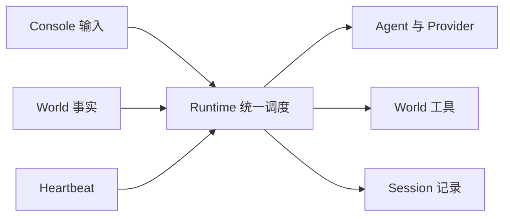

## 组件关系

| 组件 | 所有者与职责 | 实现入口 |
| --- | --- | --- |
| Runtime | 生命周期、来源订阅、旧代失效、写入屏障、依赖装配 | `runtime/runtime.ts`、`compose.ts` |
| TriggerChannel | 一个 FIFO 消费者、内存受理、接收追加、去重、背压、取消、终态与有限诊断 | `runtime/trigger-channel.ts` |
| TriggerRun | 一次触发的模型与工具续轮、执行期限、配对与效果收束 | `runtime/trigger-run.ts` |
| UserInput 门面 | 转换受理回执、取消和快照，委托公共通道 | `runtime/input-channel.ts` |
| Agent | 指令、上下文选择与心跳是否请求模型 | `agent/conversation-agent.ts`、`protocol/index.ts` |
| Provider / World | 实际模型协议 / 环境事实、领域校验和外部动作 | Provider 实现、World 公共契约 |
| Session / State | JSONL 串行追加 / 已注入的内存键值状态 | `state/`；State 尚未成为 Memory 流程 |

组件同进程装配。首批使用 FixtureWorld 和脚本模型验证；没有选定生产 World。Console 继续依赖公共契约，通用诊断补充种类、来源和触发 ID。

## 相比 M2 增加了什么

### Runtime 内部执行归一

总图中的 Runtime 调度块由两条执行路径改为一个受理所有者与执行器。

M2：UserInput 有 FIFO，Event 经旧循环直接执行，两类入口忙时互斥，多个 Event 可以并发。

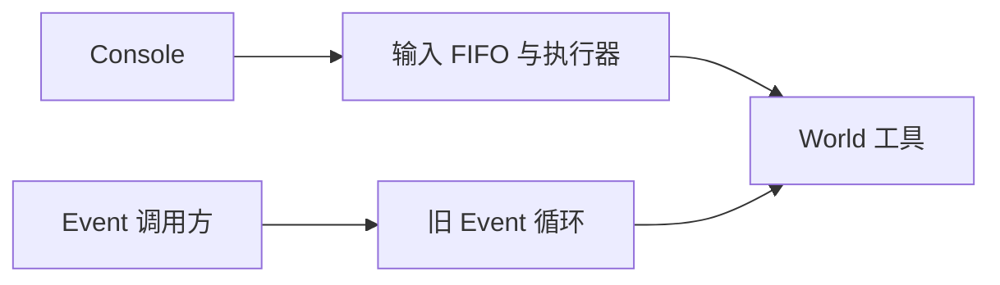

M3：在同一位置引入通用通道，两个旧入口保留为适配器，World 感知和 Heartbeat 接入同一个队列。

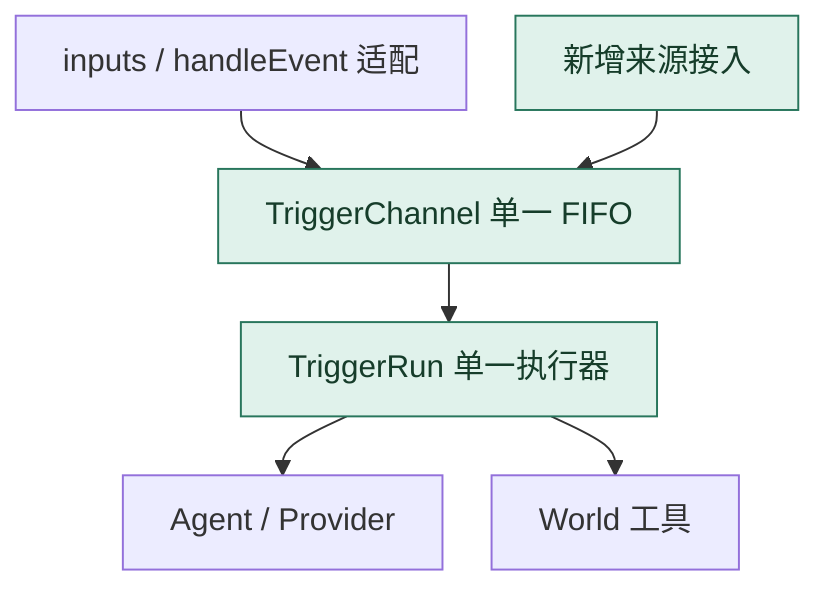

`input-channel.ts` 缩为 UserInput 门面；原 `input-run.ts` 扩展并迁为 `trigger-run.ts`；Runtime 不再持有 processEvent/dispatch 或 legacyRuns。结构归一也统一了旧 Event 的工具异常、unknown、期限与最终结果语义。

### World 感知增加主动投递口

变化对应总图中的“World 事实 → Runtime”。M2 只有外部调用方直接调用 handleEvent；M3 增加 World.subscribeEvents，World 可把感知到的事实投递给 Runtime 提供的 sink。工具执行与事实投递仍是 World 的两个不同接口。


这个增量完成了事实接入和生命周期隔离，尚未给 World 提供专门的长期去重/投递进度契约。sink 的拒绝回执、来源缓冲和 M4 承接见专项报告。

### Heartbeat 增加 Runtime 管理的周期触发源

变化对应总图中的 Heartbeat 节点。M2 没有通用周期源；M3 在显式启用后，由 Runtime 管理计时器或注入的 tick 源，使 Agent 能在没有新外部输入时获得一次判断机会。

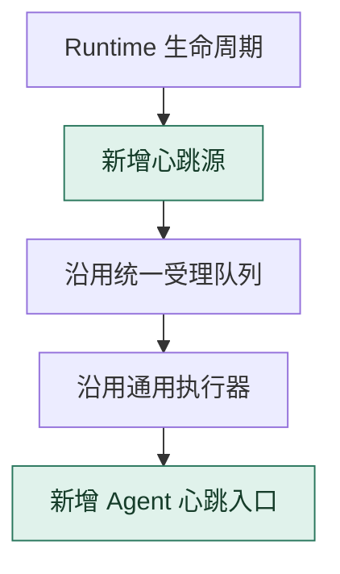

Runtime 决定 tick 的产生、身份、时效和积压处理；Agent 决定是否请求模型。默认 ConversationAgent 没有周期任务策略，心跳正常无动作结束。World 的领域定时事件仍以 Event 投递，不自动改为通用心跳。

### 公共接口变化

| 接口变化 | 当前行为 |
| --- | --- |
| `runtime.triggers` | 受理 UserInput/World Event，按种类和 ID 取消或查询，订阅所有来源诊断 |
| `runtime.inputs` | 原 UserInput 方法和回执保持兼容，共享通道诊断与 idle |
| `handleEvent(event)` | 返回该项 RunResult；受理拒绝抛 InputError，执行失败与取消返回终态 |
| `World.subscribeEvents(sink)` | 可选订阅；World.start 完成后装配，返回退订函数 |
| `RuntimeOptions.heartbeat` | 显式启用；默认计时器或注入可控 tick 源 |
| `Agent.initialHeartbeatRequest` | 可返回请求或 undefined；后者正常无动作结束 |

## 详细关系

### TriggerChannel：从受理到唯一终态

TriggerChannel 拥有一条 Session 队列及一个消费者 Promise。它负责事实何时获准执行、何时发布最终结果；请求内容由 Agent 选择，工具领域语义由 World 判断。实现入口：[trigger-channel.ts](../src/runtime/trigger-channel.ts)。

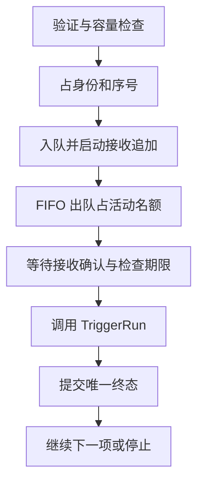

图表示正常执行路径。排队取消或过期直接进入终态收束，不调用 TriggerRun；存储明确失败关闭受理并进入停止。

| 通道内部状态 | 保证与使用方式 |
| --- | --- |
| `queue` | 只保存尚未出队项；三种触发共享待执行条数预算，活动项不计入 pendingInputs |
| `worker` | 一个消费者连续取队首；上一项最终追加结算后才能执行下一项 |
| `active` | 保存当前项、runId、取消信号和模型轮次；出队就占名额，接收追加可能仍在等待 |
| `received` | 每项接收追加的 Promise；普通执行、排队取消、过期和停止收束都等待它 |
| `done` | 本项最终结果 Promise；handleEvent 等待它，不依赖可淘汰快照或是否及时订阅 |
| `finishing` | 执行结果已确定，只等最终写入；活动取消不再改写这个结果 |
| `finalized` | 首次终态收束同步占用提交权，避免计时器、取消和停止重复发布 run_finished |
| `finalizers` | 排队项独立终态追加的集合；idle/stop 除等待 worker 外还要等待它们 |
| `closing` | 可在 Runtime 完全停止前关闭受理；unknown 和存储错误不允许后续项继续产生动作 |

公开状态和内部状态并不一一对应。队首已占活动名额但接收追加尚未确认时，尚未发布 run_started，快照仍可能显示 queued。write_pending 表示结果已确定但接收或最终追加仍未结算，不表示整次记录已经保存。

通道保存受理事实的副本。随后来源修改原对象不会改变排队项；拒绝项不占去重身份和 queueSequence。诊断事件与快照有独立有限窗口，缓存淘汰不解除去重。订阅者收到副本，其异常不改变执行结果。

### 受理与执行

图以接收写入被阻塞的场景展示两个时点：受理回执不等待追加确认，但调用执行器需要等待。出队与占活动名额可先于写入确认发生。

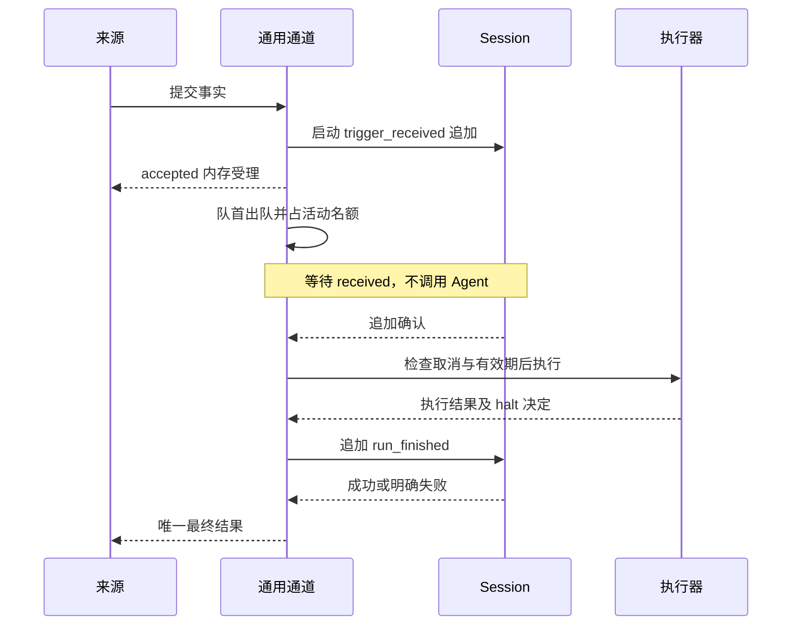

排队取消、过期和停止也等待接收追加，并保存或明确报告终态写入失败。handleEvent 持有本项完成 Promise，快照淘汰不影响它等待自己的结果。

### TriggerRun：一次触发内的模型与工具闭环

TriggerRun 不取下一项，不创建自己的输入队列，也不写最终 run_finished。它取得一个已受理项的 runId、generation、取消信号和容量，返回 `result` 与 `halt`；通道据此提交终态并决定继续或停止。实现入口：[trigger-run.ts](../src/runtime/trigger-run.ts)。

| 执行位置 | 当前处理内容 |
| --- | --- |
| 初始历史 | 等待 Session.read，过滤 trigger_received，再写入本项 input/event/heartbeat 与 run_started |
| 来源入口 | UserInput 调 initialInputRequest，Event 调 initialRequest，Heartbeat 调可选 initialHeartbeatRequest |
| 模型请求 | Agent 构造请求，Provider 按实际发送体计量；超硬上限时不发送，允许的请求及时追加后再调用 |
| 模型响应 | 受 Provider 和整次处理期限约束；响应容量、错误/截断、工具批量及调用 ID 在执行工具前检查 |
| 工具处理 | 逐项记录调用，规范化参数和工具名，再串行进入 World；原 callId 与工具名配对 |
| 工具回执 | 已取得结果先发布简要诊断，再追加；已取得的成功/失败不会因写入期间取消而重新执行 |
| 工具续轮 | 当前批回执确认后调用 Agent.nextRequest，继续使用本项事实边界，不重新取队列 |
| 执行退出 | 无后续动作、错误、取消、期限或轮数上限结束本项；未执行声明补 cancelled/not_executed，执行效果不明保留 unknown |

`result` 表示本项的成功、失败或取消；`halt` 表示共享通道必须停止后续处理。普通模型错误与轮数耗尽只结束当前项；工具 unknown 或必要存储失败还会要求停止。存储错误可以成为最终错误码，但不能解除原来的 unknown 停止决定。

同一触发可以包含多个模型轮次，每个模型响应又可包含一批串行工具。这里的“工具批次”与后续要设计的“多个输入事件合并为一批”是两个概念；M3 没有把队列项合并上传模型。

### 模型与工具续轮

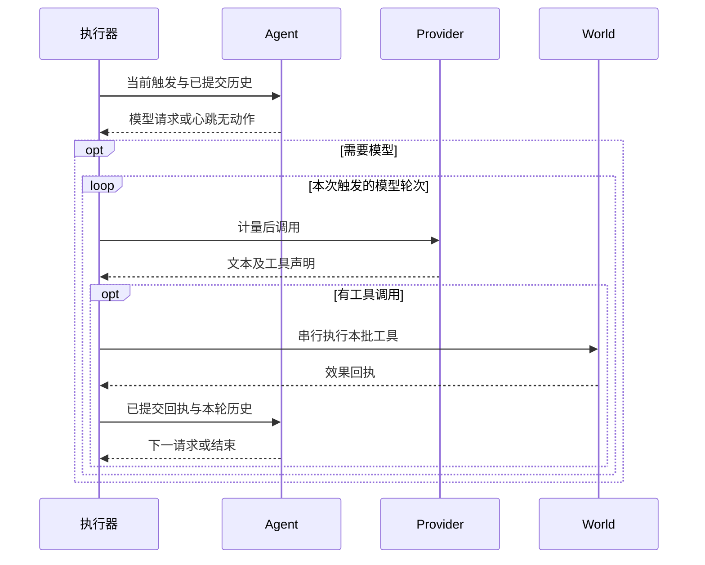

图省略过程记录。工具 unknown 在回执追加前锁定停止决定，不进入下一请求；明确 failed 可继续语义判断。Event/Heartbeat 无文本可以成功，UserInput 继续要求最终回复。

### 来源与停止

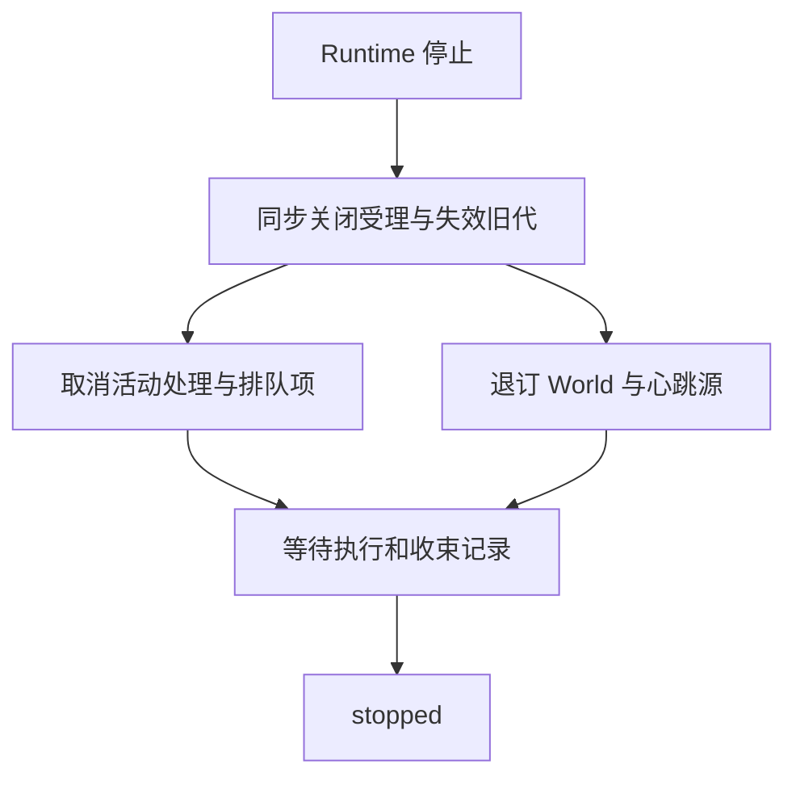

World 清理与通道收束并行等待；图只展开来源和执行控制。旧 sink 返回 stale_generation；旧 tick 被忽略。World 清理期限不截断 Session 已进入的追加，停止完成后才允许下一次启动。

## 专项报告

### 受理即启动追加，执行前等待确认

**当前决定：accepted 在内存受理后返回；接收追加成功是执行的前置条件。** 负责人已明确选择这个回执时点。它让来源及时获得受理反馈，同时为动作执行设置一条记录屏障。

admit 同步完成形状/容量检查、占用身份和序号、保存副本及入队，再立即调用 Runtime 的追加入口启动 trigger_received。这里“启动追加”表示进入 Session.append 的追加链；JSONL 可能还在等待此前写入，并不表示这一条已写入文件。来源拿到 accepted 后，应通过最终结果观察处理是否成功。

worker 出队后等待本项 received。追加尚未确认时，不调用 Agent、Provider 或 World 工具；明确失败时关闭受理并请求停止，不能跳过这个输入继续执行下一条。即使来源在排队期间取消，finish 仍先等待接收追加，再尝试保存终态。

| 时点 | 已成立的事实 | 尚未成立的保证 |
| --- | --- | --- |
| accepted 返回 | Runtime 已保存内存副本并占用受理身份和序号 | 接收记录保存、模型看到输入、动作执行、最终结果保存 |
| received 成功 | 接收追加已完成，可按 Session 契约读到 | 动作已经生效、整次处理已经完成、断电不丢失 |
| tool_finished 通知 | 已取得或收束形成工具结果分类及原因 | 工具回执追加已成功 |
| run_finished 发布 | 最终追加已经成功或明确失败，结果携带 persisted | 整轮事务、跨进程补投、外部效果恰好一次 |

这个选择保留一个故障窗口：进程可能在 accepted 返回后、接收写入完成前退出，来源若已放弃自己的副本，事实就可能丢失。M3 不承诺重启补投；将来改变投递可靠性时，应明确来源保存至哪个确认点，不能把 accepted 的含义默默改为持久受理。

**验证入口：** [trigger-loop.test.ts](../tests/integration/trigger-loop.test.ts) 的阻塞接收追加用例确认回执已返回而模型尚未执行，5 个存储阶段故障用例确认失败后各来源停止。[JsonlSessionStore](../src/state/jsonl-session.ts) 的完成点为 appendFile 返回，没有 fsync 或多记录事务。

### 严格 FIFO：当前顺序、代价与后续目标

**当前决定：一个 Session 按受理序号取队首，当前触发完成必要工具和最终记录后才执行下一项。** 新到的 Console、World Event 和 Heartbeat 都不插队，不自动取消活动处理；当前触发的工具续轮不重新进入队列。

例如 A 正在执行工具，随后受理 B、Heartbeat、C。正常路径为 A 完成所有续轮与最终写入，再执行 B、Heartbeat、C。B 若在等待时到期，只写过期终态，不执行它；Heartbeat 若已过期也正常结清。跳过失效项不改变仍需执行项的 FIFO 相对顺序。

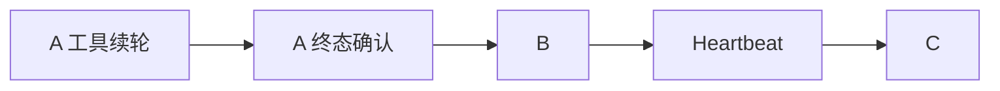

FIFO 提供可追踪的因果顺序，避免多个 Event 并发执行动作。代价是长工具、模型续轮和最终写入会增加后续事件等待时间。排队取消、过期可独立提交终态，所以诊断完成顺序可以不同于执行顺序；queueSequence 表示受理顺序，不是最终完成排序。

显式 cancel 和 Runtime.stop 属于控制通道，不排在普通输入末尾。它们可以请求停止当前处理，但不能撤销已经发生的效果。将来支持“高优先级下一项”也不自动意味着可以安全取消当前项。

| 后续目标 | 需要定义的契约 | 本批状态 |
| --- | --- | --- |
| 来源或事件优先级 | 可信的分类依据、优先级、同级排序、饥饿防护；不能把随意修改的 source 标签当作权限 | 已确认后续目标，尚未实现，具体优先级表未冻结 |
| 多事件批次合并上传 | 可合并事实、时间窗口/容量、原始关联身份、批次结果与逐项结清、过期和取消语义 | 已确认后续目标，尚未实现 |
| 自动抢占 | 可撤回阶段、已发生效果、迟到结果隔离及工具配对收束 | 仅候选讨论，本批明确不允许新事件自动取消活动处理 |

批处理可能减少模型调用，并把连续消息放入同一观察窗口；但原始事件的保存、去重和处理结果不能随着合并丢失。两条玩家消息能否合并，与两次有副作用的独立命令能否合并，需要领域契约分别判断。优先级和合并也不应被当作修复去重预算的替代手段。

**验证入口：** 混合来源 FIFO、不取消活动模型、不合并触发，以及活动工具期间到达新事实的用例位于 [trigger-loop.test.ts](../tests/integration/trigger-loop.test.ts)。

### 固定输入边界：续轮能看到哪些新事实

**当前决定：新事件 B 进入队列和 Session，不授权活动触发 A 在续轮提前使用 B。** A 可以继续读取自己的工具结果；B 等待出队后成为独立触发。这样可以把事实受理顺序、模型处理和结果归属对应起来。

这个边界由两个位置共同实现。TriggerRun 初始读取 Session 后过滤 trigger_received，使任何 Agent 都不能直接取得尚未投递的原始输入；ConversationAgent 再按 runId 分组，完整保留当前运行，选择配对完整的成功历史，并按请求容量整轮裁剪。

| 信息 | A 的当前处理与续轮 | 后续触发 |
| --- | --- | --- |
| A 自身 input/event/heartbeat | 可见，关联 A 的 runId | A 成功完成后可作为完整历史选择 |
| A 新提交的工具回执 | 可见，续轮据此构造请求 | 配对完整的成功历史可继续使用 |
| 排队 B 的 trigger_received | 过滤原始接收记录，不提前交付 | B 出队后写执行事实并进入自身上下文 |
| 失败/取消运行的记录 | 保存在 Session | ConversationAgent 当前只选择成功且配对完整的旧运行 |
| 尚未设计的 Memory | 本批没有更新/提交/读取流程 | 后续按明确的版本和可见性契约接入 |

活动历史在本次执行开始时读取，后续追加的是本次执行自己的事实；每次工具续轮没有重新读取队列或全 Session 来吸收新输入。请求上下文是 Agent 选择的有界视图，Session 是持续保存的事实历史，二者容量不同。

代价是 A 的决定可能依据较早的环境事实。例如准备发送消息或交付物品期间，环境已经变化，而新的通知 B 仍在排队。M3 选择保持输入归属清晰；特定不可撤回动作需要新的观察或确认边界时，应由 World 提供显式复核工具，让模型根据返回事实再次判断。

下图是**后续领域方案示意，尚未实现**；工具名称只说明职责，不是已冻结接口。

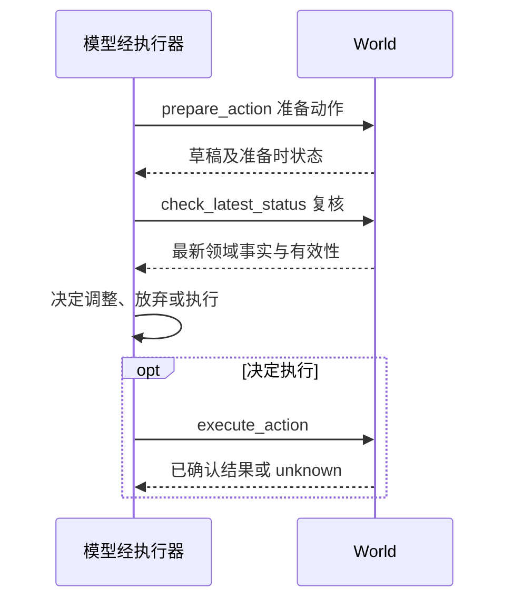

复核新环境状态可以作为 A 的工具结果出现。若复核读取的是排队 B 的玩家请求，领域契约还必须明确它是否被交付给 A、B 之后是否仍独立处理，避免同一命令重复动作。不能靠“读取最新状态”隐式绕过队列边界；复核与真正执行之间再次发生变化时，World 还需要依据动作风险定义有效性检查或确认条件。复核工具不是所有读操作都要增加的步骤，也不意味着必须要求人类确认。

**验证入口：** 活动工具续轮不读取 B、下一触发继承 A 的已提交历史，以及通用 Agent 上下文过滤接收记录的用例位于 [trigger-loop.test.ts](../tests/integration/trigger-loop.test.ts)。上述复核工具没有实现验证。

### World 通过 Sink 投递：接入、回执与代次

**当前机制：sink 是 Runtime 提供给 World 的事件接收回调。** “水槽”只是 sink 的字面译法，在这里不表示额外存储、持久队列或另一套执行器。World 调用这个函数，提交原始 Event 和可选 expiresAt，并取得通用受理回执。

```ts
type WorldEventSink = (
  event: Event,
  options?: { expiresAt?: string },
) => Promise<TriggerReceipt>;
```

Runtime.start 等待 World.start 完成，开放受理，再调用可选 subscribeEvents(sink) 同步装配订阅并保存退订函数。start 的 Promise 完成表示来源已装配；若装配失败，启动失败并执行清理。World 在订阅前产生的事实须自行保留，Runtime 没有启动期事实补投器。

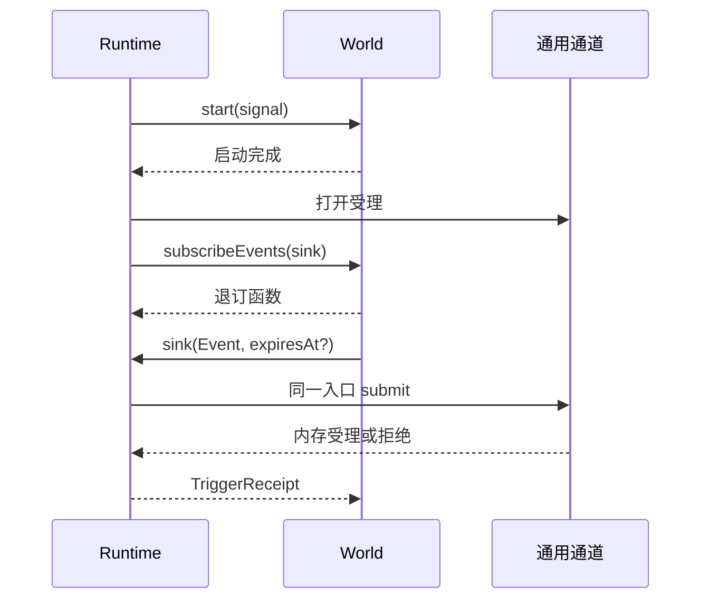

每个 sink 捕获自己的 generation 和 lease。stop 同步递增代次、关闭 lease 和受理；旧 World 即使没有及时退出或继续调用旧 sink，也会取得 stale_generation，不能把旧事实写进新生命周期。订阅装配时同步回调也可能触发 stop，迟到返回的退订函数会立即执行。

| 回执或控制点 | World 的责任与可观察结果 |
| --- | --- |
| accepted | Runtime 已内存受理；保存与执行结果尚未确认 |
| queue_full | 事实未受理，来源自行保留、限速或按明确政策放弃；Runtime 不自动补发 |
| duplicate_trigger / admission_limit | 当前去重契约或预算拒绝；现有 World 长时契约缺口见 M4 偏差 |
| stale_generation | 旧生命周期 sink 已失效；新来源须使用新装配的回调 |
| 正常 stop | 退订来源，并等待活动项和已进入记录收束；World cleanup 不能截断 Session 写入 |

World 负责环境采集、领域含义和上游缓冲；Runtime 负责机械受理与执行；Agent 判断如何响应事实。工具接口仍允许只提供工具的 World，不强制所有 World 都产生 Event。

**验证入口：** 新旧 sink、旧 tick 失效、同步订阅回调停止启动、订阅失败后新代重启用例位于 [trigger-loop.test.ts](../tests/integration/trigger-loop.test.ts)。

### Heartbeat：一次唤醒机会到正常等待

**当前机制：Runtime 产生 tick，经同一队列和记录屏障进入 TriggerRun，再调用 Agent 的心跳入口。** 默认不启用心跳；提供 heartbeat 配置后默认周期 30 秒、有效期 5 秒。自定义 HeartbeatSource 决定 tick 的时机，intervalMs 只用于默认计时器。

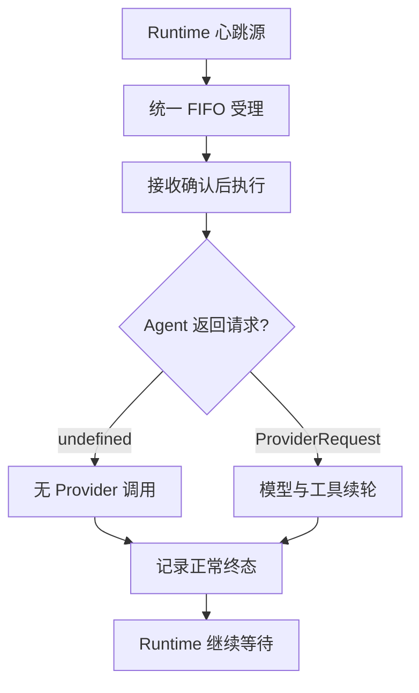

图展开参考图中的“条件审查”职责位置。当前 ConversationAgent 的默认策略直接返回 undefined，正常无动作结束；装配方可注入 heartbeatRequest，返回 ProviderRequest 才会调用模型。M3 已验证心跳能启动模型及工具续轮，但没有内置“玩家靠近”“任务到期”等领域判断，也没有实时 Memory。这些条件需要实际事实源和 Agent 策略，不能由通用计时器猜测。

图展示正常处理后继续等待的路径；unknown 和必需存储失败的停止路径见“外部效果与故障收束”。

无动作心跳没有本次 Provider 请求，因此不产生本次模型 token 用量；它仍等待接收记录、读取 Session、追加 heartbeat/run_started/run_finished，并发布诊断，耗时不是 0ms。模型响应没有工具、Agent 不需要续轮或本次预算用尽，只结束该触发；unknown 和必需存储失败才进入停止，正常心跳不关闭 Runtime。

### 心跳积压：一个未结算名额，跳过且不补发

**当前决定：同一通道至多一个未结算心跳。** 名额从受理时占用，到最终结果发布后释放；排队、活动执行、过期后等待终态追加都属于未结算。存在该项时，新 tick 仅报告 heartbeat_skipped/heartbeat_pending。

```mermaid
%%{init: {"flowchart": {"padding": 12, "rankSpacing": 25}}}%%
flowchart TB
  T[新 tick] --> P{心跳尚未结算?}
  P -->|是| S[跳过 heartbeat_pending]
  P -->|否| C{待执行队列满?}
  C -->|是| B[跳过 queue_full]
  C -->|否| A[受理并占心跳名额]
  A --> F[执行或过期收束]
  F --> R[最终追加结算后释放]
```

这避免存储挂起时反复产生过期心跳的收束任务。跳过的 tick 不占外部 ID、不递增受理序号、不写完整逐 tick 历史；它提供有限缓存诊断与累计跳过计数。受理的心跳及其无动作结果仍保存到 Session。

| 到达场景 | 当前行为 | 代价 |
| --- | --- | --- |
| 普通 World/Console 项正在执行，队列有空位，没有未结算心跳 | 心跳可入队，按 FIFO 等待 | 不抢占；等待可能超过其有效期 |
| 已有排队或活动心跳 | 新 tick 跳过，不替换旧项 | 没有自动“保留最新一次” |
| 心跳已过期但最终追加被阻塞 | 新 tick 仍跳过 | 保存挂起期间无法持续产生新的心跳处理 |
| 队列满 | 跳过，不自动重投 | 繁忙期间可能错过周期检查 |
| 受理后、执行前到期 | 记录 trigger_expired，不调用模型或工具 | 到期事实仍保留接收记录 |
| 旧代 tick 在重启后到达 | 回调被忽略 | 不会推进新代，也不积压补发 |

“繁忙结束后必须检查一次”属于另一种策略：可以考虑保留一个最新待执行 tick，或由 Agent 维护明确的待检查状态。它尚未实现，不能把当前跳过策略写成繁忙后保证补查。无动作记录和跳过诊断也需要分别观察，才能判断实际运行成本和遗漏的检查机会。

**验证入口：** 无动作不调用模型、心跳启动工具、heartbeat_pending/queue_full、过期、终态追加阻塞仍占名额和旧 tick 拒绝均有 [集成用例](../tests/integration/trigger-loop.test.ts)。

### 去重身份：内部心跳已独立，World 专门契约仍有偏差

**已实现的部分：内部心跳采用 Runtime generation 与递增序号形成身份，不进入外部 seen 集合。** 因而 30 秒周期心跳不会消耗外部 4096 默认额度；心跳是否积压由未结算名额管理，不需要永久保存每个 tick 的去重 ID。

**尚未落实的部分：讨论建议 World 去重依据专门投递契约定义，M3 实际仍与 UserInput 共用累计内存集合。** 两类外部触发的 key 为 `(kind, id)`；不同 kind 可使用同名 ID，身份不会相互撞键，但共享 seen.size 与 admissionIds 总预算。改变 source 不能绕过同种 ID 去重。

| 讨论目标 | M3 当前代码 | 影响与承接 |
| --- | --- | --- |
| Console 暂保留 M2 精确 ID 承诺 | 完成或取消后仍保留身份，同实例 stop/start 不释放 | 用户输入去重语义继续保留 |
| 心跳使用内部生命周期身份 | 已实现，不占 seen | 已满足，不与外部事件预算竞争 |
| World 根据专门投递契约管理长期身份/进度 | 未实现；仍加入同一个 seen | 与 Console 共享累计额度，交由 M4 改造 |
| 有限资源下持续接收 World 事实 | 只有有限累计身份预算，尚无来源序号、水位或去重窗口 | 超出预算后无法继续受理新的外部触发 |

4096 来自 STANDARD_INPUT_LIMITS.admissionIds，装配时可以覆盖，**不是不可配置的写死上限**。但提高这个数值只延后耗尽；完成、取消、过期、诊断淘汰和同实例重启都不释放 seen。若额度主要被 World 用完，新的 Console 输入也会被拒绝。admission_limit 关闭的是本项受理，Runtime 不会仅因此自动停止，内部心跳仍可运行。

在默认空实例中，若 World 独自受理 4096 个不同 ID，后续新的 World Event 会被 admission_limit 拒绝；若期间 Console 已受理输入，可供 World 使用的数量更少。这里的问题是实例累计身份增长，与同时排队 8 条、模型请求 64 KiB 或诊断快照淘汰不是同一容量。

**偏差记录：** 首批实现已把限制公开为有限容量边界，但没有实现讨论中的 World 专门投递契约。当前应同时记录“首批限定范围验收通过”和“该长期设计目标尚未落实”，不能用“文档已写明限制”替代对差距的承认。负责人现明确要求在 M4 实现，具体方案见 [M4 World 投递与去重计划](agent-context/plans/2026-10-08-m4-world投递与去重计划.md)。

M4 需要确定来源身份与重启边界、重复/乱序/空洞规则，以及保存、交付、处理进度的区别，再实现适合该投递契约的长期机制。单调游标、明确滑动窗口或持久进度是候选，尚未冻结；不得通过静默淘汰 ID 重新执行旧动作，也不得把持久去重直接宣称为外部副作用恰好一次。

**验证入口：** 现有 [集成用例](../tests/integration/trigger-loop.test.ts) 证明内部心跳不耗外部预算、种类身份隔离、source 修改不能绕过重复检查，以及预算耗尽会拒绝。它们验证的是 M3 的有限机制，不证明 World 长时去重目标已完成。

### 过程记录与请求上下文

每类事实在对应阶段及时追加，关联触发种类、ID、来源和代次；执行记录再绑定 runId。身份、回执确认和上下文可见性不能仅凭“记录已存在”推断。

| 记录 | 保存内容与关联 | 请求视图 |
| --- | --- | --- |
| trigger_received | 原始触发、queueSequence、generation，无 runId | 在交付 Agent 前过滤，表示接收归档 |
| input / event / heartbeat | 已进入本次执行的来源事实与 runId | 当前运行可见，后续由 Agent 按历史规则选择 |
| provider_request / provider_response | 实际请求及响应、所属运行；响应保留原生 Provider 项 | 不重复展开旧请求中携带的历史，响应项由所属适配器重放 |
| tool_call / tool_outcome | 声明、结果及 callId 配对 | 工具续轮使用已提交的结果，完整配对后随成功历史保留 |
| run_finished | 本项 RunResult；排队取消/过期可无 runId | 成功完整历史的选择依据，persisted 只描述该终态追加 |

读取失败不能变成空历史；已进入的追加在停止期间仍需等待。诊断 seq 是有限公开通知的游标，不是 Session 提交游标、World 处理水位或跨进程恢复依据。请求容量裁剪不删除 JSONL，也没有自动摘要。

### 身份、容量与时效

| 边界 | 本批参数或契约 |
| --- | --- |
| 外部去重 | `(kind, id)`；UserInput/World Event 合计 4096 个累计身份，重启不释放，耗尽明确拒绝 |
| 内部心跳 | Runtime 代次与递增序号，不进入外部身份集合 |
| 排队 | 共享 8 条待执行项，不含活动项；满时立即拒绝，来源承担上游缓冲 |
| World Event | JSON 默认 64 KiB；occurredAt 不决定过期，默认无排队期限，可显式 expiresAt |
| UserInput | 文本 8 KiB；受理后排队期限 120 秒 |
| Heartbeat | 默认关闭；启用后周期 30 秒、有效期 5 秒；至多一个未结算项，其他 tick 跳过 |
| 请求与执行 | 实际请求 64 KiB，历史软余量 16 KiB；每触发至多 8 次模型请求且受 Agent.maxTurns 限制；工具批次最多 8 |
| 调用期限 | Provider 30 秒、工具 10 秒、出队后整次处理 120 秒 |
| 响应与诊断 | 响应 1 MiB；事件 256 条/4 MiB、快照 128 条/4 MiB，独立于去重表 |

参数可在装配时覆盖。受理心跳及无动作终态保存到 Session；跳过 tick 只提供有限诊断与累计计数，不逐 tick 保存完整记录。过期心跳在终态追加未结算时仍占用心跳名额，存储挂起不会无限积压心跳收束任务。队列满的心跳不补发。请求容量没有限制 JSONL、Runtime trace 或全历史读取成本；本批未承诺外部触发无限运行。

### 外部效果与故障收束

进入 World 后抛异常、工具超时、未确认取消或回执身份错配，无法证明动作没有发生，保留 unknown。工具错误原因、轮次和原 callId 进入公开诊断；回执写入失败保留原 unknown 通知，同时最终报告 storage_error。停止决定不被存储错误解除，排队项不会继续产生动作。

接收追加、必要过程追加、历史读取和最终追加明确失败均停止后续触发。普通 Provider 错误只结束当前触发，错误回执保存后可继续下一项。取消无法撤销已发生效果；重启没有自动重试或重放。

### 兼容与迁移

旧 JSONL 保留可读，新增 trigger_received、heartbeat 与关联字段，不重写旧记录。原无 runId 的 M1 历史继续不自动纳入 ConversationAgent 的完整轮次选择。

handleEvent 的 Promise 现在交付 RunResult，调用方需要检查 status/code；await 返回不等于业务成功。Provider 在所有需要模型的路径必须提供实际请求计量。旧 Event 停止测试已迁移为保留接收、终态与 unknown 事实，同时拒绝迟到成功结果。

## 验证记录

| 日期与验证 | 结果及边界 | 证据 |
| --- | --- | --- |
| 2026-10-08 修改前基线 | 87/87 自动测试通过 | 本次任务记录 |
| M3 自动验证 | 111/111 通过，新增 24 项混合来源与故障回归；无网络 | `tests/integration/trigger-loop.test.ts`；原有输入、Provider、停止、Console/TUI 测试 |
| TypeScript 类型检查 | 通过 | `pnpm run typecheck` |
| M3 离线样例 | Console 写入 7、World 读取、Heartbeat 无动作均成功且终态保存；处理后 Runtime 仍 running | `node --experimental-strip-types scripts/m3-sample.ts` |
| 原 M1 样例 | 通过，工具写入 1，正常停止 | `pnpm sample` |
| 图形与文档 | 扩展后的 14 图已离线渲染并逐张查看；调整横向心跳增量图和局部流程间距，避免文字压缩，链接与 Owner 已核对 | 本地 Mermaid / Playwright；`scratch/m3-diagram-preview/` |
| 2026-10-08 独立验证 | 类型检查、111/111 测试、M3/M1 样例均通过，与自验一致 | 负责人在当前会话提供结果；覆盖其列出的调度、写入、心跳、故障与跨代次边界 |
| 负责人首批验收与文档收尾 | 已确认通过，扩展后的工程文档获准收尾 | 负责人明确“独立验收通过”，随后确认文档并要求收尾提交；未提供另行的源码审查或修复复核报告，不新增其结论 |
| 2026-10-08 提交前复跑 | 111/111 测试、类型检查、M3/M1 离线样例通过 | [收尾记录](agent-context/current-task/2026-10-06-m3统一触发调度.md)；未启动真实 bot、未联网 |
| 2026-10-08 审查补充 | World 专门去重契约未落实，已核对共享 seen 与默认额度；明确交由 M4 实现 | 负责人转述审查意见、当前源码与 [M4 计划](agent-context/plans/2026-10-08-m4-world投递与去重计划.md)；不改变此前限定首批的验收结果 |
| 真实 Provider 完整链路 | 尚未执行 M3 联网验收 | 既有 Provider 手动结果保留，生产 World 另定 |

## 范围边界

本批完成统一触发、World 感知接入口、可控心跳、记录、诊断与故障收束；限定首批独立验收通过。World 专门投递/去重契约是已确认的设计偏差，交由 M4 实现，不能把它归入“已完成 World 长时运行”。验收证据范围见上表。

来源优先级与批处理是明确后续目标，需分别确定公平性、事实合并与批次结果归属。新事件自动抢占仅保留候选讨论。Memory 更新/提交/读取、状态持久化、首个生产 World、恢复/重放、跨进程去重、摘要/handoff、多实例、流式工具提前执行和多协议切换均不属于首批交付。

World 复核工具也是后续领域设计，尚无生产实现；引入新观察必须同时定义与排队事件的交付关系。M4 明确承接 World 专门契约和长期去重，但具体窗口/游标与持久化保证仍需设计；它不自动扩大为 unknown 恢复、动作重放或所有后续机制同批交付。

运行约束和后续安排见 [链路推进计划](agent-context/plans/2026-10-06-链路逻辑推进计划.md)，执行与验证证据见 [M3 任务记录](agent-context/current-task/2026-10-06-m3统一触发调度.md)。

## 2026-10-08 包迁移指针

本页保留阶段当时的结构、路径与验收事实。TUI 现位于 packages/apps/tui，组合样例位于 examples/tui，公共契约共用 control-api。工程迁移、当前入口及验证见 [M3.1 进度与架构图](2026-10-08-M3.1进度与架构图.md)；历史验收不替代迁移后人工复验。
