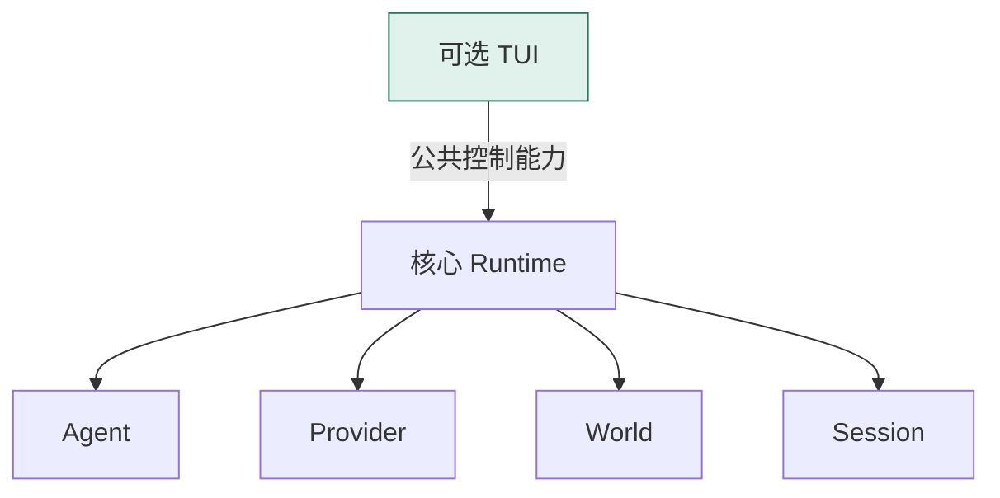
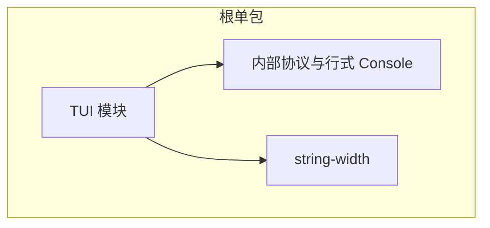
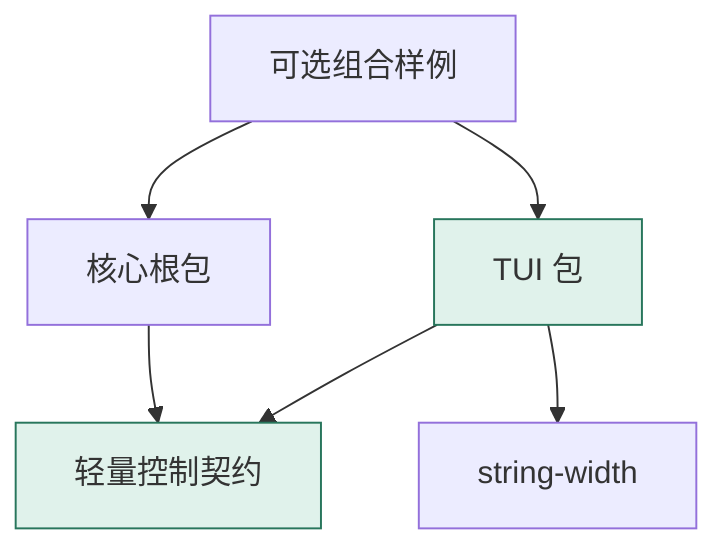
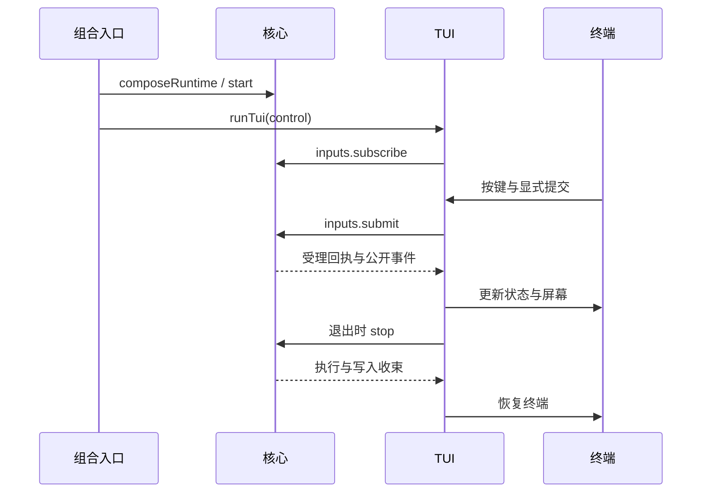
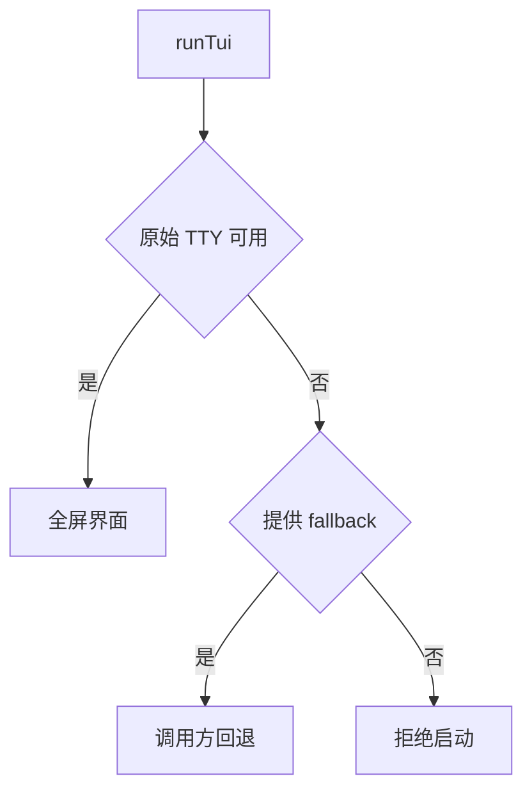

Owner: `src/control/`、`src/index.ts`、`packages/shared/control-api/`、`packages/apps/tui/`、`examples/tui/`、`package.json`、`scripts/check-packages.mjs`

# M3.1 进度与架构图

日期：2026-10-08。基线：[M3 首批统一触发](2026-10-08-M3.0进度与架构图.md)，main 提交 55bdc7e，首批独立验收已记录。M4 仍为候选计划。本补充负责 TUI 工程边界，沿用 M3 执行语义。

当前状态：迁移实现与自动验证完成，位于 codex/tui-package-migration。新的源码独立审查和负责人人工终端复验未另行记录。M2.1 的历史人工验收保留，不扩写为本次迁移验收。

## 交付范围

TUI 成为独立可选包，核心继续留在根包与 src。核心与 TUI 共用一份轻量控制契约，前端从公开包入口消费能力；src/console 收束为内部行式测试入口。核心、TUI 与完整开发工作区分别安装和检查，产物可在仓库外独立安装。

本轮保留既有终端驱动、编辑、回看、诊断与退出行为；非 TTY 回退改为调用方显式注入。OpenTUI、分进程连接、World 配置、完整监控和新调度能力留后续。

## 简化总图

箭头表示已有控制调用或执行协作。绿色 TUI 是本轮主要变化，核心继续拥有执行与事实记录。

公共契约描述输入、回执、快照、事件与生命周期。它是类型与能力边界，没有新增运行中的服务或执行队列。

## 组件关系

| 组件 | 实现与入口 | 所有权 |
| --- | --- | --- |
| 核心根包 | src、1002bot / 1002bot/control | 公开已有装配与实现，继续拥有 M3 执行、记录与生命周期 |
| 控制契约 | packages/shared/control-api | 单份 RuntimeControl、InputChannel、输入/回执/快照/诊断类型，无前端或核心实现依赖 |
| 可选 TUI | packages/apps/tui、@1002bot/tui | 草稿、回看、有限活动缓存、终端驱动和呈现 |
| 内部行式测试 | src/console/terminal.ts | 消费同一控制契约，未来可由其他测试替代 |
| 离线组合 | examples/tui/sample.ts | 通过公开入口创建核心与 TUI；FixtureWorld、脚本 Provider、真实 JSONL，显式行式回退 |
| 跨包集成 | tests/integration/tui.test.ts | 使用真实核心和公开 TUI 产物验证交互；开发依赖不进入核心运行图 |

## 相比 M3 增加了什么

### 结构修改点：TUI 的包边界

M3 时 TUI、核心与终端依赖属于一个包，TUI 读取内部协议路径并引用行式 Console。根安装与检查一并覆盖这些模块。

修改前：以下箭头表示 TUI 的源码依赖，三个节点均在根包中。

修改后：以下箭头表示工作区声明的包依赖；组合样例是开发包。

### 就地展开：公开入口与现有界面逻辑

src/control 导出 composeRuntime 与控制类型。Runtime 已满足原能力形状，组合入口直接把对象交给 runTui；界面没有两侧重复封装的适配器。协议路径继续兼容导出已有类型，限额与异常实现留在核心。

| 路径 | 迁移后逻辑 |
| --- | --- |
| control-api → src/protocol | 输入、回执、快照、事件与 TriggerKind 共用定义；核心兼容导出 |
| src/control → 核心包 exports | 导出已有装配与控制类型，编译产物使用 JS/声明 |
| tui/src/terminal.ts | 从契约包接收 RuntimeControl；按键、提交、命令、事件、重绘与退出继续原实现 |
| input.ts / editor.ts / text.ts | 字节、粘贴、字素和列宽逻辑保持，外部列宽依赖归 TUI |
| state.ts / view.ts | 公开诊断类型改用包入口；活动保留、草稿版本、折行与回看锚点保持 |
| probe.ts | 随 TUI 打包为 bot-tui-probe，无核心依赖 |
| examples/tui | 负责公开装配与可选回退，核心独立检查不扫描该组合 |

复杂度仍主要在 terminal.ts 的回执、草稿版本、诊断、背压与退出交错；本轮没有重写这条逻辑。新增工程复杂度是包导出、声明、安装范围与跨包回归，采用独立安装产物验证。

## 详细关系

### 同进程控制与显示

箭头表示实际调用/回调，契约包只提供类型，没有运行时中转。

### 非 TTY 的归属

独立包在创建界面状态和订阅之前检查终端条件。没有 fallback 时拒绝启动，核心生命周期仍归调用方；组合样例传入内部行式入口，保持旧重定向回归。

## 专项报告

待添加。

## 验证记录

| 类别 | 2026-10-08 证据 | 覆盖与限制 |
| --- | --- | --- |
| 迁移回归 | 完整测试 114/114；TUI 本线 13 项单元、7 项集成 | 增加非 TTY 拒绝与 2 项依赖边界检查，不联网 |
| 类型与构建 | 核心、契约、TUI、组合样例和跨包集成检查通过；各产物构建通过 | 检查声明与公开入口，不代表其他平台兼容性 |
| 核心单独源码安装 | 干净目录没有 TUI/string-width，类型检查、构建通过；核心测试 93 通过、1 项 TUI 边界检查跳过 | 只安装核心与契约依赖；共享锁信息不等于前端安装 |
| TUI 单独源码安装 | 没有核心 src，构建/类型检查与 13 项单元测试通过 | 前端编译不读取核心内部文件 |
| 核心 tarball | 仓库外真实 FixtureWorld/JSONL 读回 7，persisted=true，20 条记录 | Provider 脚本化，不是联网运行 |
| TUI tarball | 未安装核心，运行导入/声明检查通过，探针命令存在 | 未发布 registry，契约 tarball 通过本地 overrides 提供 |
| 独立探针 PTY | 你好🙂：10 bytes / 6 cells；换行、submit、quit 正确，退出码 0 | 工具注入按键，不替代真实中文输入法验收 |
| 组合样例 | 重定向 set/get 返回 7，两个 persisted=true，EOF 停止正常 | 显式注入内部行式回退，已验证迁移后的启动命令 |
| 核心行为边界 | Runtime/Agent/Provider/State 与 main 55bdc7e 无差异 | 公共类型归属与入口改变，执行逻辑未新增 |
| 独立审查/人工复验 | 未另行记录 | 历史 M2.1 验收不替代本轮结论 |

离线安装证据由 scripts/check-packages.mjs 生成，原始结果为 scratch/package-install-check.json；任务记录见 [Console 开发记录](agent-context/current-task/2026-10-06-consoleTUI首批开发.md)。安装命令见 [包安装与迁移](使用说明/包安装与迁移.md)。

## 范围边界

本线完成包结构、已有契约归属、依赖与检查隔离、可选组合和迁移说明。包均可本地打包安装，尚未发布 registry 或推送/合并迁移分支。

本轮没有引入 OpenTUI/React 或更改核心运行时，没有新增远程协议、WebUI、扩展加载、World 配置或监控能力。packages/apps、extensions、shared 的分类不表示已创建这些未来产品。后续按 [Console 计划](agent-context/plans/2026-10-06-console终端交互计划.md) 继续框架与界面讨论。
