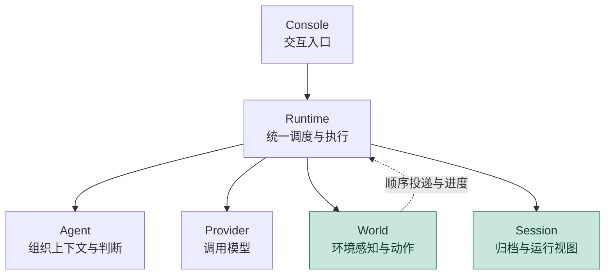
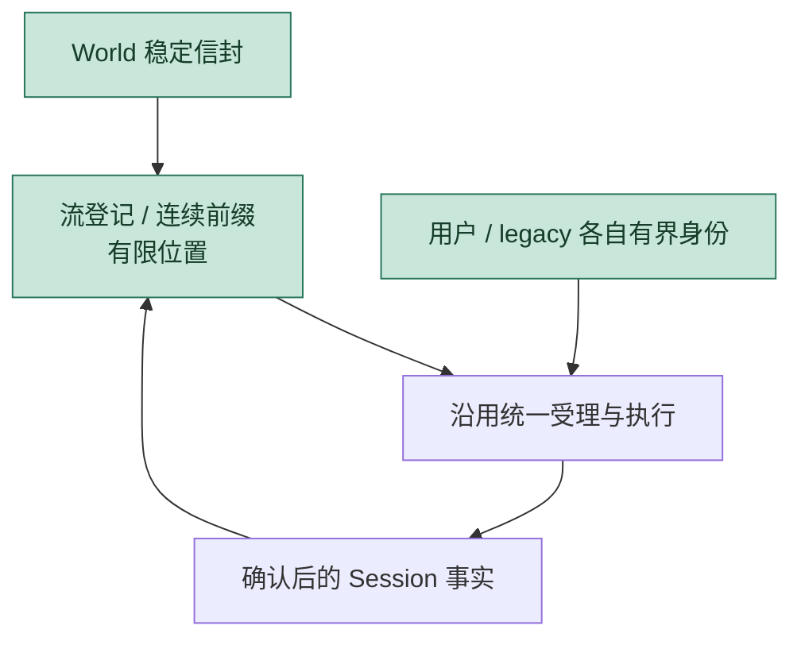
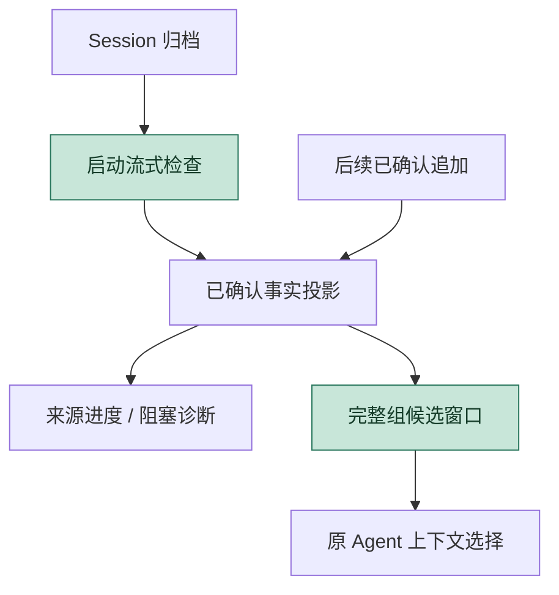
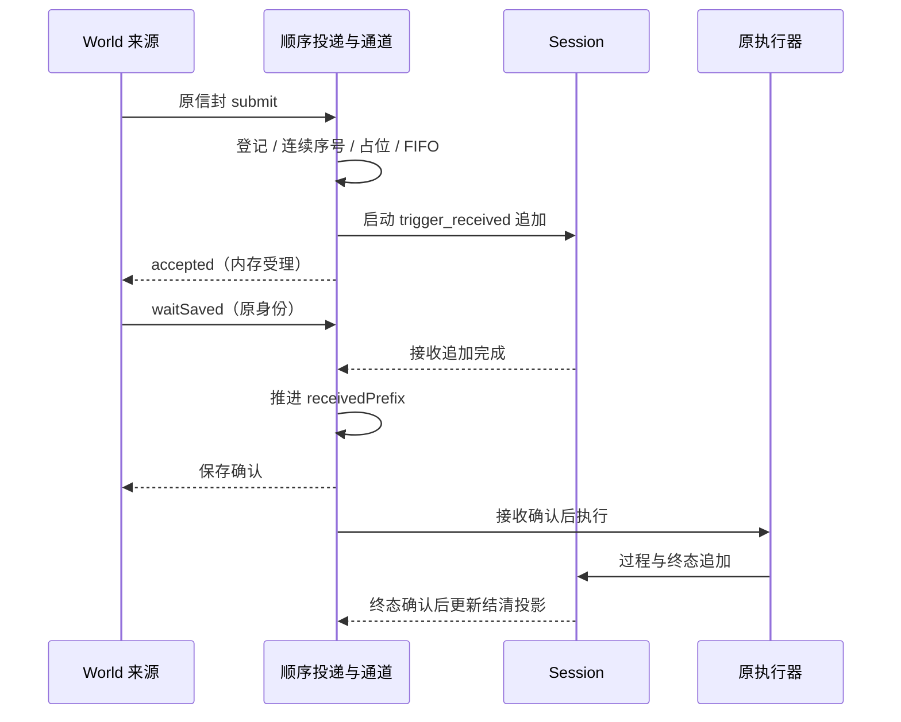
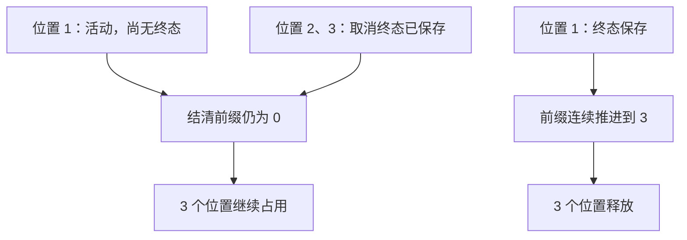
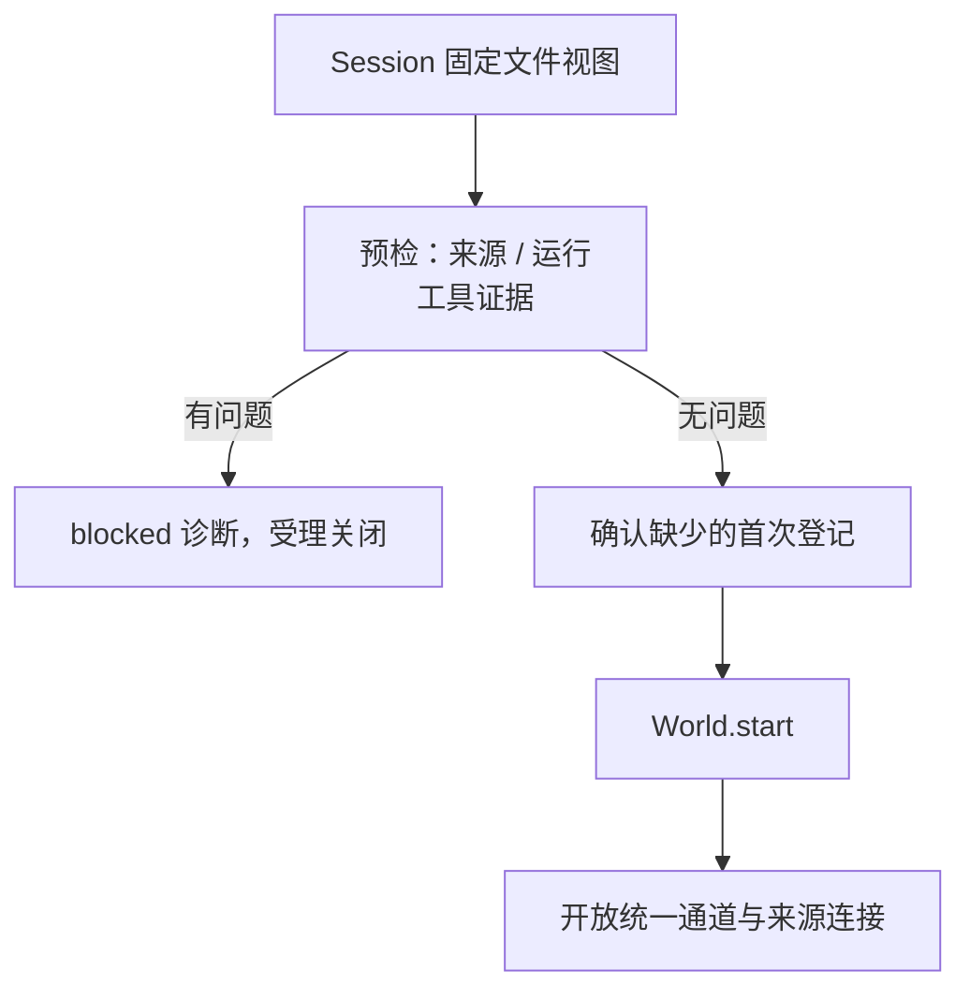

Owner: `src/protocol/delivery.ts`, `src/runtime/runtime.ts`, `src/runtime/trigger-channel.ts`, `src/runtime/trigger-run.ts`, `src/runtime/world-delivery-state.ts`, `src/runtime/session-preflight.ts`, `src/state/jsonl-session.ts`, `src/state/session-audit.ts`, `src/state/history-window.ts`, `scripts/m4-sample.ts`, `scripts/m4-console.ts`

# M4.0 进度与架构图

基线日期：2026-10-09。2026-10-10 负责人确认对提交 a28c1a12b40e081839229942c906e056266ad4a5 的全量独立验收通过，M4.0 基座交付达标。上一主线为 [M3.0](2026-10-08-M3.0进度与架构图.md)。实施自验与独立核验均为全量 144/144、完整类型检查通过；任务状态和生产 World 继续延后。操作与迁移见 [顺序投递说明](使用说明/M4顺序投递与迁移.md)。

## 交付范围

本次补齐 M3 已记录的 World 去重偏差：提供独立稳定投递身份与连续进度，使符合来源契约的 World 能越过累计 4096 个身份继续运行。与此同时，增加保存确认、新实例重建前检查和有界运行视图，形成投递、保存、执行、终态结清及重建诊断的闭环。

| 能力 | 本批实际交付 |
| --- | --- |
| World 专门投递 | 装配登记有限流/固定 epoch，稳定 sequence，重复查询、缺口拒绝及容量背压 |
| 保存与结清 | accepted 保持内存回执；独立 waitSaved；已确认 Session 投影受理/保存/连续结清进度 |
| 新实例 | 流式重建前缀与历史窗口；启动检查未结清、工具 unknown、悬空调用、登记冲突和损坏 |
| 有界运行读取 | 每次运行从近期完整组候选取历史，显式预算化旧历史查询；有限 trace 和诊断 |
| 可交互验证 | 离线来源 Console 与真实本地发件记录，独立进程重建、故障退出和容量回归 |
| 兼容迁移 | 裸 Event 独立有限配额、World 编码句柄、旧 Store 能力诊断、历史视图及记录边界说明 |

沿用 M3 的严格 FIFO、单活动处理、接收写入屏障、固定输入边界、显式取消、unknown 停止、旧代连接失效和心跳跳过。Agent 继续拥有语义判断，World 继续拥有领域事实与效果判断，Runtime 负责机械受理和执行。

## 简化总图

箭头表示控制调用与协作关系；绿色块为本批重点展开的位置。World 升级为稳定信封与顺序投递，Session 增加启动流式检查与有界历史候选视图；Provider 与工具仍由原执行器调用，图中没有增加第二个执行调度器。

来源进度和历史候选都由已确认 Session 事实投影。前者回答“哪个来源位置保存/结清了”，后者回答“给 Agent 哪些完整历史候选”；两者不互相替代。

## 组件关系

| 功能块 / 所有者 | 接口与责任 | 实现入口 |
| --- | --- | --- |
| World 来源 / World | 首次投递前确定稳定身份，保留未保存项，重投沿用原信封 | World.subscribeDeliveries；测试适配器 `tests/fixtures/ordered-world.ts` |
| 顺序投递与进度 / Runtime | 登记绑定、序号判断、保存等待、连续前缀与有限位置 | `protocol/delivery.ts`、`runtime/world-delivery-state.ts` |
| 统一受理与执行 / Runtime | 混合 FIFO、单活动项、取消与最终结果；模型/工具续轮 | `runtime/trigger-channel.ts`、`runtime/trigger-run.ts` |
| 生命周期与检查 / Runtime | 启动检查、登记屏障、来源启停、代次、停止写入等待 | `runtime/runtime.ts`、`runtime/session-preflight.ts` |
| 归档 / SessionStore | 串行追加、固定文件视图扫描、读取失败与行容量 | `state/jsonl-session.ts` |
| 诊断与候选 / Runtime 的投影 | 检查运行证据；保留完整历史组、提供旧历史查询 | `state/session-audit.ts`、`state/history-window.ts` |
| 判断与协议 / Agent、Provider | Agent 选择候选；Provider 计量请求并保留原生响应项 | 原 ConversationAgent / Provider 接口 |
| 交互 / 调用方 | 展示受理、来源进度、运行结果和只读诊断 | `scripts/m4-console.ts`；原公共控制接口 |

所有核心组件仍装配在同一 Runtime 进程。测试生产者可独立重建对象或进程，使用自己的发件 JSONL；核心 Session 是另一份事实记录，两个文件没有跨文件事务。StateStore 仍为注入能力，未承担任务延续或长期 Memory。

## 相比 M3 增加了什么

### 总图中的 World：从累计身份集合到稳定来源前缀

M3 的 user_input 与 world_event 共用累计 seen 集合，合计 4096 后拒绝；Heartbeat 使用内部身份。M3 报告公开限制，但没有落实讨论要求的 World 专门长期契约。M4 在 World 与原通道之间展开此边界，替换 ordered 路径的身份状态。

修改前，World 与用户共用累计身份：

修改后，在 World 接入处新增流状态，原执行路径沿用：

新身份为 `(World.id, streamId, epoch, sequence)`，Session 隔离去重范围。queueSequence 仍只代表当前 Runtime 的混合 FIFO 排位；generation 只控制旧连接权限。World 原 Event.id 保留业务含义，取消和查询改用回执 triggerId。

每流固定 epoch、无缺口缓冲、无动态换代，换来只保留有限流状态、标量前缀和未压缩位置。不是通过增大 4096、定期清空 Set 或淘汰旧 ID 达成长期投递。累计旧前缀可判断重复，活跃区间还校验原事实；查询完整旧结果仍需归档。

### 总图中的“Session 归档与运行视图”：启动检查与增量候选分开

M3 执行前读取历史并由 Agent 选择；Runtime.trace 累积本实例记录。M4 增加两条拥有不同用途的读取路径：启动流式检查全历史，运行中取已确认增量候选。trace 则改为近期视图。

归档保持追加事实，候选只是有界投影。首次登记是控制记录，不进入模型上下文；队列接收记录也不提前作为 Agent 新事实。显式旧历史查询允许增加扫描成本，不默认每个触发读取全文。

| 其他变化 | 使用影响 |
| --- | --- |
| 启动前检查 | 含未结清/unknown 的旧 Session 不再直接开放执行 |
| 独立 World 保存等待 | 来源不依赖诊断订阅、有限快照或等待整轮模型执行才能确认接收保存 |
| 裸 Event 兼容 | 保留单独 legacyIds 预算；开启 ordered 时明确拒绝裸入口 |
| World 句柄编码 | 原 Event.id 不再直接作为通用取消/查询 ID |
| JSONL 行边界 | 16 MiB 默认上限，超限明确失败并保留诊断，不裁断原生项 |
| Heartbeat | 沿用 M3 独立机制，没有新增任务状态或自动任务恢复 |

## 详细关系

### 来源受理与执行屏障

占位和接收追加启动发生在通知监听器之前，保持重入时顺序。来源保存确认与执行都依赖同一接收追加；图不承诺调用方观察两者的严格先后时刻。追加失败关闭受理，原保存等待失败，后续项不会绕过屏障。

### 结清前缀与位置释放

待执行队列与来源未压缩位置是两个预算。取消可以腾出排队名额，但前缀未越过时不能腾出来源位置；否则慢项前方可不断受理/取消后项，终态集合仍会无界增长。跨流共享 16 个位置意味着一个慢来源可能对其他来源施加背压，本批不增加公平调度。

### 启动与只读检查

上图是 start 路径。`diagnoseSession` / `inspectSession` 在预检结果处返回，不保存登记，不启动或清理 World。启动扫描和登记等待期间发生 stop，代次/取消检查阻止继续启动；已进入的登记追加仍属于停止写入屏障。

### 执行时的上下文边界

初始请求使用完整历史候选及当前项；后续续轮只增加本项的模型和工具记录。来源接收追加、排队取消和控制登记不成为活动项新事实。Agent 的 `readHistory` 是显式旧完整组查询，仍排除排队接收和当前未结束组。默认候选仅成功完整组，失败/取消归档可在显式查询中选择。

Heartbeat 继续由 Runtime 管理计时器或手动 tick 源，进入同一 FIFO，由 Agent 可选入口决定是否唤醒模型。已有一个心跳未结算时跳过新 tick，过期项不补跑；内部生命周期身份不占 UserInput/legacy 配额，也不占 ordered 位置。默认 Agent 无任务策略时不调用模型。M4 没有增加“从历史自动续任务”的分支。

## 专项报告

### 稳定身份的复杂度由谁承担

Runtime 每条登记流维护 admittedTail、receivedPrefix、settledPrefix，加上合计有界的活跃位置；不保留全部历史原始 ID。来源适配器承担首次编号、未确认事实保存及重连后的原身份重投。这是长期去重成立的前提，不能把适配器每次调用分配新序号当作稳定来源。

连续源只接受下一序号，缺口明确拒绝并提示 expectedSequence。首版不做任意乱序缓冲、持久 ID 索引或滑动时间窗口。累计重复的业务结果不会因前缀存在而变成成功；duplicate 只返回 admitted/saved/settled 阶段。绑定不符或旧代连接明确拒绝。

实际集成已连续处理 4097 条，使用默认配额，Console 的独立身份容量仍可使用；来源位置随连续结清归零。该证据落实 M3 的必做义务，但只覆盖符合顺序契约的来源，legacy 仍明确有界。

### 保存、结清、效果与 unknown

| 事实 | 更新时机 | 故障边界 |
| --- | --- | --- |
| admittedTail | 合法新项内存占位 | 进程退出可失去，来源保留原信封 |
| receivedPrefix | trigger_received 追加成功后 | 只证明接收保存，不能证明 Agent 已处理 |
| settledPrefix | run_finished 追加成功，且更早项已结清 | cancelled/failed/expired 也可结清；unknown 不被消除 |
| 实际领域效果 | World 执行并判断结果 | 与回执保存不原子；异常或证据不足保留 unknown |

Session 是单一进度事实依据，先追加确认再更新投影，最后发布保存依据。没有第二个可独立写入的核心游标文件；重建遍历归档，首版没有检查点。

工具可能已产生效果而回执尚未保存。进程在接收保存后、实际效果发生后或终态保存后退出，重建分别提供未结清诊断或恢复已结清前缀，均不自动调用工具。unknown 停止决定继续在回执写入前锁定；回执保存失败也不能重新开放执行。测试保留真实夹具写入值并确认后项取消。

文件追加完成提供普通进程重建所需记录；未采用 fsync，不承诺断电、设备损坏或跨系统效果事务。即使 settledPrefix 已推进，诊断仍可能 blocked。

### 诊断不是恢复操作

启动检查覆盖 ordered、legacy、UserInput 和工具证据，不能只检查新来源后宣称整个 Session 可执行。旧无 runId 记录保持可读，对可关联的工具调用/回执进行核对，不伪造现代完整运行组。

| 检查发现 | 当前处理 |
| --- | --- |
| 接收已保存但无终态 / 中断运行 | blocked，不自动重新入队 |
| tool_call 无回执 / 配对缺失 / unknown | blocked，不补 failed，不重放效果 |
| 登记、绑定、epoch、schema 或连续序列冲突 | blocked，保留位置与原因 |
| legacy 历史无法建立新来源起点 | legacy_source_boundary，要求明确迁移证据 |
| JSONL 尾部未确认 / 无效 UTF-8 / 损坏 / 读取失败 | 只读报告，不截断或跳过 |
| 自定义 Store 缺少 scan | ordered 拒绝；legacy_store 可运行但不承诺有界重建 |

诊断详情最多 64 条、消息最多 1024 个字符，保留 issueCount；运行中实时故障也进入概要。`inspectSession` 的结果表示该文件快照能否重启，不是对活跃 Runtime 的健康判定或停止命令。

### 有界视图与仍然增长的归档

| 对象 | 容量和成本 |
| --- | --- |
| 启动扫描 | O(历史量)，64 KiB 分块；固定文件长度视图，不收集全文 |
| 默认候选 | 32 个完整运行组 / 16 MiB，任一上限触发整组淘汰 |
| 超大或配对不完整组 | 整组省略，计入 omittedRuns；不裁断原生项或工具对 |
| 活动执行 | 本项续轮记录单独保留，仍受请求/响应/轮次/时限约束 |
| trace | 最近 256 条 / 4 MiB；不是完整归档或模型上下文 |
| 单 JSONL 记录 | 默认 16 MiB，超限明确失败；包含换行 |
| 显式旧历史 / read() | 查询可扫描全文；read 收集全文时有 O(历史量) 内存成本 |
| 磁盘归档 | 本批没有压缩、退休或删除政策，持续增长 |

16 MiB 单记录边界在保留原生 Provider 项和回执的前提下选定；超过上限不截断内容。规模样例最大记录 7,929 字节只代表该离线负载，不能代表所有工具或 Provider 的上限。旧合法超大行可以显式提高 recordBytes，承担对应解析内存。

下面是实施期间的观察，Node v24.14.0 / Windows，同一实例逐步增加事件；最终阶段值来自不同长度的新增批次，不是独立等长对照实验：

| 累计事件 | 归档字节 | 历史组 / 候选字节 | trace 条数 | scan / 全文 read | 新增批次平均每项 |
| ---: | ---: | ---: | ---: | ---: | ---: |
| 64 | 535,647 | 32 / 305,254 | 256 | 1 / 0 | 5.40 ms |
| 256 | 2,486,333 | 32 / 307,904 | 256 | 1 / 0 | 7.01 ms |
| 1024 | 10,306,491 | 32 / 308,904 | 256 | 1 / 0 | 11.34 ms |

1024 条后归档 6,145 条记录，新实例扫描约 390.33 ms，结清前缀重建为 1024。各观察点的未压缩位置归零，默认执行只有一次启动 scan，没有逐项 read。未经受控 GC 的 heapUsed 从约 13.0 MB 增至 46.4 MB，平均延迟也增长；结果支持视图容量和读取路径的事实，不支持恒定进程内存、恒定吞吐或性能改善结论。[原始测量](../scratch/m4-profile.json) 可复核。

### 兼容代价与迁移

完整操作要求见 [迁移说明](使用说明/M4顺序投递与迁移.md)。关键变化是 World 取消/查询使用回执编码句柄、admissionIds 只供 UserInput、legacyIds 独立、history/trace 改为视图、ordered 需要 scan、含未确认效果的 Session 启动阻塞。

旧日志不重写。旧 World 事实缺少可靠来源序列时不能将文件行号或 queueSequence 转成水位；本批拒绝直接首次登记 ordered，没有自动转换脚本。生产切换需要明确来源起点与旧效果证据；新 Session 也没有继承旧 Session 的去重保证。此迁移限制是当前基座边界，不应把“日志可读”写成“旧来源自动升级”。

## 验证记录

实施自验证据对应 2026-10-09；2026-10-10 独立验收与负责人确认单独标明。测试使用脚本模型、真实本地 Session 和测试 World，无真实 bot。

| 证据 | 结果与对应版本 |
| --- | --- |
| 实施前基线 | 全量 117/117，通过；沙箱 Git 子进程权限问题在获准后消除 |
| 中间实现全量 | [142/142](../scratch/m4-full-tests.log)，约 66 秒；后续增加预检/只读入口与 CLI 用例，不能作为最终全量结论 |
| 当前相关回归 | [76/76](../scratch/m4-targeted-tests.log)，包含输入、生命周期、统一触发及存储窗口 |
| 当前 M4 集成 | [22/22](../scratch/m4-fast-tests.log)，约 27 秒；其中 4097 条长时容量用例约 26 秒 |
| 当前完整类型检查 | [通过](../scratch/m4-typecheck-final.log)，覆盖核心、共享契约、TUI、组合样例和集成测试 |
| 最终合并全量 | [144/144](../scratch/m4-final-tests.log)，约 37 秒；代码在专项验证后未再修改 |
| 当前 M1 / M3 离线样例 | [M1](../scratch/m4-final-m1-sample.log) 写入 1 并停止；[M3](../scratch/m4-final-m3-sample.log) 用户/World/心跳均 succeeded、persisted，Runtime running |
| M4 样例 / CLI | 先前样例通过；当前双进程重建与 EOF 管道交互已包含在 22/22 中 |
| 规模测量 | [profile](../scratch/m4-profile.json)，结果和测量限制见专项报告 |
| 图形核对 | 7 图使用本地 Mermaid/Edge 离线渲染；修改前后分图，逐图查看文字、方向和布局；截图见 scratch/m4-implementation-diagram-preview |
| 文档链接与 Owner | 12 页核对通过，81 个本地链接有效；结果见 scratch/m4-links-check.json |
| 独立验收 | 2026-10-10，负责人确认 a28c1a1 的架构契约、实现、自动化、兼容与文档全部达标；工作区追加核验记录见下文 |
| 负责人阶段确认 | 2026-10-10 明确确认本轮交付达到验收标准；没有新增真实 TTY 交互记录 |
| 真实 Provider 联网往返 | 未验证，离线脚本模型不替代该项 |

重点回归覆盖受理立即返回/保存等待、原身份冲突、缺口与 epoch、连续结清位置、来源确认丢失后的重建、4097 条默认容量、unknown 与存储失败、启动扫描/登记停止竞态、旧日志迁移拒绝、纯只读检查、两个真实进程正常重建、三个实际退出窗口和 CLI EOF。

负责人提出疑似阻塞后，检查 Git diff、日志和残留工具会话，确认专项通过后没有再改代码；只读进程检查没有发现残留项目测试。最后一次名称过滤未跳过长容量用例，导致重复执行，现保留已完成结果，不重跑专项。[任务记录](agent-context/current-task/2026-10-08-m4主线基座规划.md) 保留版本与中断核对。

### 2026-10-10 独立验收与提交前复核

负责人转述的独立验收覆盖提交 a28c1a12b40e081839229942c906e056266ad4a5，核验记录已追加到上述任务文件：全包类型检查、144/144 测试、M4/M3/M1 离线样例均通过。此处记录独立结论的来源，本次文档收尾不冒称第二次独立审查。

本次两笔提交共用同一未改动实现的提交前验证：[全量 144/144](../scratch/2026-10-10-commit-tests.log)、[禁用包管理器网络访问的完整类型检查](../scratch/2026-10-10-commit-typecheck-offline.log) 通过。TUI 样例 rootDir 配置单独提交，本机 TypeScript 5.9.3 修前/修后都通过，未复现兼容报错；它不改变 M4 运行逻辑。验收结论写入报告和任务记录，计划保留原文。

## 范围边界

本批仅交付主线基座。任务状态/心跳任务延续、生产 World、长期 Memory、工具效果事务、unknown 人工解除、自动恢复/补投/动作重放、动态 epoch 换代、持久任意 ID 索引、滑动去重窗口、持久检查点、fsync、归档清理、多实例、优先级和批处理均未实现。World 显式复核工具仍由后续领域风险决定，没有将判断权移到调度器。

首个生产 World 单独确定。Console 产品体验继续由独立计划负责；M4 离线来源 Console 用于验收核心链路。固定来源契约减少 Runtime 常驻身份状态，但不能消除来源保存责任、全历史启动扫描或磁盘增长成本。
