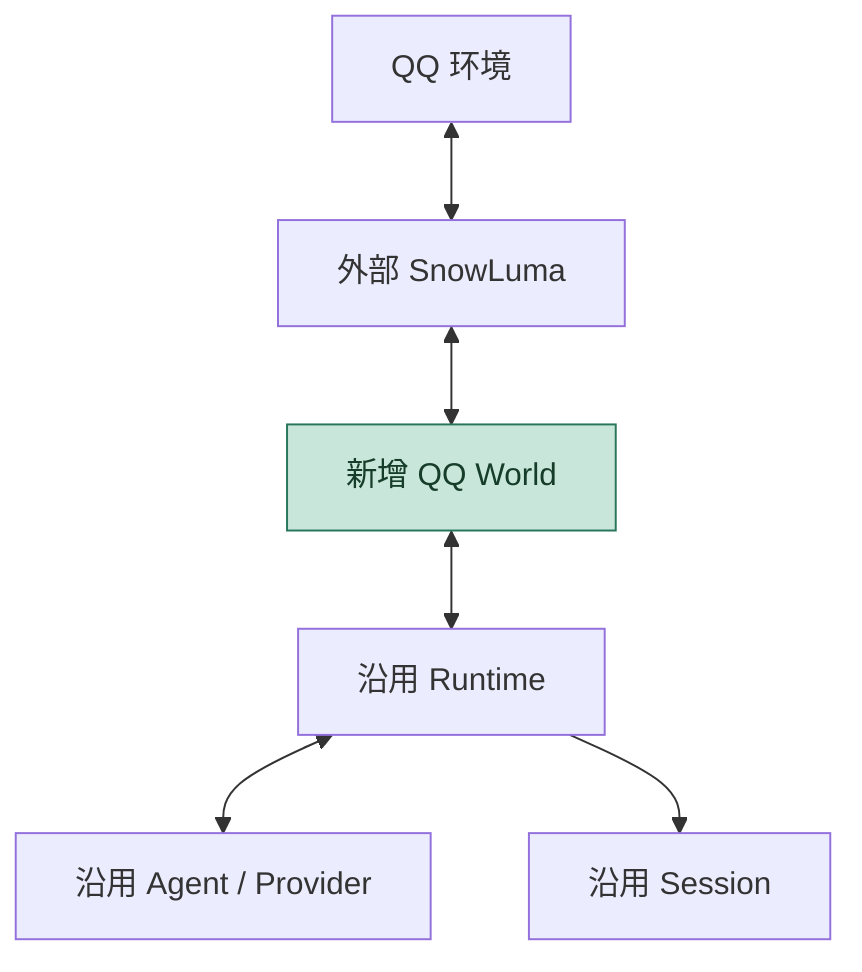
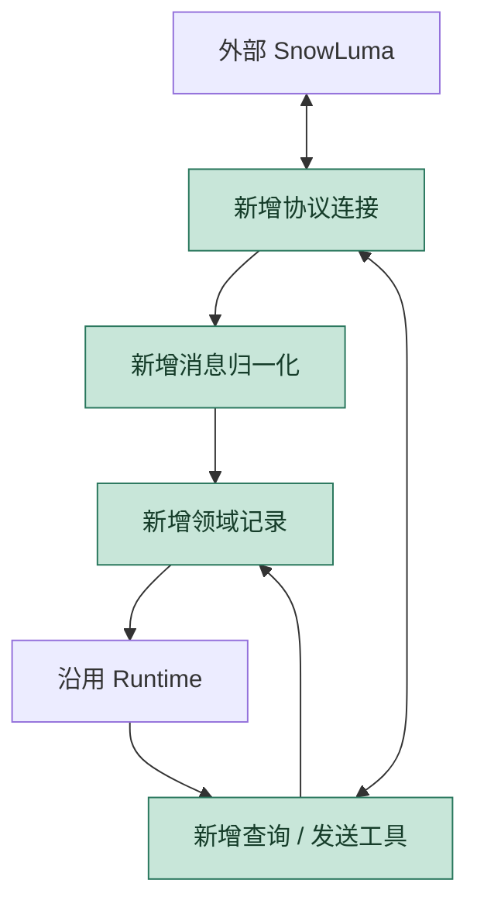
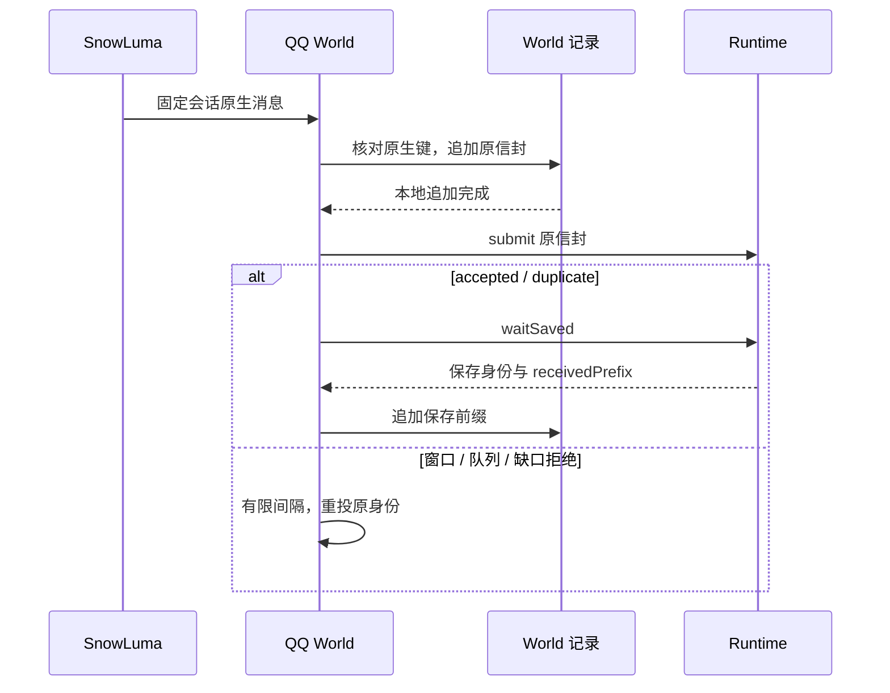
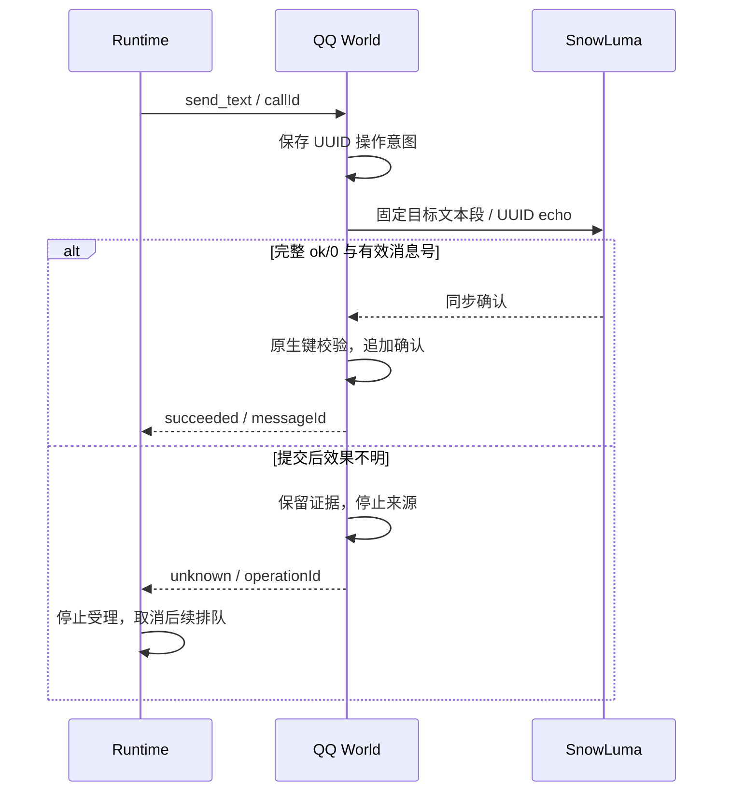

Owner: `packages/extensions/world-qq/src/`、`examples/qq/`、`scripts/run-tests.mjs`、`scripts/check-packages.mjs`、`package.json`

# M4.1 QQ World 进度与架构图

基线：2026-10-11，`03570784d4c1f8323ebf8de189f9da924b3510e5`；分支 `feat/world-qq`，独立工作树 `.worktrees/QQ`。依赖已验收的 [M4.0](2026-10-09-M4.0进度与架构图.md) 公共接口；M5 仍为独立候选设计。此页记录 QQ 线实现、离线自验、全线复核及真实 SnowLuma + Provider 两层验收结果。

## 交付范围

已实现可安装的 `@1002bot/world-qq`：一个 QQ 账号、一个固定群聊/私聊，将文本事实持久保存并顺序投递；模型查询已知消息、显式发送文本、确认原生结果并由 Runtime 保存终态。新增无密钥配置、外部 SnowLuma Compose 示例、离线装配和两层手动验收入口。主线 Runtime/Agent/Provider/Session 源码沿用 M4。

## 简化总图

箭头表示协作；绿色为新增生产 World，SnowLuma 由部署方管理。

## 组件关系

| 组件 | 所有权与职责 | 实现 |
| --- | --- | --- |
| 外部桥接 | 部署方维护 QQ 登录、镜像与 OneBot 服务 | SnowLuma，不由 World 启动 |
| 协议连接 | Bearer 握手、登录校验、独立 echo、有限响应等待与重连 | `world-qq/src/driver.ts` |
| 领域消息 | 固定会话、自身过滤、文本及有界元数据 | `world-qq/src/normalize.ts` |
| 本地记录 | 独占文件、绑定、连续序号、原生映射、保存前缀及操作事实 | `world-qq/src/journal.ts` |
| World | 生命周期、捕获容量、投递泵、查询/发送与诊断 | `world-qq/src/world.ts` |
| 执行基座 | FIFO、单活动项、保存屏障、unknown 收束与历史 | 既有 `src/runtime/` 与 Session |
| 装配 | 对齐 Session/来源绑定、事件边界与工具/清理期限 | `examples/qq/compose.ts` |

## 相比 M4 增加了什么

增量位于总图的 World 节点。M4 离线来源已证明通用顺序/终态机制；QQ 包为不可补投的原生推送补充自己的持久身份与显式发送证据。

入站身份分配和有效发送确认共用串行领域身份写入，防止相同原生键在并发路径中拥有两种事实。平台依赖仅属于扩展和 QQ 样例；根流水线显式加入新包，core-only 仍独立安装。

## 详细关系

### 来源保存与投递

constructor 不打开资源。Runtime 预检通过后调用 start；账号确认前输入受 256 项/16 MiB 边界限制。保存前缀只用于已保存待投递视图，连续终态及窗口释放仍由 Runtime 管理。退订同步撤销口，已等待的保存 Promise 不阻止 World 停止。

### 显式效果与终态

发送未知不重发；请求 UUID 与 Runtime callId 不共用身份作用域。成功只证明桥接同步确认。最终模型文本没有自动发送路径，己方确认消息可查询但不会再次触发模型。

## 专项报告

### 持久身份与容量

原生键为账号/会话种类/目标/有符号 32 位 message_id；ordered 身份为 World/stream/epoch/sequence。记录绑定还包含 Session。磁盘保留全 epoch 原信封和原生映射；没有无限增长的 RAM Map。扫描采用固定分块与单记录边界，文件增长会增加去重、补投和查询成本。

默认捕获边界 256 项/16 MiB，领域文件 256 MiB，预留 4 MiB 供确认与诊断。WS 原始帧 1 MiB，Event 64 KiB，出站文本 8 KiB，非文本元数据 32 项。超限事件在编号前拒绝；捕获或存储容量停止新来源并诊断，不能承诺 QQ 上游无损背压。

Node v24.14.0 的一次本地实测：256 条 4096 字节文本，序列化待捕获峰值 256 项/1,093,780 字节；领域记录 2,289,307 字节；捕获总时间 3161 ms，查询末尾 4.59 ms，重启扫描加登录 9.09 ms，清理 2.13 ms，整进程 RSS 99,782,656 字节。保留 256 项默认值，设置 16 MiB 留给更大原始帧；16 MiB 是保留输入字节边界，非堆上限。该测量不外推到 256 MiB 满文件性能。可复现入口：`packages/extensions/world-qq/scripts/measure.ts`；原结果 `scratch/qq-measure.json`。

### 查询证据

本地快照标记来源、观察时间与 `fresh: false`。远端观察必须匹配完整账号/会话/原消息时间/发送者/内容；缺少字段或碰撞证据时返回 `unproven_message`。SnowLuma 消息库查询不证明 QQ 内容实时更新，`fresh` 只表示本次观察返回。已确认己方消息缺少原生时间，首版保证本地快照。

### 生命周期与失败

API 默认 7000 ms，样例 Runtime 工具期限 10000 ms；World 清理默认 3000 ms，Runtime 等待 4000 ms。登录/握手未就绪在 30000 ms 启动期限内按 1000 ms 节奏重连，入站补投间隔 250 ms。停止会终止自有 WS 和请求等待，等待捕获、工具与追加；期限结束不证明物理资源退出，诊断保持可见，后台清理继续完成。

独占记录阻止双实例写入；死 PID 锁可回收，无法证明已退出时阻断。破损尾部、非法来源前缀和绑定变化不自动修复。原生冲突、unknown 和容量等停止原因在当前状态可见，磁盘允许时追加诊断。提交后的所有失败响应暂时保守保持 unknown，已部署版本的确定未执行错误码尚无实证。

## 尚未完成的整体结构

| 缺口 | 当前事实与影响 | 归属与下一步 |
| --- | --- | --- |
| SnowLuma `get_msg` 缺失 `self_id` 字段 | 实测 `SnowLuma 1.14.22-node` 的 `get_msg` 返回 `["time","message_type","sub_type","message_id","message_seq","user_id","message","raw_message","font","sender","real_id"]`（不含 `self_id`/`post_type`）；`fresh: true` 保守返回 `unproven_message`，闭环使用默认 `local_snapshot` (`fresh: false`) | 首版保持保守拒绝；后续若基于已认证单实例连接放开 `fresh: true`，在 `world.ts` 回填已确认 `accountId` |
| Core `OpenAIResponsesProvider` 点号工具名线编码 | 真实 Responses 网关校验 `tools[].name` 需匹配 `^[a-zA-Z0-9_-]+$`；`examples/qq/manual.ts` 已在装配侧完成 `qq.*` $\leftrightarrow$ `qq_*` 双向线名映射并通过验收 | 作为最小传输层提案交主线在 `src/providers/openai-responses-provider.ts` 统一编解码带点号工具名 |

## 验证记录

日期：2026-10-11。离线套件使用真实本地 WS、World 文件与 Session（模型脚本化）；手动真实验收使用外部 Docker SnowLuma 容器、真实 QQ 私聊会话与真实 Responses Provider 完成三阶段验证。

| 检查 | 证据与边界 |
| --- | --- |
| QQ 包测试 | 36/36 通过；含真实进程在捕获/提交/终态位置退出、去重重启、unknown 与排队取消、帧边界及端点未就绪重连 |
| 全仓聚合 | 180/180 通过；实际命令和最终复核日志见任务记录 |
| 类型与离线装配 | root typecheck 通过；sample:qq 一次显式发送、成功持久终态，本地 final 没有额外发送 |
| 独立产物 | QQ tarball 导出/声明通过；core-only 源码/产物没有 QQ/ws；TUI 安装仍独立。core 源码 123 通过、1 个可选项跳过；TUI 单包 13 通过 |
| 容量与清理 | 上述一次实测，原始 JSON 在 scratch；满文件增长和 OS 实际磁盘耗尽未做破坏性压力验证 |
| 文档与图 | 四张 Mermaid 图已用本地资源渲染并查看 PNG，无遮挡/裁切；链接与 Owner 检查见任务记录 |
| 自查 / 独立审查 / 负责人验收 | 自查修复启动取消与身份写入竞争；探索侧完成全线代码与离线复核；负责人完成真实环境两层验收 |
| 真实服务（`probe` / `bridge` / `provider`） | 镜像 `motricseven7/snowluma:v1.14.22@sha256:f75698eeaa06a3aed6b42e88975fff6b0313a960f7e7093b2329455310fd6eee`（`SnowLuma 1.14.22-node`, `v11`），端点 `ws://127.0.0.1:3001/`。 1. `probe`：确认 `get_login_info`、入站 `messageFormat: array`、有符号 32 位 `message_id`（正/负值均出现）及 `get_msg` 字段列表。 2. `bridge`：私聊捕获 `sequence: 1` (`messageId: 927965085`) $\rightarrow$ `qq.get_message` (`local_snapshot`) $\rightarrow$ `qq.send_text` 同步确认 (`messageId: -1073697471`, `onebot_sync`) $\rightarrow$ Session `run_finished: succeeded`，QQ 端人工确认收到。 3. `provider`：独立 Session `qq-prod-provider-1` 捕获 `sequence: 1` (`messageId: 1832010475`) $\rightarrow$ 真实模型调用 `qq.get_message` (`local_snapshot`) $\rightarrow$ 续轮调用 `qq.send_text` 同步确认 (`messageId: 918137457`, `onebot_sync`) $\rightarrow$ 最终 assistant 文本仅存本地 Session 不外发，`run_finished: succeeded`；后续 `sequence: 2` (`messageId: -1237418955`, `unsupported: ["json"]`) 模型查快照后判断无文本不外发并正常结清 |

包聚合覆盖：`pnpm test` 收集 QQ 包测试；`pnpm run typecheck` 检查包和 QQ 样例；`pnpm build:all` 生成 QQ JS/声明；`pnpm check:packages --store-dir D:/.pnpm-store` 检查独立归档与 core-only。`test:core` 不加载 QQ 测试/SDK。

## 范围边界

沿用 M4 FIFO、固定输入边界和 unknown 停止。首批没有多账号/多会话 Session、媒体理解或下载、引用展开、主动提及、成员管理、QQ 控制台、草稿确认、扩展加载器、任务状态和长期 Memory。不承诺 fsync、上游断线补齐、自动工具重放或通过更换 epoch 恢复执行。

包契约见 [QQ World README](../packages/extensions/world-qq/README.md)，操作说明见 [QQ 装配](../examples/qq/README.md)，执行/提交证据见 [任务记录](agent-context/current-task/2026-10-11-qq-world.md)。
