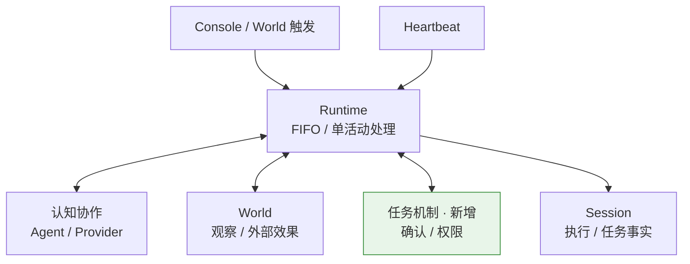
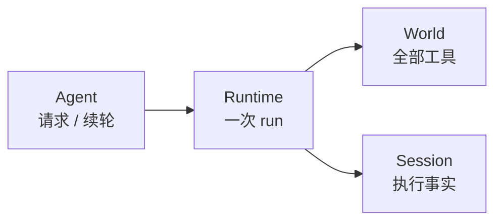
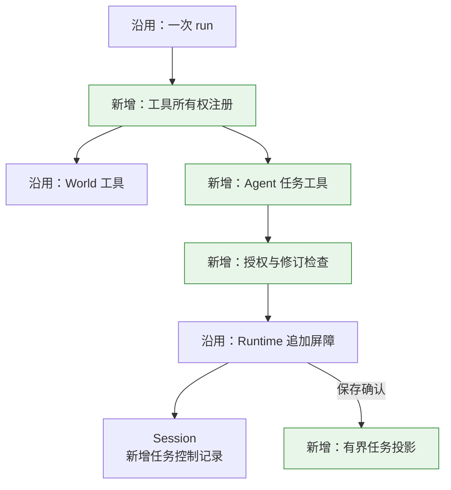
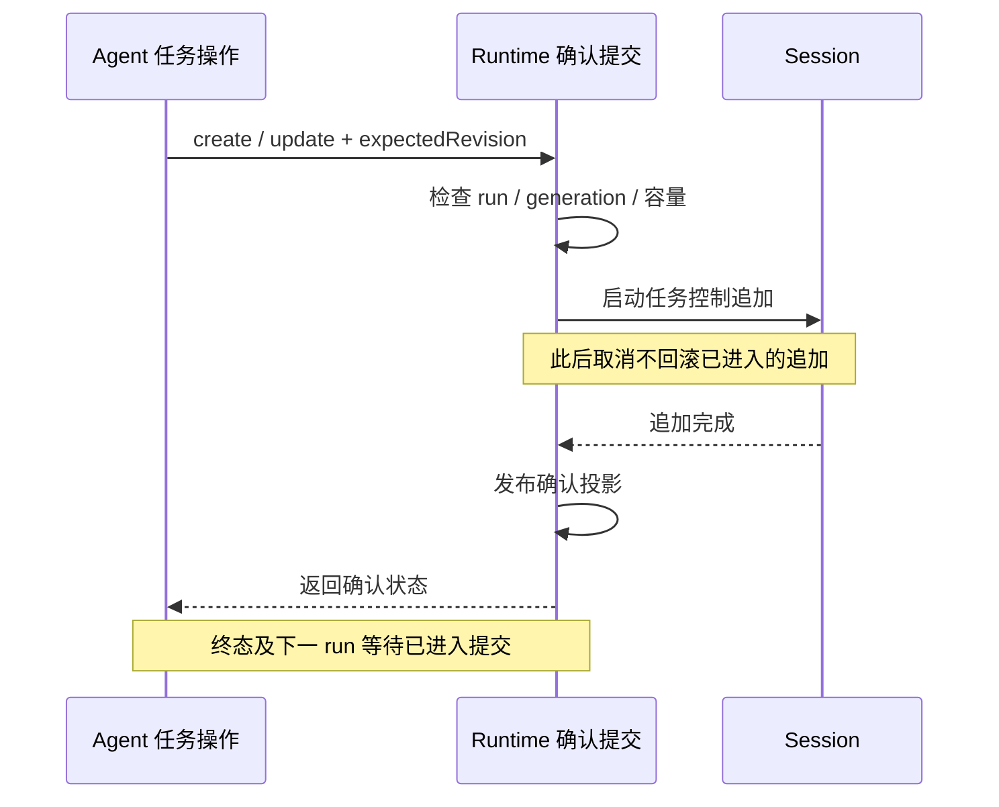
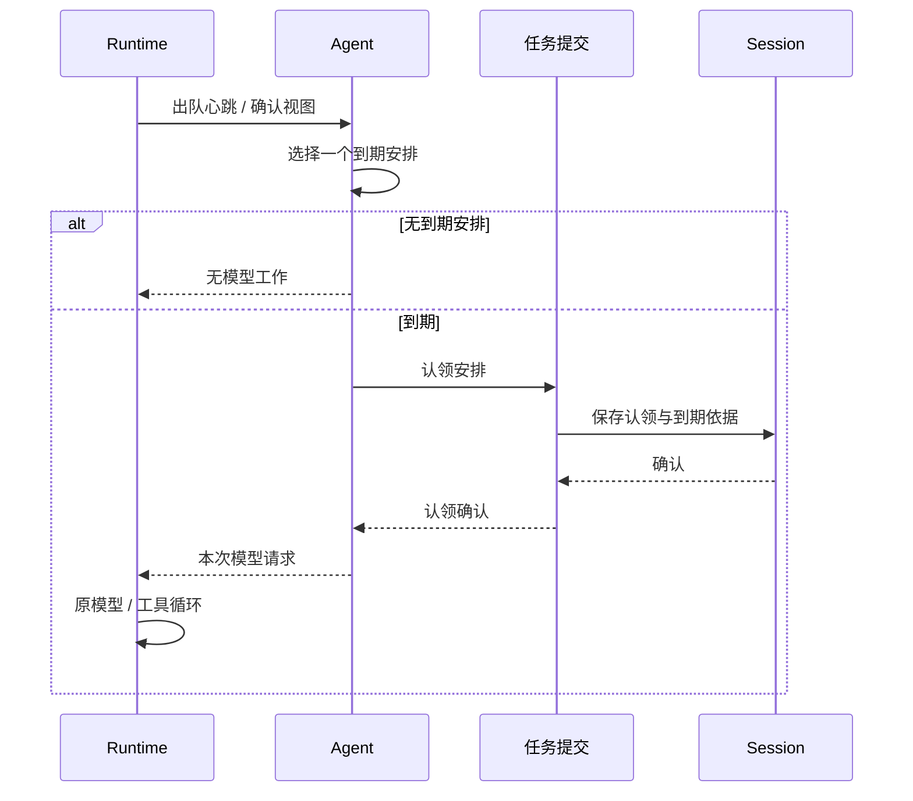
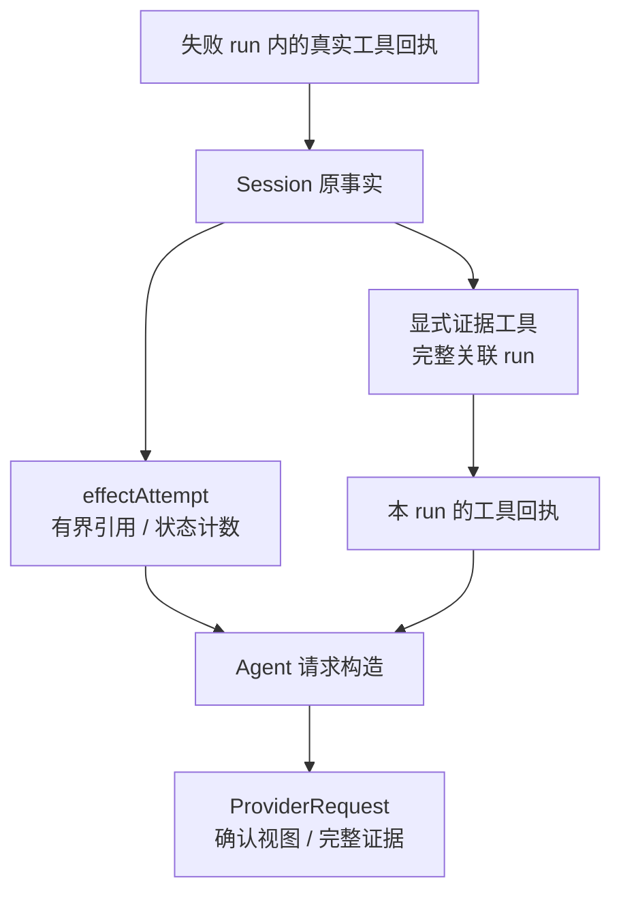
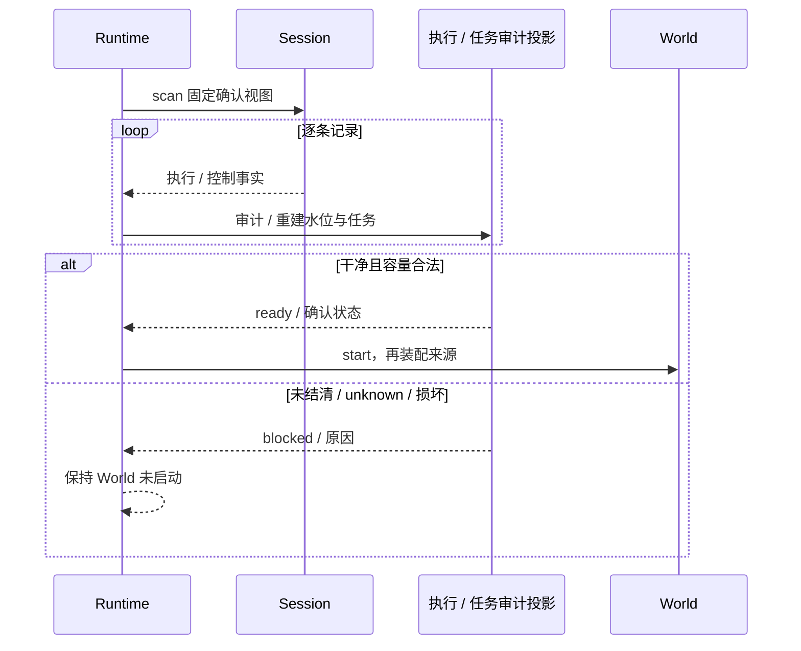

Owner: `src/protocol/task.ts`, `src/agent/task-tools.ts`, `src/agent/conversation-agent.ts`, `src/runtime/tool-registry.ts`, `src/runtime/task-coordinator.ts`, `src/runtime/trigger-run.ts`, `src/runtime/runtime.ts`, `src/runtime/session-preflight.ts`, `src/state/task-projection.ts`, `src/state/session-audit.ts`, `scripts/m5-sample.ts`, `scripts/m5-console.ts`

# M5.0 进度与架构图

基线日期：2026-10-11。本批落实负责人选择的路线 A“跨触发任务与心跳延续”，在 `main / 07ee94b` 上实施。上一主线为 [M4.0](2026-10-09-M4.0进度与架构图.md)，期间 QQ World 的独立开发提交已进入基线，见 [M4.1](2026-10-11-M4.1进度与架构图.md)。本批实现和离线自验已完成；独立审查、负责人交互验收和真实 Provider 联动另行记录，不提前声称通过。

## 交付范围

**Agent 可以保存跨触发意图，让当前处理结束，在到期心跳中开启一次新尝试，并明确完成或重排。** 等待不保存执行栈；认领不表示行动成功；普通失败不再次派发旧安排。

| 能力 | 本批实现 |
| --- | --- |
| 持久意图 | Agent 任务工具提交 active / waiting / completed / cancelled 状态，带期望修订和有界 JSON 数据 |
| 明确安排 | wakeAt 与独立 scheduleRevision；保存一次认领后才调用模型 |
| 工具所有权 | 一次 run 固定 World / Agent 声明，拒绝重名，保持原调用与回执配对 |
| 确认提交 | run/generation/调用权限、撤权后拒绝、已进入追加确认、终态与下一 run 屏障 |
| 效果依据 | 最近尝试与最近 World 工具尝试分别保存概要；失败运行的成功工具仍可见；完整证据显式进入续轮 |
| 启动重建 | 同次 Session 扫描验证执行和任务事实，干净恢复确认视图，未知/未结清/损坏继续阻断 |
| 交互 | 离线 Console 输入与顺序感知、手动推进时钟、查询与 restart；独立进程样例 |

设计见 [实施计划](agent-context/plans/2026-10-11-m5跨触发任务与心跳延续实施计划.md)，具体参数、工具和操作见 [任务与心跳说明](使用说明/M5任务与心跳延续.md)。沿用 FIFO、单活动项、固定输入边界、心跳跳过/过期、World unknown 停止、有限历史和追加完成保存语义。

## 简化总图

箭头表示功能块协作；绿色节点是本批重点。认知协作包含 Agent 判断和 Provider 模型协议，具体所有者在下表展开。任务确认机制属于通用基座，World 提供领域工具与真实效果。

## 组件关系

| 所有者 / 模块 | 职责 | 关键边界 |
| --- | --- | --- |
| Agent / `task-tools.ts` | 任务意图、状态/安排更新、查询语义 | 五个 `agent_task_*` 工具；不直接操作 Session 文件 |
| Agent / `ConversationAgent` | 低成本到期选择、构造模型请求和完整轮次选择 | 可选 `tasks: true`；无到期安排且无自定义策略时零模型调用 |
| Runtime / `tool-registry.ts` | 固定本 run 的声明与所有权 | 名称重叠在调用模型前失败，World 与 Agent 回执都有 owner |
| Runtime / `task-coordinator.ts` | 授权、串行提交、确认等待、归档查询 | AgentContext 的 TaskRunPort 可写；Runtime.tasks 只读 |
| State / `task-projection.ts` | 已确认任务、编号尾部、安排消费与尝试投影 | 活跃状态有界；已结束任务留在 Session，无累计身份集合 |
| Runtime / `session-preflight.ts` | 一次扫描重建执行/任务并审计 | World.start 之前完成；启用任务必须有 Session.scan |
| Session / `JsonlSessionStore` | 串行追加和固定文件视图 | task_changed / task_claimed 是同一事实链中的控制记录 |
| World / 测试与生产适配 | 领域版本、观察和外部效果 | 不拥有通用任务数据库；本批不改 QQ 领域代码 |

MemoryState 继续作为原装配依赖，未承担任务真相。任务写入通过 Runtime 既有 appendLifecycle，确认后才发布投影；没有增加独立可写任务文件或第二个模型循环。

## 相比 M4 增加了什么

重点位于总图的 **Agent 工具路径和 Runtime 任务确认机制**。M4 已能串行处理、保存并结清一次触发；它没有跨触发意图和明确安排的消费事实。

M4 局部结构：

M5 局部结构；下图展开新路由和提交位置，原队列、执行器和 World 路径沿用：

结构变化具有三个实际后果：任务操作进入同一调用/回执记录链；一次触发结清后意图仍存在；新心跳先消费明确安排，再发起新 run 的判断。任务完成依赖 Agent 的显式更新，不由工具或 run 的成功推导。

## 详细关系

### 提交、取消与可见性

保存挂起时 `.tasks.snapshot()` 没有未确认状态。取消、工具结束/时限或 Runtime.stop 撤销新提交权；已经进入追加的操作仍确认并发布，随后才收束。排队尚未进入追加的操作再次检查权限。必要存储失败关闭受理并停止。

Agent 工具使用原工具时限；非协作的迟到操作不能提交。时限到达时，已经进入的必要写入仍须结算；若完整回执已取得则保留它。这是确认屏障的等待，不是暂停旧模型执行。存储永不返回时，stop 仍可能等待，不能声称清理期限能跳过必要写入。

### 到期、一次认领和新判断

认领记录包含 taskId、scheduleRevision 和 checkedAt，确认视图标明 consumedByRunId / selectedTaskId。一个 tick 最多选择一个任务，按 wakeAt / taskId 稳定排序。队列满、已有未结算心跳或排队过期时不追赶全部 tick，也不删除任务安排。未消费的到期任务保留，后续合法心跳再检查。任务 Agent 只检查显式时间条件；领域条件由模型和 World 工具判断。

### 失败效果实际交给下一次模型

图中箭头表示事实如何进入 ProviderRequest；默认历史仍筛选成功完整 run。

lastAttempt 表示最近关联运行；effectAttempt 保留最近具有 World 回执的运行。内容更新、单纯任务操作或新认领不会抹去旧成功效果。World 回执无论 succeeded、failed、cancelled 或 unknown，都来自实际记录；Agent 自报的“完成”状态不作为效果凭据。

显式 `agent_task_evidence` 将关联且已结清的整个运行作为工具输出送进续轮，包含失败组、调用/回执和原生 Provider 项。它不经过 ConversationAgent 的成功历史筛选，整体超限则报错，不切掉一半配对或原生项。

### 新实例重建与阻断

重建验证任务编号、内容修订、安排世代、原 run/generation/触发/调用、owner 配对与 checkedAt。认领保存后异常退出、普通记录损坏或效果 unknown 均继续阻断；控制记录不解除 M4 审计，不推进已经结清的 World 位置。

## 专项报告

### 五种结果分别表示

| 事实 | 证明什么 | 不自动推导什么 |
| --- | --- | --- |
| Task waiting | 意图继续存在，当前 run 可以结束 | 旧 Promise、Provider 调用或执行栈仍存活 |
| 安排已消费 | 一个明确尝试机会已经认领并保存 | 已经调用模型或工具 |
| 工具 succeeded | 对应工具返回并保存了其成功回执 | Task completed |
| run succeeded / failed | 该次有界处理的终态 | 整项意图成功或外部效果从未发生 |
| Task completed / cancelled | Agent 已明确提交意图终态 | 下一 run 自动重试或重新激活 |

认领后尚未调用模型就正常停止，安排仍消费；普通模型失败后也不重复。Agent 要再次尝试，必须明确设置新 wakeAt，令 scheduleRevision 增加。进程退出留下未结清 run，则须先诊断，不能以新安排绕过阻断。

### 身份与归档

taskId 由 Session 内单调编号分配；内容 revision 用于期望修订，scheduleRevision 用于独立消费身份。generation 只约束实例连接与提交权，runId 用于尝试因果，callId 仅配对该 run 的工具。它们不复用 Heartbeat ID、World sequence 或 QQ 原生消息号。

完成/取消从活跃 Map 移出，档案通过确认扫描查询。编号尾部用标量保留，内存没有累计 taskId 去重集合。归档查询保留有限活跃状态及一个目标；扫描延迟随文件增长，本批没有索引/检查点或磁盘清理承诺。

### 固定输入与确认任务视图

同 run 续轮看到本项确认状态，下一 run 看到全局确认状态。排队事件的 trigger_received 和未出队原始输入不进入模型事实；任务控制记录不作为新用户消息重放。模型候选注明 selectedTaskId / omitted，认领项优先；必要的当前项不能容纳时明确失败，不偷偷省略。

模型最终自然语言不产生任务记录；只有结构化任务操作可提交。被动事实与主动观察的共同版本域由测试 World 声明，本批没有通用最新投影，也没有将新事实自动拼入续轮。

### 容量、保存与权限

| 容量 | 默认值与行为 |
| --- | --- |
| 活跃状态 | 64 项、128 KiB 状态合计，任一上限达到则拒绝变更 |
| 单项控制状态 | 4 KiB UTF-8 JSON，整体拒绝超限 |
| 模型候选 | 16 KiB，完整项裁剪并报告省略数 |
| 尝试概要 | lastAttempt / effectAttempt 各最多 8 个 World 引用，每份不超过 stateBytes；省略保留计数/runId |
| 完整证据 | 32 KiB，超限拒绝整组 |
| 当前 run 关联 | 最多 activeTasks 项，包括本 run 内已转终态项，run 结束释放 |

活跃状态字节上限不包含两份尝试概要；它们按独立单项预算有界。终态错误码仅保留有限概要，完整原因仍在原记录；加入终态后重新检查整份概要预算。上表不等于恒定进程 heap、模型 token 或磁盘使用量。保存确认仍是 appendFile 完成，无 fsync、多记录事务或跨进程锁。一次认领依赖 **单 Session、单 Runtime 写入者**，不提供并发进程的分布式幂等。

只读 Runtime.tasks 可查询事实，不能解除阻断或修改任务；写权限只属于当前 AgentContext。旧 Agent 默认不启用任务工具；旧 M4 数据可读，M5 新种类要求升级读取端，不能删控制记录降级。

## 验证记录

| 检查 | 本次证据 |
| --- | --- |
| 全量自动化 | `pnpm test` 204/204，exit=0，约 44.2 秒；含新 M5 23 项集成与 1 项端到端，也覆盖现有 QQ/TUI；原始输出 `scratch/m5-final-tests.log` |
| 完整类型检查 | `pnpm run typecheck` 通过，覆盖 core、control-api、TUI/样例、跨包测试、QQ World/样例；`scratch/m5-final-typecheck.log` |
| 故障与恢复 | 实际 World 文件写入后 unknown、认领追加失败、普通失败后的成功效果、取消确认、超时迟到撤权、独立进程退出和干净重建均由聚合测试验证 |
| 交互闭环 | 管道 Console 与 World 事实建任务，advance 到期后观察/行动/完成，tick 零模型，restart 后继续；EOF 正常收束 |
| 兼容与样例 | M1 正常写入 1 并停止；M3 三种来源 succeeded/persisted；M4 重复不调用模型且新序号继续；M5 waiting → 一次认领 → completed，文件值 7，新实例零模型。证据 `scratch/m5-final-*-sample.log` / `m5-final-sample.log` |
| 包隔离 | 离线 core-only / TUI / QQ 安装检查通过；容量修订前 core-only 副本为 146 pass / 1 skip / 0 fail，TUI 13/13。最终 core 已重新 pack、离线安装并验证任务闭环、长错误码容量及公开类型；`scratch/m5-package-check.log` / `m5-archive-task-probe.json` |
| 文档 | 七图用本地 Mermaid/Edge 离线渲染查看，总图和心跳图按约 800 px 阅读区精简；7 页、56 个 Owner、34 个本地链接检查通过；`scratch/m5-document-check.json` |
| 外部验收 | 未运行真实 QQ bot、Provider 或联网；未产生独立审查/负责人 M5 验收结论 |

原 M4 的 144/144 是历史独立验收来源，不替代本次 204 项结果。自动化只脚本化模型，使用真实来源文件、Session、领域记录、临时进程及现有包的本地协议端口。首次包检查因默认缓存缺少离线 tarball 退出；指定项目已有 D:\.pnpm-store 后完成，没有联网补包。

## 范围边界

路线 B 的响应性、自动抢占、暂停/恢复、多活执行、并发工具、异步回执、高频快照、来源优先级和批处理不在本批；后两项保留后续目标。Task 意图不是领域业务数据库，生产 World 继续独立验收，长期 Memory 继续延后。

不承诺动作恰好一次、跨进程锁、unknown 解除、自动动作重放、fsync、检查点或归档清理。真实 Provider 与生产 World 的联动仍需独立场景验证；本报告描述 M5 通用基座的离线实现与证据。
