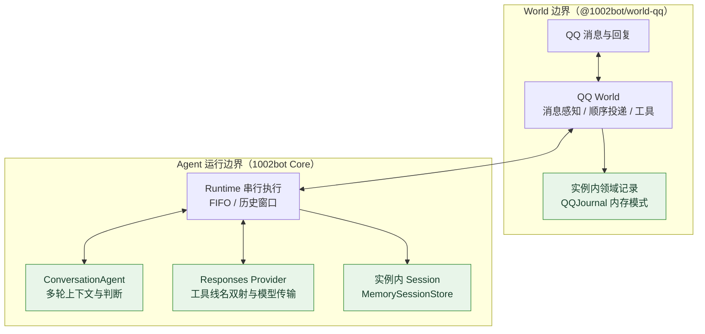
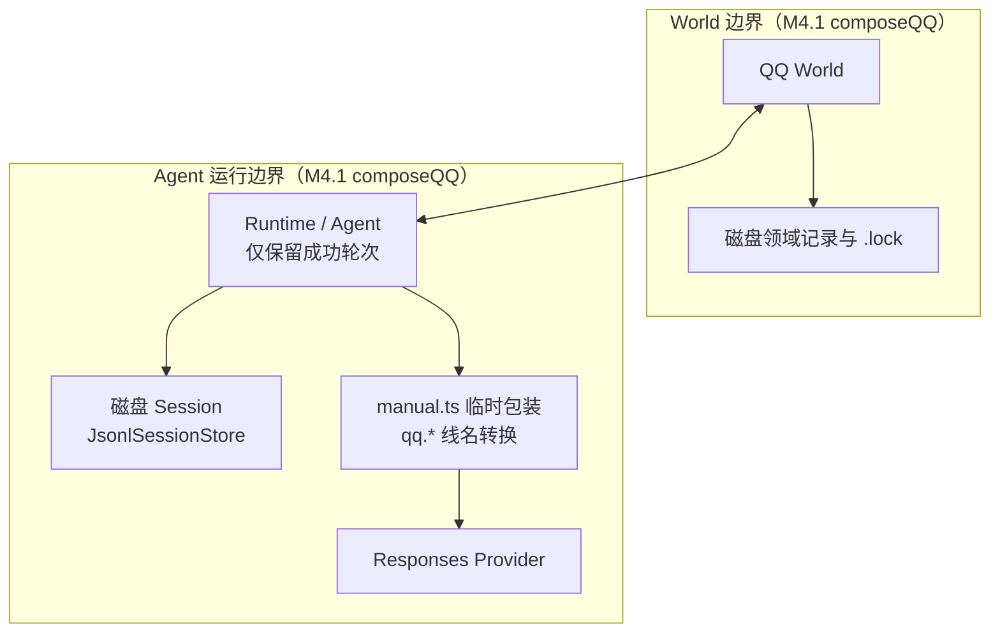
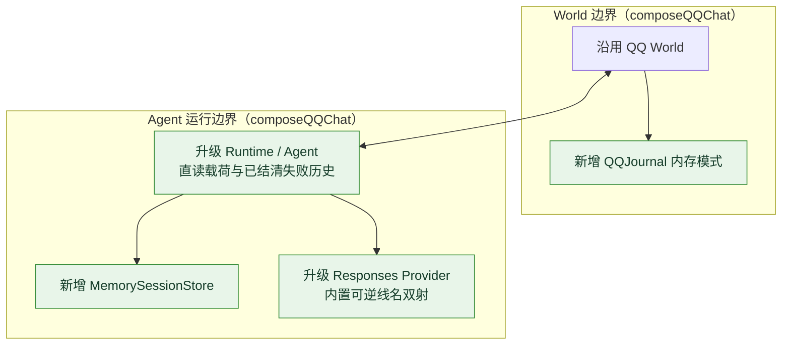
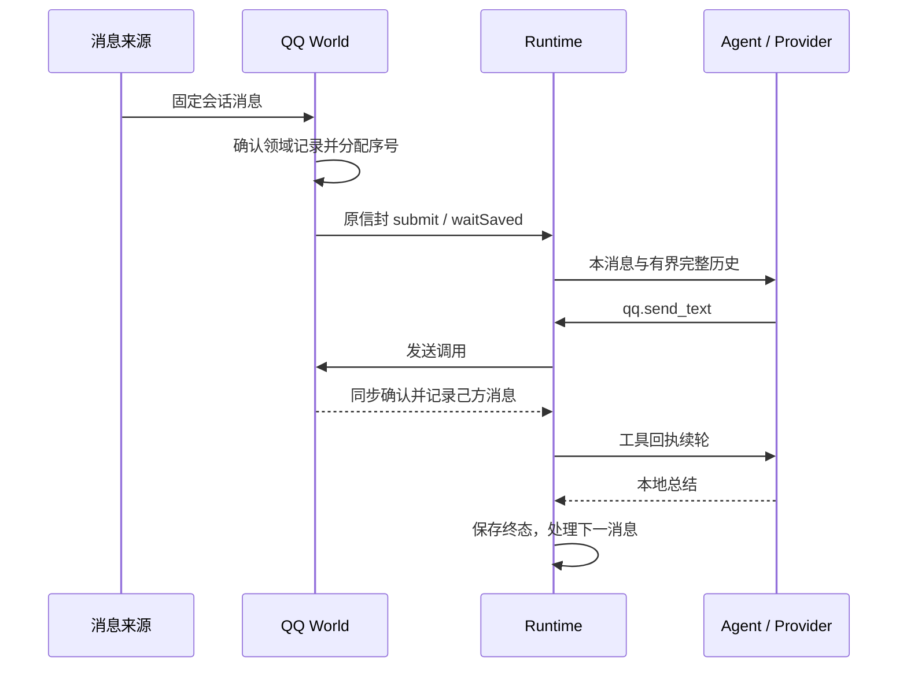
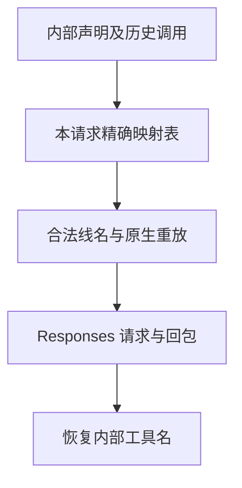

Owner: `src/state/memory-session.ts`, `src/index.ts`, `src/agent/conversation-agent.ts`, `src/providers/openai-responses-provider.ts`, `src/providers/responses-tool-names.ts`, `src/runtime/runtime.ts`, `src/runtime/session-preflight.ts`, `src/runtime/compose.ts`, `src/state/history-window.ts`, `packages/extensions/world-qq/src/config.ts`, `packages/extensions/world-qq/src/journal.ts`, `packages/extensions/world-qq/src/world.ts`, `examples/qq/compose.ts`, `examples/qq/manual.ts`, `examples/qq/chat-offline.ts`, `examples/qq/chat-fixture.ts`, `scripts/run-tests.mjs`

# M5.1 进度与架构图

日期：2026-10-11，实施基线 `main / e33e804`。当前主线实现基线为 [M5.0 跨触发任务与心跳延续](2026-10-11-M5.0进度与架构图.md)（已完成实现、独立审查与交互实测）；下一主线“受控响应”处于讨论阶段，尚未定案或实现。本批作为 M5.0 基线后的独立补充 M5.1，在 [M4.1 QQ World](2026-10-11-M4.1进度与架构图.md) 与 [M4.0 顺序投递基座](2026-10-09-M4.0进度与架构图.md) 之上，按 [M4.1/Agent 对接计划](../scratch/Off-topic%20discussion/2026-10-11-M4.1与Agent基线无持久化多轮对话对接计划.md) 打通首个 QQ World 边界与 Core Agent 运行边界的无持久化多轮消息对话；M5.0 已实现的任务槽位与心跳延续在本装配中暂不启用，留待后续接入。实现与离线自验已完成，负责人已确认代码验收通过；本批人工真实环境验收未进行。

## 交付范围

**固定授权会话的消息可连续触发 Agent 回复，追问读取此前对话，引用读取本会话入站或已发送消息；重建整个装配时会话清空。**

| 交付 | 本批行为 |
| --- | --- |
| 两端纯内存记录 | Core MemorySessionStore 与 QQJournal 内存模式，不创建 Session、领域日志或锁 |
| 多轮对话 | 当前消息直接进入模型事实；发送及引用回查保留现有两项工具 |
| 失败效果可见 | QQ 装配选择完整已结清历史，发送成功后普通模型失败的回复仍可进入下一轮 |
| Provider 编码 | 合法可逆线名，同步覆盖声明、调用、原生重放与回包；内部名称保持 |
| 生命周期 | 同一实例 stop/start 保留；新装配和新进程清空两端状态 |
| 运行入口 | chat 连接部署环境；chat:offline 提供本地交互与自动样例 |

本批仅消息事件，FIFO、单活动项、固定输入边界及 unknown 停止继续成立；默认无任务工具、心跳和抢占。

## 简化总图

箭头表示跨边界与组件间协作；绿色节点为本批新增或升级的模块。整个系统由外围 **World 边界**（`@1002bot/world-qq`）与核心 **Agent 运行边界**（`1002bot` Core）两部分组成，由 `composeQQChat` 统一装配并绑定同一进程内生命周期：

总图中的两个记录端（`World 边界` 内的 `QQJournal` 与 `Agent 运行边界` 内的 `MemorySessionStore`）均由 `composeQQChat` 同步创建。世界消息身份、去重与发送确认归 `World 边界`；触发排队、执行屏障与历史确认归 `Runtime`；多轮上下文组装与回复判断归 `ConversationAgent`；点号工具名与线上协议的双向转换归 `Responses Provider`。

## 组件关系

| 所属边界 / 所有者 | 职责与源码位置 |
| --- | --- |
| 跨边界装配 | `examples/qq/compose.ts`（`composeQQChat`）同时实例化 `World 边界` 与 `Agent 运行边界` 的两个内存端，声明 `persistent=false`、启用 `includeUnsuccessfulHistory` 并对齐超时与容量边界 |
| World 边界 · QQ World | `packages/extensions/world-qq/src/world.ts`、`journal.ts`、`config.ts`：沿用消息过滤、去重、连续编号、发送意图与同步确认，`QQJournal` 支持 `storage='memory'` 实例内记录模式 |
| Agent 运行边界 · Runtime | `src/runtime/runtime.ts`、`session-preflight.ts`、`state/history-window.ts`：沿用接收、执行、终态和追加确认屏障；支持 `includeUnsuccessfulHistory` 将完整已结清失败轮次纳入历史窗口 |
| Agent 运行边界 · Agent | `src/agent/conversation-agent.ts`：直接消费当前 `qq.message` 载荷，按完整已结清组（含已发送成功的失败轮次）组织多轮上下文，并按实际 Provider 请求体预算整组裁剪 |
| Agent 运行边界 · Provider | `src/providers/responses-tool-names.ts`、`openai-responses-provider.ts`：建立请求级可逆线名映射表，编码传输并恢复内部 `qq.*` 工具身份 |
| Agent 运行边界 · Core 存储 | `src/state/memory-session.ts`（`MemorySessionStore`）：串行追加 JSON 记录，提供独立副本及固定长度 `scan`，保持预检与投影原接口 |

## 相比 M4.1 增加了什么

本批直接演进自 **M4.1（QQ World 单轮磁盘基线）**（M5.0 在 Core 主线新增的任务与心跳基座在本装配中保持默认关闭）。结构变化集中在总图的 **跨边界双端存储装配** 与 **Agent 运行边界内的工具线名编码及多轮历史选择** 两处：

修改前（M4.1 `composeQQ` 装配）：`World 边界` 与 `Agent 运行边界` 分别依赖磁盘日志与文件锁；`OpenAIResponsesProvider` 不支持带点号的 `qq.*` 工具名，只能在 `examples/qq/manual.ts` 手动入口外挂临时包装；且 `Runtime` / `Agent` 仅保留 `succeeded` 轮次，先前真实样例的普通消息也出现了冗余 `qq.get_message` 查询：

修改后（本批 `composeQQChat` 装配）：`composeQQChat` 同步创建两端实例内内存存储；工具线名双向编码下沉至 Core `OpenAIResponsesProvider`；`Runtime` 与 `ConversationAgent` 显式开启 `includeUnsuccessfulHistory`，直接消费当轮消息载荷并保留失败轮次中已确认发出的回复：

旧 `composeQQ` 和 `QQConfig` 的磁盘契约继续可用。新 `QQMemoryConfig` 通过 `storage='memory'` 显式选择实例内记录，与 `MemorySessionStore` 共同绑定在同一装配实例上，避免只重置一端造成来源序号与 Session 水位不一致。Core 的工具线名编码由 `OpenAIResponsesProvider` 统一完成，`examples/qq/manual.ts` 的临时包装层已移除。

## 详细关系

### 一条消息与后续追问

当前 qq.message payload 已含文本、发送者、消息号、提及及引用；普通轮次无需重新查询当前消息。仅在需要历史引用时调用 qq.get_message。最终 assistant 文本仍是本地输出，对外发送经过 qq.send_text。

### 工具传输身份

合法内部名称原样保留；不合法名称将标点转换为下划线，遇到重名或超长时加入摘要后缀，映射同时包含历史调用。qq.send_text 通常对应可读的 qq_send_text，名称冲突时也能精确恢复。serializeRequest 与 measureRequest 共用路径，实际 HTTP 字节量可直接对照。原生 reasoning 等不透明项保持，function_call 的名称转换为内部身份后保存在 Session。

旧手动样例曾保存原生线名；重放时用相同 callId 配对的通用调用取得内部名称再编码。既有日志不重写，未知工具仍经现有 Runtime 名称校验。

## 专项报告

### 内存确认与生命周期

MemorySessionStore 在调用边界序列化参数，按串行队列确认；读取返回独立 JSON 副本。scan 在确认后捕获记录条数，之后追加不混入该次扫描。单条或整体容量失败保留在队列上，后续读写一起失败，Runtime 按必要存储故障关闭受理。

QQ 内存记录沿用 exclusive 捕获、原生键冲突、序号、保存前缀和出站意图/结果。相同实例停启保留这些事实；新装配实例共同重建两端空状态。RunResult.persisted 与 waitSaved 的既有字段表示所选 Session 已确认追加；内存确认无法跨进程保留。

### 失败轮次的真实回复

qq.send_text 成功代表已确认的对外回复；之后模型错误不会撤销它。新 QQ 装配在 Runtime 候选窗口和 Agent 选择中均启用 includeUnsuccessfulHistory，使配对完整的已结清失败/取消组可见。Core 其他装配的默认策略仍只选择成功组。

本策略不解除 unknown 或未结清预检阻断。完整组仍受历史窗口和模型请求预算裁剪，无法保证全部旧对话永久在上下文中；本实例领域记录内的消息可通过明确引用回查。

### 容量与上下文

| 容量 | 默认与行为 |
| --- | --- |
| MemorySessionStore | 256 MiB 合计、16 MiB 单条；UTF-8 JSON 行计量，整体失败后关闭后续写入 |
| QQJournal | 256 MiB 合计、4 MiB 预留；原生身份及确认保留到实例结束，超限停止或拒绝 |
| 历史窗口 | 32 个完整组、16 MiB；整组淘汰 |
| Provider 请求 | 64 KiB 硬上限、16 KiB 软余量；计入模型、声明、原生项与工具输出 |

参数可由装配覆盖。序列化字节预算不等于恒定进程 heap、token 或无限会话；本批不做状态自动清理和身份过期。

### 消息与安全边界

QQ 仍过滤自身消息、message_sent、非目标账号/会话及非消息事件。新消息可在活动模型等待时受理，排队原始消息不进入该 run 的续轮，也不自动取消它。发送提交后效果不明继续 unknown、停止后项；fresh 远端查询的证据要求保持，本批主要使用明确标记的本地快照。

## 验证记录

| 检查 | 当前证据 |
| --- | --- |
| 代码验收 | 负责人确认通过（2026-10-12 补记）；本批人工真实环境验收未进行 |
| 内存及 Provider 针对性 | 首轮 16/16，随后线名/旧记录兼容 4/4；输出 scratch/m6-targeted-tests.log |
| QQ 端到端 | 9/9：追问/引用、新实例清空、失败效果可见、实际字节计量、FIFO 隔离、unknown 与容量、过滤/冲突、历史裁剪、独立进程无文件写入；scratch/m6-chat-extended-tests.log |
| 工作区类型 | 最终 pnpm run typecheck 通过，覆盖 Core、TUI、QQ 及装配/跨包测试；scratch/m6-final-typecheck.log |
| 全量回归 | 最终 219/219，0 fail/skip，约 47.6 秒，scratch/m6-final-tests.log。首次 218/219 的旧线名断言已按实际合法声明更新并复核 |
| 交互与样例 | 文档的 pnpm chat:offline --sample 命令通过；实际终端依次 blue/repeat/引用/diagnose/restart/repeat/quit，诊断 ready/35 条/0 问题，重建后回复无历史；scratch/m6-offline-sample.log / m6-interactive-acceptance.log |
| 安装隔离 | 最终离线 core-only 源码 153 pass/1 skip/0 fail，TUI 13/13；真实 core/QQ tarball 的 MemorySessionStore、QQMemoryConfig 运行导出与声明通过，Core 不安装 QQ/ws；scratch/m6-final-package-check.log / package-install-check.json |
| 文档 | 5 图本地 Mermaid/Edge 离线渲染并查看，编码图改为竖向保证可读；7 页、55 个 Owner 和本地链接核对通过；scratch/m6-document-check.json / 2026-10-11-m6-diagrams |
| 2026-10-12 注释与文档复核 | 219/219、0 fail/skip，约 46.2 秒；全工作区类型检查通过。9 个源码文件的有效词法与去注释编译结果对照 `79add4c` 完全一致；5 图离线渲染并查看，7 页 / 55 个 Owner / 17 个本地链接检查通过。证据：scratch/m51-comments-tests.log、m51-comments-typecheck.log、m51-comments-check.json、m51-document-check.json、2026-10-12-m51-diagrams |
| 真实环境 | 本轮未启动真实 QQ bot 或连接真实模型；M4.1 的既有单轮验收不代替本次多轮验收 |

自动检查只脚本化模型决定，使用真实回环 WS/HTTP、QQWorld、Runtime 与内存存储；独立子进程在空目录运行完整样例，结束后目录仍为空。说明和操作命令见 [无持久化 QQ 对话](使用说明/无持久化QQ多轮对话.md)。

## 范围边界

仅单账号、固定会话和消息事件。M5.0 已在 Core 实现的跨触发任务工具与心跳延续继续保留在 Core，本聊天装配默认不启用，定时提醒与跨轮任务槽位留待后续接入 QQ 装配。受控响应、完整工具能力属性、自动抢占、挂起恢复、并行、多会话、优先级、批处理、媒体理解和长期 Memory 尚未实现，分别归属后续主线规划。

内存模式不提供进程恢复、发送恰好一次、unknown 解除或自动重发。QQ/SnowLuma 自身的数据和部署生命周期由外部环境负责。旧磁盘文件不会因 chat 模式被删除、转换或导入。
