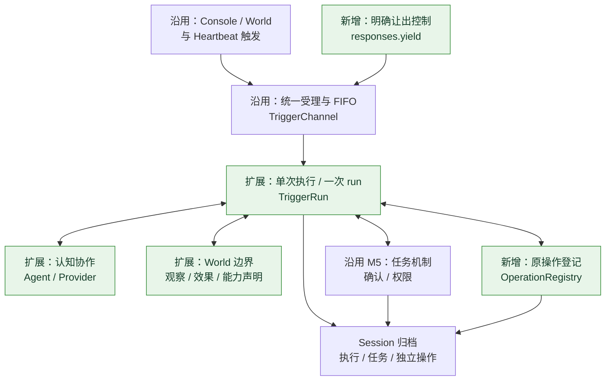
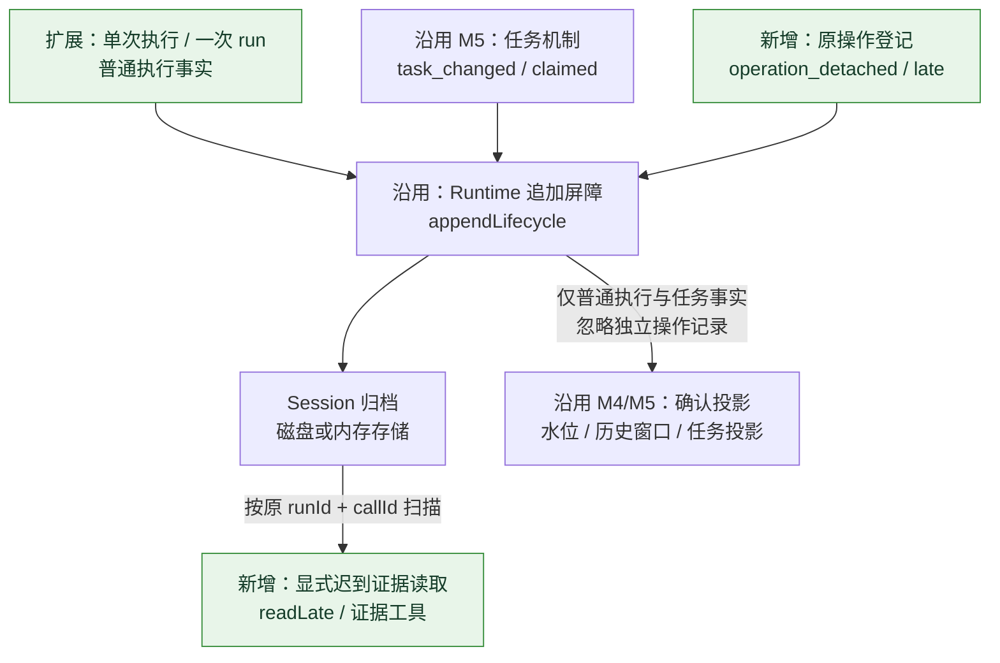
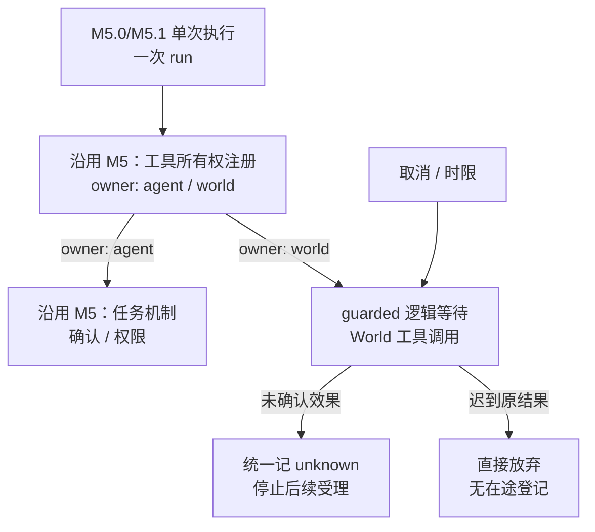
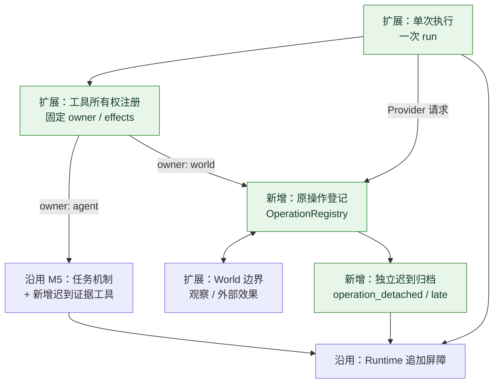
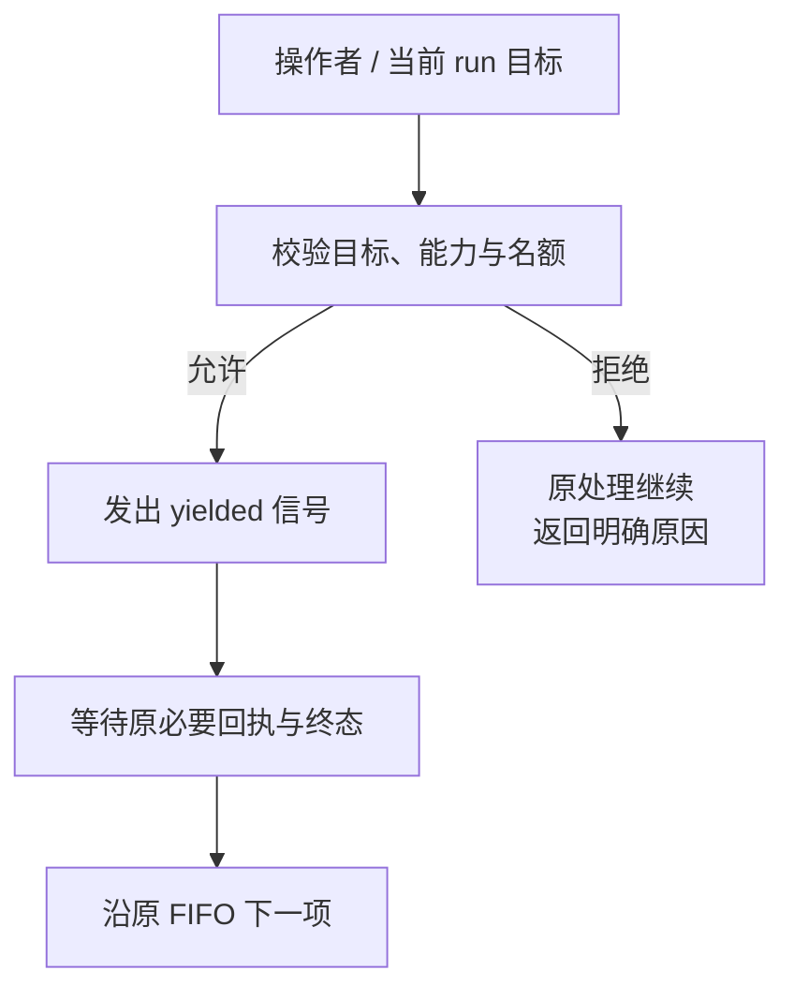
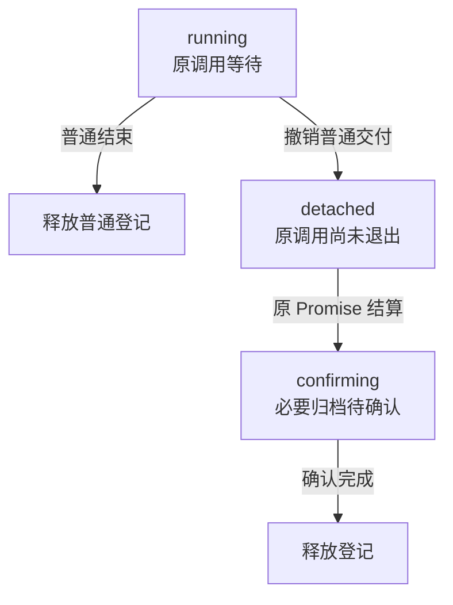
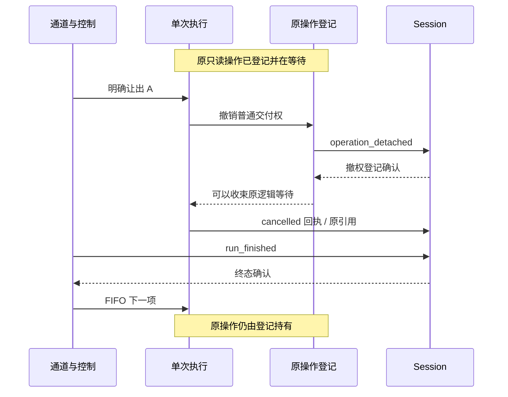
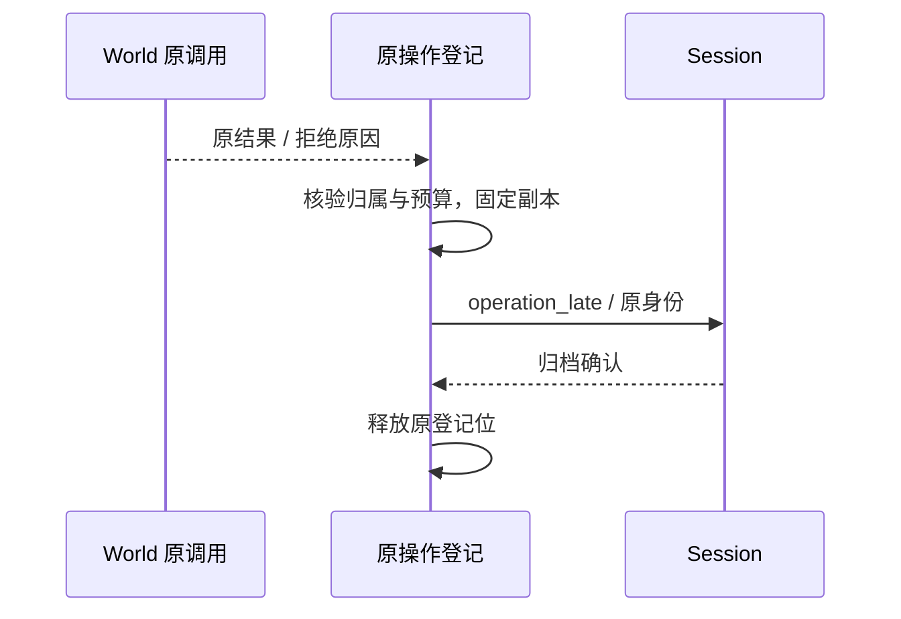
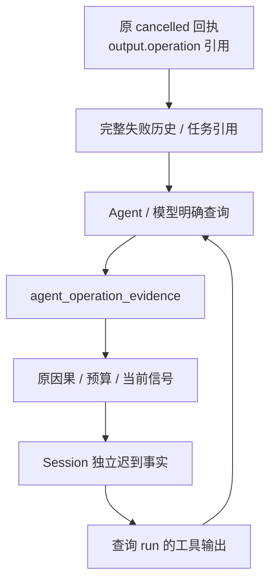
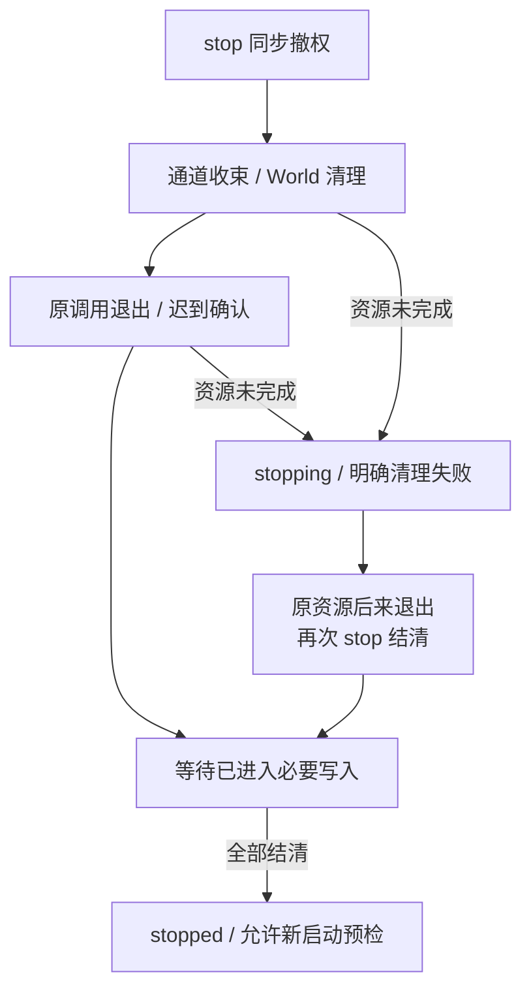

Owner: `src/protocol/responsiveness.ts`, `src/protocol/index.ts`, `src/runtime/runtime.ts`, `src/runtime/compose.ts`, `src/runtime/operation-registry.ts`, `src/runtime/trigger-channel.ts`, `src/runtime/trigger-run.ts`, `src/runtime/tool-registry.ts`, `src/runtime/session-preflight.ts`, `src/state/session-audit.ts`, `src/state/history-window.ts`, `src/state/task-projection.ts`, `src/agent/operation-tools.ts`, `src/agent/conversation-agent.ts`, `scripts/m6-console.ts`, `scripts/check-packages.mjs`, `tests/fixtures/response-world.ts`, `tests/integration/controlled-response.test.ts`, `tests/e2e/controlled-response.test.ts`, `package.json`

# M6.0 进度与架构图

日期：2026-10-12；实施基线 `main / e05e834`，实现提交 `870f46c`。负责人选择推进 Core 受控响应，正式范围见 [实施计划](agent-context/plans/2026-10-12-m6受控响应基座实施计划.md)。继承 [M5.0 任务与心跳](2026-10-11-M5.0进度与架构图.md) 和已完成人工验收的 [M5.1 QQ 多轮对接](2026-10-11-M5.1进度与架构图.md)。**受控响应实现与离线闭环已完成，全量 242/242 通过；2026-10-13 负责人确认自动验收通过，人工真实环境验收尚未执行。** 本页只将实际实现列为交付，安装/文档复核见验证记录。

## 交付范围

**A 等待可信只读观察时，B 可正常受理；操作者明确让出 A，原回执和终态确认后按 FIFO 处理下一项。原 A 晚到的数据独立归档，需要明确查询才交付。**

| 本批交付 | 实际行为 |
| --- | --- |
| 明确控制 | Runtime.responses.yield 以 runId/generation 定位活动项；回执与真正结清分开，普通新消息不取消 A |
| 可信工具能力 | World 声明 effects；每 run 固定 owner/能力，模型参数不能改变。缺省及动作仍保守 |
| 原调用上下文 | World 获得原 Session/run/触发/call 关联，调用记录含能力与 World 身份 |
| 有限操作登记 | Provider/World 进入实际调用前占位；逻辑取消不删除未退出调用，快照区分执行、撤权和确认中 |
| 迟到记录与证据 | 独立撤权/结算，排除普通自动历史；取消只读回执给出原引用，Agent 可明确调用证据工具 |
| 清理与预检 | 未退出资源使 M6 stop 失败并保持 stopping；错配、重复、未结清新记录与既有 unknown 阻断启动 |
| 可交互闭环 | dev:m6、sample:m6 使用实际文件 World/Session 和脚本模型，完成让出、继续、归档、查询与重启 |

`responsiveness` 显式启用本能力，默认旧装配继续沿原路径。共享 Console/TUI 控制协议和 QQ 装配未启用新入口。M6 保持一个逻辑 run、固定输入边界、FIFO 与必要追加确认；没有暂停恢复、自动抢占或任意写操作撤回。

## 简化总图

箭头表示当前功能协作，绿色节点是本批新增或扩展。下图在 [M5.0 简化总图](2026-10-11-M5.0进度与架构图.md) 的功能块（`Console / World 与 Heartbeat 触发`、`认知协作`、`World 边界`、`任务机制`、`Session 归档`）基础上，将 `Runtime` 内部定位为 **`统一受理与 FIFO`**、**`单次执行 / 一次 run`** 与新增的 **`原操作登记`** 三部分，并从外部接入可信操作者的 **`明确让出控制`**：

为明确总图中 `单次执行 / 一次 run`、`任务机制`、`原操作登记` 写入 `Session 归档` 时怎样与 [M4.0](2026-10-09-M4.0进度与架构图.md)、[M5.0](2026-10-11-M5.0进度与架构图.md) 和 [M5.1](2026-10-11-M5.1进度与架构图.md) 的存储及内存投影衔接，下图展开 `Runtime -> Session` 边界，复用前序报告中的 **`Runtime 追加屏障（appendLifecycle）`** 与 **`已确认事实投影`**：

总图中的三处绿色核心变化（**`单次执行 / 一次 run`**、**`明确让出控制`**、**`原操作登记`**）将在下一章逐块展开；它们与前序阶段架构的连接关系如下：

- **沿用 `统一受理与 FIFO`（M3/M4 `TriggerChannel`）并接入 `明确让出控制`**：`Console / World 触发` 与 `Heartbeat` 仍进同一条 FIFO 队列、单活动 `run` 串行消费。`明确让出控制`（`responses.yield`）来自可信操作者，不经过普通触发正文，直接针对当前活动 `run` 校验安全门禁并发出取消信号，原终态确认后再按原 FIFO 推进下一项。
- **并列 `任务机制`（M5.0 `TaskCoordinator`）与 `原操作登记`（M6.0 `OperationRegistry`）**：`单次执行 / 一次 run` 内的 Agent 任务状态提交仍走 M5.0 的运行权限与修订检查；而 `Provider` 请求与 `World` 工具调用在实际发起前先进入 `OperationRegistry` 占用在途名额，逻辑让出后由登记器继续持有未退出的原调用 Promise 与独立归档权。
- **复用 `Runtime 追加屏障（appendLifecycle）` 并隔离 `已确认事实投影`（M4.0 / M5.0 / M5.1）**：普通执行事实、M5 任务控制记录（`task_changed` / `task_claimed`）与 M6 独立操作记录（`operation_detached` / `operation_late`）全部经同一个 `appendLifecycle` 追加到 `Session`（`JsonlSessionStore` 或 M5.1 `MemorySessionStore`）。但独立操作记录不带顶层 `runId` / `delivery`，因此 M4.0 的**来源进度水位**与**完整组候选窗口（`HistoryWindow`）**、M5.0 的**有界任务投影（`TaskProjection`）**以及 M5.1 的**已结清失败历史**均自动忽略它们，仅留在归档中供 `readLate` / `agent_operation_evidence` 按需读取。

## 组件关系

| 所有者 / 模块 | 实际职责与接口 |
| --- | --- |
| Core 协议 / responsiveness.ts | ResponseControl、原身份、容量、快照与 OperationRecord；独立 origin 不携带普通顶层运行权限 |
| Runtime / runtime.ts、compose.ts | 可选装配、原操作生命周期、responses 公开检查/控制、严格清理与写入跟踪 |
| Runtime 通道 / trigger-channel.ts | 比较当前目标、发出明确取消信号、保存原终态后继续 FIFO；旧 cancel 保留强制语义 |
| Runtime 执行 / trigger-run.ts | 读取固定候选、记录本轮事实、固定能力、登记外部等待、仲裁已取得回执与中断 |
| Runtime 声明 / tool-registry.ts | 固定 World/任务/证据工具的归属和能力，重名在模型前拒绝，公共回执头核验 |
| Runtime 原操作 / operation-registry.ts | 在途预算、撤权登记、独立迟到确认、原引用查询、复用清理等待与必要追加故障 |
| State / Audit、HistoryWindow、TaskProjection | Audit 核对新因果事实；后两者继续单普通活动组并忽略独立记录，不维护另一套执行状态 |
| Agent / operation-tools.ts | 可选 agent_operation_evidence；语义决定由模型作出，只读端口受本 run 信号与预算限制 |
| World / 生产或测试实现 | 保证能力和调用资源契约，拥有平台数据、动作、实体/版本域；Core 不解析 QQ/领域状态 |
| 离线入口 / m6-console.ts、ResponseWorld | 操作者控制与实际文件/version 演示；原 Console/TUI 产品继续独立 |

ToolExecutionContext.origin 提供关联而不授予写权。World 工具名线编码、原生 Provider 项重放和原输入受理身份机制继承 M5.1/M4，没有另建模型循环。

## 相比 M5.0 / M5.1 增加了什么

### 在总图的“单次执行 / 一次 run”处展开

修改前（M5.0 / M5.1）：`单次执行 / 一次 run` 通过 M5.0 的 `工具所有权注册` 将调用按 `owner: 'agent' | 'world'` 分流；`owner: 'world'` 直接走 `guarded` 逻辑等待。活动项取消或超时时直接结束逻辑等待，已进入 `World` 的未确认效果统一记为 `unknown` 并停止通道，逻辑结束后的迟到原结果直接放弃，没有可信能力门禁与在途资源登记：

修改后（M6.0）：在 `工具所有权注册` 上固定可信 `effects: 'none' | 'external'` 声明，并将 `agent_operation_evidence` 并入 `owner: 'agent'`。`Agent` 工具仍走确认权限与只读查询；`World` 与 `Provider` 外部等待先进入 `原操作登记` 占位，只读调用撤权后由登记器独立归档，当前执行不接续它：

Provider 同样经过登记；旧回包只产生有限诊断，不能在取消后执行其工具。工具头核验包含标识、名称和状态；真实写入后返回非法状态也按未确认效果收束，不能继续后项。

### 在总图的“明确让出控制”处展开

新增的安全让出和既有强制 cancel/stop 不同。动作正在等待回执时，安全控制拒绝，让它继续；强制取消仍有可能 unknown 并停止。只读能力必须由可信实现审定，不以工具名、模型解释或参数作推断。

requested 只是控制请求已发出；run_finished 才证明原项结清。目标已变、正在收束、关闭受理或容量不足均拒绝。若更早排队的是 C，A 结束后仍先执行 C，不为请求中的 B 插队。

### 在总图的“原操作登记”处展开

以前逻辑等待结束后没有外部未决预算。本批保留原 Promise 和归档所有权，避免反复取消累积无限后台调用。图只表示登记位；普通动作安全门禁另外等待回执验证。

普通结束释放本地调用登记，效果分类仍要匹配实际回执。撤权条目需等迟到事实确认；confirming 不等于完成。名额与 serialized pending 字节都有上限，不用时间戳或 TTL 假定资源退出。

## 详细关系

### 一个只读 A 与 FIFO 后项

图示展示一种晚到时序。迟到事实也可能在原终态之前确认；“晚到”指已经失去普通交付权，两个确认链不要求固定总顺序。Header 已取得时仍保存真实回执；控制不把成功改成“未执行”。撤权登记写入阻塞时，A 不结清，后项不调用模型。

### 原操作结束后的独立确认

此路径没有向当前执行器交付结果的箭头。单条超限明确保存 discard，原调用已退出而写入未完成时快照为 confirming。

### 明确证据怎样进入新判断

引用只提供身份；没有确认证据时 found=false。迟到记录不自动加入当前/未来的普通组。模型明确查询后，该工具输出成为查询 run 的真实事实，可随后按既有整组规则进入历史。查询数据仍受实际 Provider 请求预算；不能因为查询成功就声称整条一定能装入模型。

### 停止、物理退出和新代

重复 stop 共用尚未完成的 World 清理和登记等待。资源超时不改写事实，不删除原 Promise，不宣布成功，也不启动新代。独立归档只在 Runtime 原登记权仍有效的运行/停止期提交；完整停止后没有旧回调写权。必要 Session 写入永不返回时仍等待，这不是资源期限可以解决的状态。

## 专项报告

### 可信能力与取消结论

effects=none 表示工具不改变外部业务状态；未声明或 external 表示执行中的效果尚需实际回执确认。模型只决定调用，不能给参数追加“只读”标记来获得让出权限。声明与名称/owner 一起固定，World 收回本次调用独占的本地等待资源后才结算 Promise。

共享连接属于 World 生命周期。名额追踪本地适配器持有的调用，不能证明远端查询、生成或计费已经结束；Signal 只是协作请求。迟到错误来自纯只读调用时保留诊断并允许其他合法处理；错配或 declared read 返回 unknown 时停止并保留审计阻断。未知动作晚到成功不会自动解除原 unknown。

首版没有以 cancellation 枚举宣称可靠撤回：只读可以结束逻辑等待，退出证明来自原 Promise 和本地资源契约，未退出继续占位。具有可靠结清证据的动作如何让出，仍属于后续工具协议范围。

### 五种事实分开

| 事实 | 实际证明 | 不自动证明 |
| --- | --- | --- |
| yield requested | 操作者控制已发出 | 原 run 已结清或 B 已开始 |
| 普通 cancelled / run_finished | 原逻辑处理已中止并确认终态 | 原本地调用/远端服务已退出 |
| 快照 confirming | 原 Promise 已结算，归档仍待确认 | 登记位已释放、记录已可靠保存 |
| LateResult returned | 取得与原调用匹配的 ToolOutcome | 工具业务 succeeded；实际 status 在 outcome 内 |
| 明确查询成功 | 本 run 已取回完整预算内证据 | Task completed、新动作应重试或最新版世界事实 |

一个已认领安排在 A 让出后仍消费，Task 可以保持 waiting；后续 Heartbeat 不自动续跑它。Agent 若需继续，查询最近尝试/明确证据并设置新安排。原任务提交和已发送动作不因新控制回滚，late 也不替换 task effectAttempt。

### 原身份、历史与审计

原 World 调用用 Session/runId/generation/callId 关联，记录真实 worldId、toolName 和 effects；Provider 用原 run 与轮次。generation 不承担任务安排身份。origin.source 是原触发来源，worldId 是实际工具实现所属 World，两者不混用。

operation_detached 与 operation_late 使用 schema=1，顶层没有旧 run/generation/trigger/delivery 权限。Audit 先核对当前原调用和能力，再跨越普通终态追踪撤权结算。迟到记录错配、重复、缺失或 unknown 均可诊断，问题带原 run/触发身份。新实例只读重建，不恢复旧 Promise，不自动重放动作。

HistoryWindow 与 TaskProjection 的普通单活动组保持；独立记录不重新打开 A，不把 B 的组切走、不推进已结清来源。M5.1 的失败/取消完整历史选择继续有用，但不意味着独立迟到数据自动进入其中。

### 固定输入、版本与领域复核

B 在 A 等待期间仍可受理、启动 trigger_received 追加，但原始排队事实不交给 A。让出后按 FIFO 选择的新 run 可使用它自己的明确观察工具；不会从队列正文猜优先级。

测试 World 的主动读和被动推送共用 entity/epoch/version 结构，并真实保存文件。版本 1 的推送先确认后，版本 0 的原读结果晚到只保留旧观察，不能覆盖 World 最新视图。Core 没有实现任意 World 共享的最新缓存，投递序号/时间戳/QQ 消息号也不是通用状态版本。

不可撤回动作前的业务条件复核继续由 World 的工具或版本前置条件定义，模型决定调用，World 校验条件。固定输入和受控让出都不能单独证明条件仍有效；本批不向 QQ 发送增加撤回承诺。

### 容量、失败与实例寿命

| 边界 | 标准值及行为 |
| --- | --- |
| 登记条目 | Provider/World 在途及确认中合计 3；发起前超限失败 |
| 主动让出 | 最多留下 2 个未退出调用；满时拒绝控制；强制停止受总条目上限 |
| 独立记录 | 完整 JSON 对象 32 KiB，待确认合计 128 KiB；不含具体 Session 的行终止符 |
| 显式证据 | 完整记录 32 KiB，超限整体拒绝；之后另计入 Provider 实际请求 |
| 既有预算 | 历史整组裁剪、请求硬上限、工具/轮次期限、Session 单条/累计容量继续生效 |

超大观察只保存有界 discard 原因和身份；生产方及查询方修改对象不会改写已确认事实。必要撤权或迟到写失败关闭受理，存储故障不被取消原因覆盖；恢复预检继续阻断缺失确认。以上预算不是总 heap、远端并发、token 或内部存储 I/O 的绝对期限。

MemorySessionStore 和 JSONL 共用新协议。新内存实例不承诺进程恢复；JSONL 追加确认仍没有 fsync 或多记录事务保证。没有自动数据清理、数据库、检查点或累计操作身份集合。

## 验证记录

| 范围 | 已有证据与限度 |
| --- | --- |
| 首批与扩展 | 8/8、16/16，再到 20 项集成 + 2 项子进程/终端 22/22；日志 scratch/m6-targeted-fourth.log |
| 原引用与可见性 | 22/22 复核通过，模型从取消回执取得原引用再明确查证，确认中快照、副本隔离通过；scratch/m6-targeted-reference.log |
| 最终全量 | 242/242、0 fail/skip，约 49.5 秒；含真实写入后非法回执状态的 unknown 收束，兼容 QQ/TUI/旧任务与来源；scratch/m6-final-tests.log |
| 完整类型 | 最终 pnpm run typecheck 通过，覆盖 Core、TUI、QQ、样例与跨包测试；scratch/m6-final-typecheck.log |
| 可交互闭环 | 实际子进程管道命令通过：观察 A、受理 B、推送 7、yield、释放/结算、诊断、stop/start、再输入；日志见 targeted 端到端输出 |
| 自动样例 | A cancelled/yielded/persisted；B succeeded/persisted 读取 version=1/value=7；原 A version=0 只经明确工具读取；ready/36 条/0 问题，Runtime running；scratch/m6-final-offline-sample.log |
| 旧样例兼容 | M1 写入 1 并停止；M3 混合来源、M4 重复/新序号重建、M5 waiting/一次认领/completed 均运行通过；scratch/m6-compat-m1.log / m3.log / m4.log / m5.log（各文件使用 m6-compat- 前缀） |
| 原操作/存储故障 | 真文件写后 unknown；provider 晚到动作不执行；撤权写入阻塞/失败、迟到写失败、清理失败/重试、旧目标、重复归档、任务认领后让出、版本覆盖与容量均实际验证 |
| 独立读取 | 样例子进程退出后，另一进程只读新日志：ready、原迟到身份可查、Runtime 保持 new、世界文件仍为 7；不启动旧工作 |
| 安装隔离 | 最终离线 Core-only 176 pass / 1 skip / 0 fail，TUI 13/13；Core/QQ 真 tarball 运行和类型通过，新 response API 的让出、迟到证据、快照阶段已验证，Core 无 QQ/前端依赖；scratch/m6-final-package-check.log / m6-final-package-install-check.json |
| 文档 | 10 图以本地 Mermaid/Edge 离线渲染并查看，过宽时序拆成正常收束与独立确认两个主题；Owner、链接及章节顺序由 scratch/m6-document-check.json 核验；图形 scratch/2026-10-12-m6-diagrams |
| 注释复核（2026-10-13） | 13 个 TypeScript 文件的非注释 token 与去注释 JavaScript 同 `870f46c`；提交前全量 242/242 和全工作区类型检查通过。原操作契约、容量、迟到证据与停止清理注释已补充；证据 scratch/m6-comments-check.json、m6-comments-tests.log、m6-comments-typecheck.log；10 图再次离线渲染并查看，图形 scratch/2026-10-13-m6-comment-diagrams |
| 自动验收 / 人工 | 2026-10-13 负责人确认自动验收通过；人工真实环境验收尚未执行。M5.1 的人工验收不替代 M6 验收，本轮未启动真实 bot 或连接实际 Provider |

实现采用真实 Session/World 文件、独立临时进程和需要的原有回环端口；只有模型决定脚本化。不能用旧阶段 219/219 或初版 241/241 代替本轮原引用补齐后的 242 项。

## 范围边界

首批没有自动抢占、优先级、防饥饿、消息批处理、多活 run、暂停恢复、并发工具调用、通用 Observation 缓存、长期 Memory、unknown 解除、动作恰好一次或跨进程锁。优先级与批处理继续是后续目标。

QQ 任务/心跳与生产响应性接入继续独立验证，默认 QQ 多轮装配保持。若下一批紧接本主线作独立 QQ 集成，沿 M6 基线编号为 M6.1；讨论中的 M5.2 仅对应“先 QQ、后 M6”的另一顺序，不作为已冻结名称。

操作与升级顺序见 [M6 受控响应与迁移](使用说明/M6受控响应与迁移.md)。本批完成的是 Core 可交互离线基座；实际部署工具能力和真实环境取消/资源契约仍需逐实现审定。
