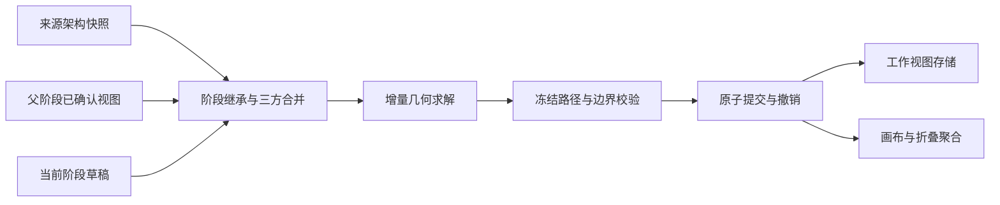

# Visualization P0/P1 几何与快照验收

## 交付范围

2026-11-01，以 `7ae4a49` 为修复基线，完成增量阶段布局、确认快照继承及冻结黑盒的功能修复。自动化与原生浏览器功能验收通过；拖动性能仍未达到稳定 60 FPS，负责人最终验收待进行。

## 简化总图

箭头表示内容输入及提交方向；冲突结果返回只读候选，现有工作视图保留。

## 组件关系

| 责任 | 实现位置（相对 packages/visualization） | 交接内容 |
| --- | --- | --- |
| 稳定 ID 与阶段差异 | `src/core/graph/diff.ts` | 新增、删除、替换及父阶段 |
| 共享几何求解 | `src/react/model/placement.ts`、`hierarchy.ts` | 位置、尺寸、内容锚点与失败结果 |
| 继承与合并 | `stage-navigation.ts`、`snapshot-inheritance.ts` | 父确认、来源、生成基准与草稿 |
| 冻结几何 | `frozen.ts`、`blackbox-routes.ts`、`edge-routes.ts` | 内部坐标、Canonical 路径、刚性边界段 |
| 路径缓存 | `route-cache.ts`、`display-route-snapshots.ts` | 端点几何、障碍版本与显示路径 |
| 操作事务 | `src/react/canvas/use-workspace-session.ts`、`use-canvas-controller.ts` | 保存、确认、撤销与阶段切换 |
| 数据与存储装配 | 独立 progress-reports adapter、Playground | 真实报告数据与 localStorage 适配器 |

## 相比上一阶段增加了什么

对照 `7ae4a49`，阶段切换已从旧展开推动逻辑迁入共享几何求解。既有叶节点保持世界坐标，容器通过 `fitOffset` 保持内容锚点；新节点先填空隙，再按自然尺寸每轴增加最多 800px 的固定预算扩容。预算不会随每次成功扩容累加。

快照继承增加父确认内容、目标来源图与生成基准。来源和父确认未变化时恢复草稿；变化时三方合并独立编辑，受保护对象发生不兼容修改时返回冲突。自动路径作为派生缓存处理，人工路径与冻结账本按用户约束处理。

冻结从可见节点与路径扩展到全部 Canonical 关联边，包括折叠隐藏内部边。跨边界连接保存端口及内部刚性段，外部段单独求解；折叠时将隐藏内部障碍压缩为完整保护框。

## 详细关系

### 阶段几何

`planStageTransition` 读取父确认内容，按 StageDiff 创建增量集合，调用 `placeAddedNodes` 安置，再进行节点、路径与冻结边界校验。成功结果才交给会话提交；失败候选不会写入目标草稿。

手动展开与阶段安置共用 `fitChain`，手动展开可在约束允许时调整局部自由兄弟。固定节点、锁定节点及冻结成员均参与障碍约束。目标草稿恢复后逐项同步共同节点展开状态，冲突分支保持目标状态；承载增量所必需的展开保留，冻结容器跳过同步。

### 确认与恢复

草稿、确认内容及继承基准独立保存。v1 迁移保留节点视图并生成未确认草稿。确认、切换、刷新与来源修订通过稳定 ID 对齐实体；来源删除固定或冻结对象时产生明确冲突。

自动显示路径保存障碍签名，签名随被选中的路径几何一起继承。障碍变化后重新校验路径；本地路径编辑与上游新增硬障碍并发时，旧路径失效并重算。人工点列、冻结账本仍受严格三方合并约束。

### 冻结路径与历史

内部点列、标签及边界段均相对 owner 原点保存。整体移动更新根位置，内部相对坐标不变。折叠移动时先虚拟恢复冻结框尺寸，对隐藏端口进行连接预检；展开恢复保存尺寸及路径。单点边界端口可持久化恢复。

边界求解失败向阶段切换与合并入口传播，阻止提交。经障碍版本核验的已确认交叉可复用；普通占位路径和旧 Canonical 路径须重新校验硬障碍。

解冻恢复冻结前的约束及人工路径，并保留其他冻结组的边界段。离散操作和历史跳转先捕获当前显示几何，保证解冻撤销恢复操作前的实际路径。

## 专项报告

### 真实报告阶段链

原生 Edge 使用实际公共画布、实际 progress-reports 数据及本机存储适配器，独立端口 5205 与存储键隔离验收。成功链路的 M1 预先整理为根层间距 2200×1700px、展开框 1360×640px，全部 M1 节点固定。随后逐阶段确认并进入下一阶段。

| 目标阶段 | 增量求解 ms | 复用路径 | 寻路数量 | 显示边总数 |
| --- | ---: | ---: | ---: | ---: |
| M2.0 | 37.5 | 10 | 12 | 22 |
| M2.1 | 53.0 | 21 | 10 | 31 |
| M3.0 | 76.4 | 17 | 18 | 35 |
| M3.1 | 38.5 | 35 | 5 | 40 |
| M4.0 | 88.0 | 33 | 16 | 49 |
| M4.1 | 95.7 | 49 | 15 | 64 |
| M5.0 | 267.2 | 59 | 15 | 74 |
| M5.1 | 196.5 | 68 | 18 | 86 |
| M6.0 | 794.4 | 70 | 33 | 103 |

求解耗时为模型转换记录，不含整页渲染和输入自动化耗时。模型回归逐阶段比较全部继承内容锚点，位移为零。默认紧凑 M1 固定 Runtime 后进入 M2 成功；紧凑布局中 M2→M3 因固定卡片夹住新增展开区域而原子阻止，现有布局保留。空间约束场景与成功链路分别验收。

### 冻结与持久化

M6 Runtime 冻结包含根及后代共 25 个节点。收起 Runtime 后，显示边从 103 减至 72；内部 Canonical 点列仍保留。完成折叠整体移动、只读展开、解冻及撤销。

最终 Edge 验证解冻撤销前后 81 个节点几何与 103 条 SVG 路径逐项一致；刷新、M6→M1→M6 往返及新独立标签页恢复亦一致，控制台 error 为空。来源修订与上游/草稿冲突由模型用例覆盖。

## 尚未完成的整体结构

本期性能目标仍有缺口。原生 Edge 冻结折叠黑盒拖动记录 7 帧，帧间隔 P95 为 1025ms，完整几何计算 P95 为 24.8ms，约束与隐藏边界预检 P95 为 73.8ms；每次最多重算 39/72 条显示边。IAB 的另一轮记录帧间隔 P95 1006.2ms、几何 P95 35.9ms、约束 P95 34.5ms。约 1 秒帧间隔可能含浏览器遮挡节流，完整计算开销也已超过 16.7ms。

稳定 60 FPS 验收保持未通过。后续仍属 P0/P1 性能收口：在前台窗口复测，压缩冻结连接预检与外部段重复计算，再以相同 M6 场景复验。P2–P4 保持未启动。

## 验证记录

2026-11-01 最终执行：

- 包级测试 199/199，通过；覆盖真实阶段链、三方合并、硬障碍缓存失效、隐藏路径、边界失败、约束和恢复。
- 包级 Core/Web/Playground 类型检查通过；库构建校验 111 个 JS/声明/样式产物，站点构建通过。
- 全仓测试 242/242、4 suites，通过；全仓类型检查通过。根测试在允许临时 Git 仓库与回环端口的环境执行。
- 原生浏览器通过 Computer Use 在 Edge 验证；几何与路径相等比较基于实际 DOM，未读取 React 私有状态。
- 独立子代理最终审查发现缓存签名来源与冻结边界 fallback 两项问题，修复并增加行为回归后复核通过。
- 正式 5199 入口重新启动，页面正常、控制台 error 为空。保留原工作视图，验收夹具独立存储。

证据：`.scratch/visualization-closure-{tests,types,build,web}.log`、`.scratch/visualization-closeout-root.log`、`.scratch/visualization-closeout-root-types.log`、`.scratch/visualization-p0p1-edge-results.json`、`.scratch/visualization-p0p1-edge-final.png`、`.scratch/visualization-p0p1-primary-final.png`。一次浏览器旧标签调试连接失效后，使用同浏览器新标签完成独立恢复与截图。

## 范围边界

本轮只修复 P0/P1。后续顺序为 P2 用户覆盖层及自定义连接，P3 自动端口与统一代价函数，P4 局部多边协同路由。尚未实施这些能力；冻结黑盒当前为单层，报告模块内部结构仍可递归展开。

## 提交与归档

独立提交：`ed498f6`（增量几何）、`c034997`（快照继承）、`0d8ef64`（冻结完整路径）。最后的验收纠错、共享展开及记录归档另作收尾提交。

本轮接手计划原文复制至 `history/plans/2026-11-01-visualization-p0p1-takeover.md`。任务记录快照为 `finish-task/2026-11-01-visualization-p0p1-closure-snapshot`，索引标记原记录已归档并保留原件，逐件 SHA-256 校验。原 Deepseek 计划及其既有历史副本保持不变。

补充验证：`pnpm check:packages --store-dir D:/.pnpm-store` 通过，覆盖 Core/TUI 独立源码与 Core/TUI/QQ 打包消费；Core 独立源码176通过、1跳过，TUI独立源码13通过。首次默认离线缓存缺少 strip-ansi，改用当前仓库已记录的 D 盘缓存后通过。日志 `.scratch/visualization-closure-packages.log`。接手计划与归档副本 SHA-256：`af58a00d21034fb782bc40321c33b3e6c238f3fa061cbbbd4f2b9b82e48ebba5`。
