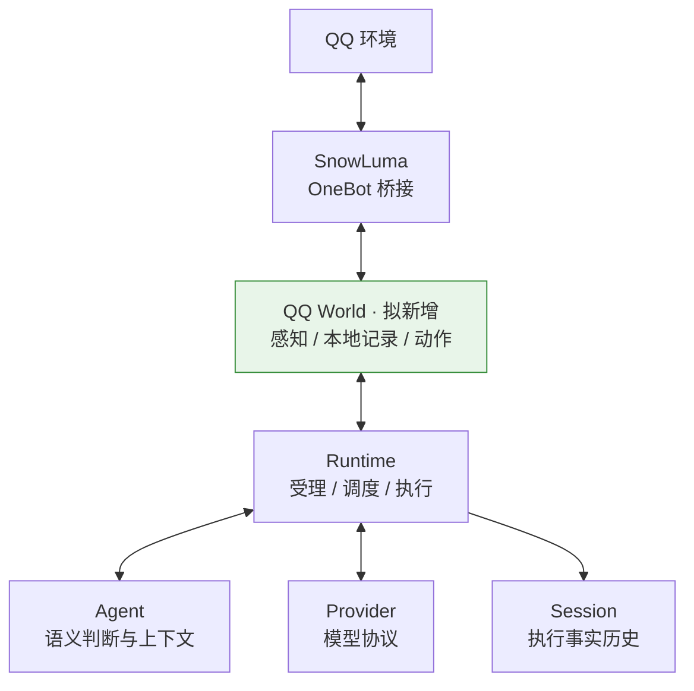
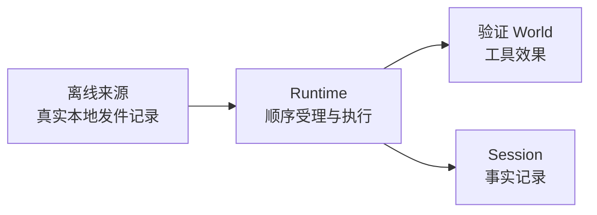
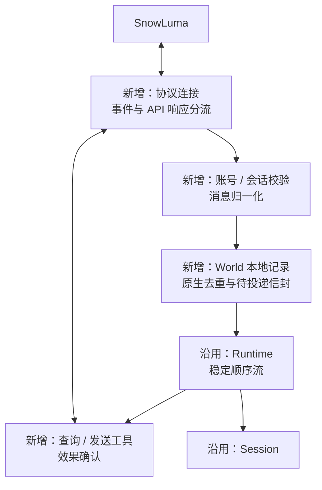
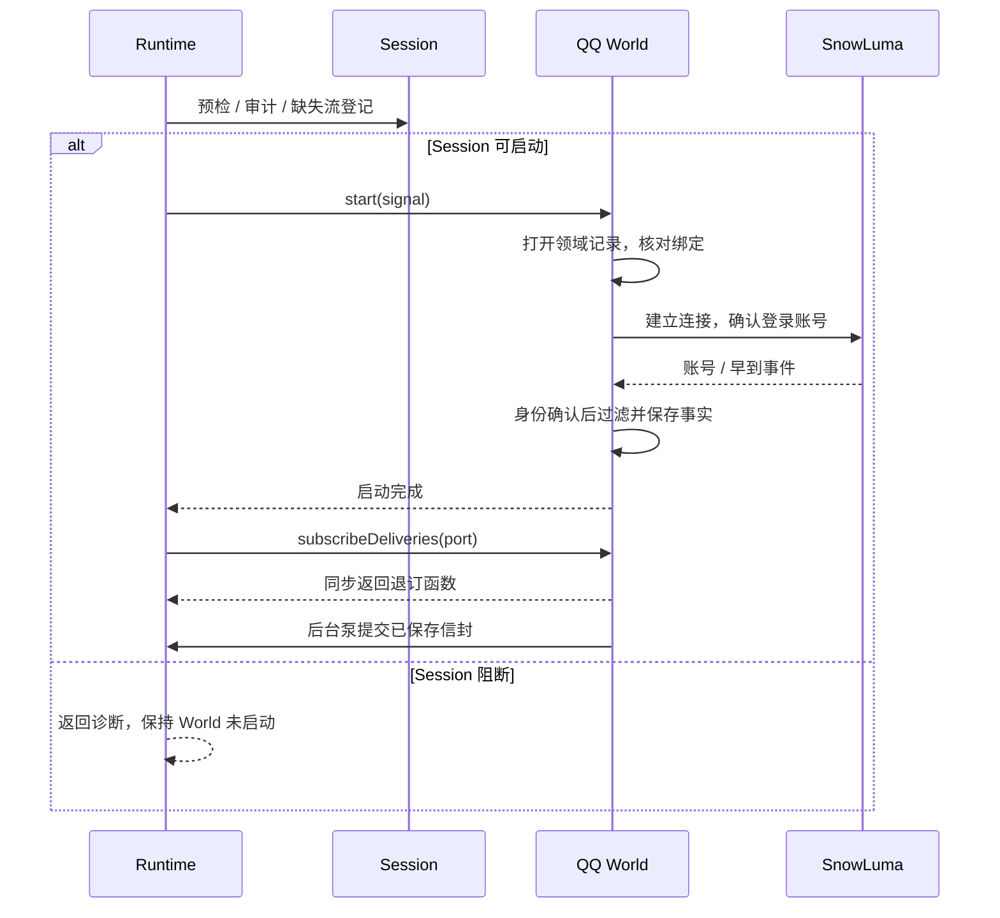
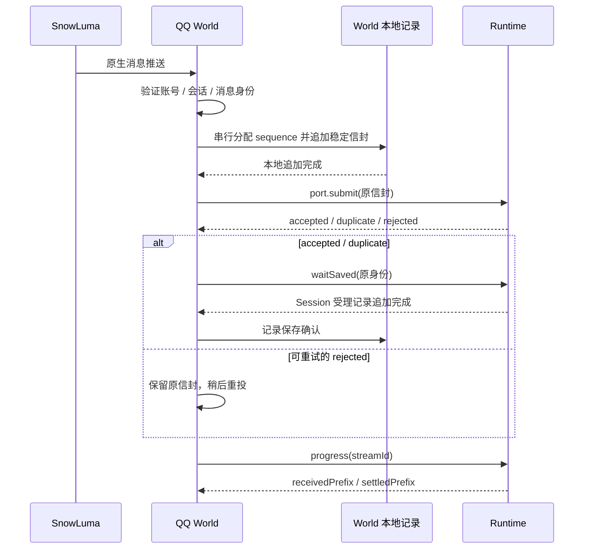
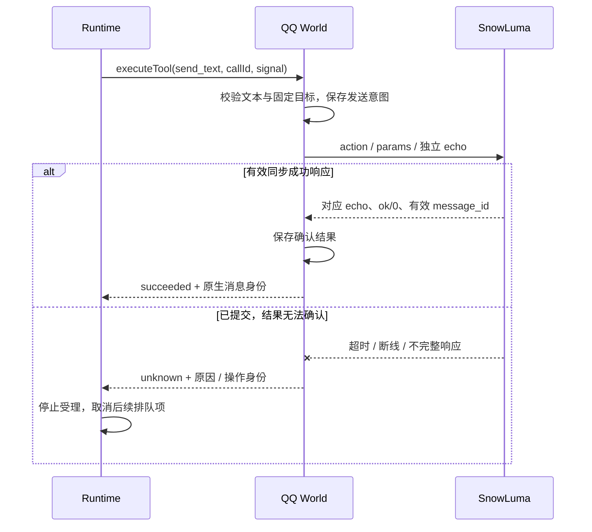

Owner: `src/protocol/index.ts` 的 `World` / `ToolOutcome`，`src/protocol/delivery.ts` 的 `WorldDeliveryPort`，`src/runtime/runtime.ts`，`src/runtime/compose.ts`

# World 职责与 QQ World 首批接入边界设计

归档说明（2026-10-12）：本页保留 QQ 承建前的 M4.0 边界与交接设计快照。后续 QQ World 已在 [M4.1](../../../2026-10-11-M4.1进度与架构图.md) 实现，纯内存多轮对接已在 [M5.1](../../../2026-10-11-M5.1进度与架构图.md) 完成人工验收；下文的候选范围和未完成项描述当时状态，当前实现与验收以对应阶段报告为准。

基线日期：2026-10-11；当前主线 `main / 03570784d4c1f8323ebf8de189f9da924b3510e5`。负责人已确认 M4.0 提交链 `a28c1a1 → db4c736 → 0357078` 完成独立验收。本页说明现有公共边界，并提出首个生产 World 的承建范围；QQbot 为已确认目标，SnowLuma 为拟用桥接，Cortico、AstrBot 为参考。QQ World 尚未实现、建分支或联网验收。

## 交付范围

首批建议完成一个可交互闭环：**一个 QQ 账号、一个固定授权会话，收取文本事实，模型按需查询已知消息，通过显式工具发送文本，确认结果并留下记录，能够停止和重新连接。** 固定会话由配置选择群聊或私聊，模型不能自行选择其他收件人。先形成完整闭环，再按可审查增量拆分交付。

| 工作线 | 当前事实与下一步 |
| --- | --- |
| M4.0 基座 | 已完成顺序投递、保存确认、连续结清、Session 启动预检与有界历史视图；验收来源和证据见 [M4.0 报告](../../../2026-10-09-M4.0进度与架构图.md) |
| 通用主线 | 继续维护 Runtime / Agent / Provider / Session；[M5 候选计划](../../plans/2026-10-11-m5持续任务与心跳延续候选计划.md) 尚未冻结或实施 |
| 生产 World 线 | 拟由其他 AI 在独立分支承建 QQ 适配包、装配样例、领域存储和验收材料；本报告是交接依据 |
| 两线依赖 | QQ 首批依赖现有 M4 公共契约；M5 可使用离线 World 验证。两线分别验收，联动能力另列集成验收 |

首批工具建议收敛为 `qq.get_message` 和 `qq.send_text`。前者查询本 World 已捕获或已确认发送、且属于固定会话的消息；后者发送纯文本到固定会话。模型最终文本进入现有 Runtime 公开输出，QQ 消息由发送工具产生。完成首批不要求任务数据库、长期 Memory、多会话调度或专用 QQ 控制台。

## 简化总图

箭头表示功能协作；绿色块是本次拟新增的结构。SnowLuma 是外部桥接服务，QQ World 是项目内的领域适配包。

World 将环境事实交给 Runtime，并执行 Runtime 发起的工具调用。Agent 判断收到事实后是否行动；Provider 承担模型通信。SnowLuma 的公开说明支持 QQ 到 OneBot v11 的动作与事件转换，首批建议使用正向 WebSocket 的事件/API 合并端点。实际端点、鉴权、已安装版本和动作覆盖由承建方核实，不沿用参考项目的端口常量。[SnowLuma 官方仓库](https://github.com/SnowLuma/SnowLuma)、[OneBot WebSocket 契约](https://github.com/botuniverse/onebot-11/blob/master/communication/ws.md)

## 组件关系

| 组件 / 所有者 | 拥有的职责 | 对外边界与实现位置 |
| --- | --- | --- |
| SnowLuma / 部署方 | QQ 登录、平台连接、OneBot 服务 | 外部进程；首批由部署方启动，World 不管理 QQ 客户端或注入器 |
| QQ World / World 承建方 | 连接、账号确认、授权会话过滤、消息归一化、稳定投递记录、动作校验与回执、资源清理 | 拟建 `packages/extensions/world-qq`；实现公共 `World` |
| Runtime / 主线 | Session 预检、代次、FIFO、单活动处理、时限、保存屏障、unknown 停止、公开诊断 | `src/runtime/`；调用 `start` / `stop` / `executeTool`，装配 `subscribeDeliveries` |
| Agent / 主线 | 指令、事实解释、完整历史选择、行动判断 | `src/agent/`；接收 Runtime 提供的事实和工具声明 |
| Provider / 主线 | 模型请求、响应、原生协议重放 | `src/providers/`；不持有 QQ 平台连接 |
| Session / 主线 | 受理与执行事实、终态、流登记与水位重建 | `src/state/`；不是 QQ 消息库或发送重试队列 |
| 装配入口 / World 承建方 | 配置、固定账号/会话与 Session 绑定、依赖构建、手动运行方式 | 拟建 `examples/qq`，通过公共导出使用 core 和 World 包 |
| Console / 既有独立工作线 | 本地输入、结果与诊断展示 | 复用现有公共接口；首批不依赖 TUI 改动 |

World 通过 `start(signal)`、`stop(signal)`、同步 `subscribeDeliveries(port)`、`tools()` 和 `executeTool(call, context)` 接入。每个工具回执必须匹配原 `callId` 和工具名；原生异步响应用于完成该调用的 Promise。现有契约没有供 World 任意追加执行结果的异步端口。详细操作语义见 [顺序投递与迁移](../../../使用说明/M4顺序投递与迁移.md)。

## 相比 M4 增加了什么

变化锚定总图中的 **World 块及它与外部环境的连接**。M4 已交付从稳定信封到终态结清的通用机制；生产接入还需要把不受该机制控制的 QQ 推送、原生身份和 API 响应转换为可信来源与工具结果。

当前 M4 的验证结构：

拟新增的生产结构；Runtime 与 Session 公共契约沿用 M4：

| 结构增量 | 解决的问题 |
| --- | --- |
| 协议连接与响应关联 | 一条连接上区分平台事件与 API 回应；重连和迟到回应不误配工具 |
| 平台身份与授权范围 | 确认账号、固定会话、原生消息归属和自身消息，避免跨会话执行与自触发 |
| World 本地持久记录 | QQ 推送不能直接证明可补投；本地保存后才能承诺稳定信封重投与去重 |
| 发送结果分类 | 协议响应、实际提交及未知效果分别处理，未知发送不会被当成普通失败继续执行 |

这仍是一条 Runtime 执行路径。World 不增加第二个模型循环、优先级调度或消息批次执行器。

## 详细关系

### 启动与订阅

构造函数只保存配置，不建立连接或打开外部资源。`start` 期间还没有投递口，收到的事件由 World 有界保留；账号确认之前不能仅以一个默认账号值判断是否为自身消息。账号确定后核对 `self_id`、授权范围并过滤自身消息，再分配顺序身份。

预检阻断时 Runtime 不调用 World 的 `start` 或 `stop`，因此 World 的既有领域记录保持原样。处理绑定冲突或未结清 Session 必须走明确诊断，不能清空发件记录或更换 epoch 来绕过阻断。

### 捕获、受理与保存

`accepted` 只证明内存受理；`waitSaved` / `receivedPrefix` 才证明 Session 已保存受理事实。`settledPrefix` 是连续终态结清，包含失败、取消和过期，不能解释成业务行动成功。首版仅释放 RAM 副本和待投递视图，epoch 内磁盘原信封及原生身份映射保留；重复和确认丢失始终能找回原事实，不引入磁盘原文压缩协议。

新事件遇到 `queue_full`、`delivery_window_full` 或缺口拒绝时，World 保留原信封，按有限重试间隔再次提交；确认丢失同样重投原身份。不能删除或合并已经分配 sequence 的位置。Runtime 窗口名额要等连续结清前缀越过才释放，收到保存确认不等于执行窗口已经空闲。

### 显式发送与效果确认

发送响应的 `message_id` 必须按实际 SnowLuma 版本验证类型与含义；它证明桥接返回了发送确认，不证明对方已经收到或阅读。World 的内部 API 截止时间应早于 Runtime 工具时限，给回执与记录留出余量。Runtime 对已经进入 World 的工具发生取消/超时会保守收束为 unknown，当前没有只读工具可抢占分类契约。

## 专项报告

### 四类身份与固定绑定

| 身份 | 用途与约束 |
| --- | --- |
| QQ 原生消息键 | 至少包括已确认账号、会话种类/目标、原生 `message_id`；原生 ID 保存原值，不当作 M4 序号 |
| ordered 身份 | Session 绑定 `World.id / streamId / epoch`，sequence 从 1 连续递增；重投保持同一信封 |
| Runtime `callId` | 一次运行内的调用/回执配对；不能作为跨运行全局发送幂等键 |
| OneBot `echo` / World 操作身份 | 关联某次原生请求；使用独立不碰撞标识，重连后迟到回应不能完成另一项调用 |

World 本地记录还要绑定 QQ 账号、固定会话和 Session。Core 的流登记不能代替平台绑定验证。同一原生键再次出现，应找到原 ordered 身份；同键对应不同事实应诊断并停止该来源继续编号。原生字段参照 [OneBot 消息事件](https://github.com/botuniverse/onebot-11/blob/master/event/message.md)，实际消息号复用及重放范围须按部署版本验证。

### 来源保证从本地保存开始

OneBot WebSocket 事件推送没有本项目要求的持久保存确认协议。因此首批可承诺：**完成 World 本地追加的事实具有稳定身份、可再次投递；桥接断线期间或追加完成前丢失的推送，不承诺自动找回。** [OneBot WebSocket 契约](https://github.com/botuniverse/onebot-11/blob/master/communication/ws.md)

建议首版采用 World 自有串行追加记录，保留原生键、稳定信封和确认进度。去重索引可使用有界 RAM 缓存，缓存未命中时流式查找磁盘记录；记录空间耗尽时明确停止新增捕获并报告，不能通过缓存淘汰再次接受旧消息。该方案适合首批单会话，磁盘增长和查找成本须测量，后续可替换为领域索引存储。

建议初始容量为：启动待确认/待保存缓存合计最多 256 项且最多 16 MiB；领域记录最多 256 MiB，并预留确认和停止记录空间。参数均应配置化，承建方实测后在自己的报告中给出最终默认值、单位、达到上限的行为和峰值证据。它们是 World 容量，与 Runtime 队列和顺序窗口分别计量。超过容量后断开或暂停接收仍可能丢失上游消息，必须留下可见诊断；不写成端到端无损背压。

过滤和抽样只能发生在分配 sequence 之前，并明确其规则。归一化 Event 在编号前按 UTF-8 检查装配的 `eventBytes` 边界，当前默认 64 KiB；超限事实明确拒绝或按声明规则生成有标记的摘要，不能先编号再丢弃。协议连接还需限制原生帧大小，避免解析前占用无界内存。

已经保存的 sequence 不重排、不跳号。重连不换 epoch、不重新编号；部署绑定改变要求明确的新 Session/来源安排，不自动继承旧进度。

### 发送结果、重连与 unknown

| 情况 | 工具结果与动作 |
| --- | --- |
| 参数不合法、目标越界，确认尚未提交 | `failed`，记录领域原因 |
| 提交前取消且确认没有外部请求 | 可返回 `cancelled`；仍受当前 Runtime 工具取消收束规则约束 |
| 匹配回应，`status=ok` / `retcode=0`，有效结果且确认记录保存完成 | `succeeded`，返回发送消息身份和确认级别 |
| 桥接明确拒绝，并能根据该动作语义证明未发生发送 | `failed`；错误码须有实际版本证据 |
| `async` / `retcode=1`，缺少最终效果确认 | `unknown`；首批没有异步完成协议，不自行推断成功 |
| 请求可能已提交，超时、断线、取消、响应格式不全或确认记录失败 | `unknown`；保留操作身份、原因和已知证据，停止后续处理 |

OneBot 对异步返回的定义只确认已提交异步处理，不能由 `async` 推导发送成功。[OneBot 响应定义](https://github.com/botuniverse/onebot-11/blob/master/communication/http.md)

**禁止自动重发的是效果不明的出站动作。入站来源补投仍使用原信封重试。** 连接恢复可以继续接收事实、恢复未保存投递，不能重发未知发送或把本地待发送意图自动重放。操作日志用于诊断；它不赋予当前 Runtime 自动恢复能力。

### 自触发、上下文与查询边界

收到自身消息时，在确认账号后排除其触发资格。一次发送已作为工具事实写入 Session；首批不再另造普通 `qq.self` ordered 触发。有效且已经保存的发送确认将本会话己方 message_id 纳入 World 已知消息索引，允许查询；unknown 的发送意图不能冒充已确认消息。后台连接错误留在本地诊断，不自动向 QQ 发送错误通知。

入站建议使用 `qq.message`：payload 保留账号、会话、消息身份、原生时间、发送者、文本及有界的提及/引用信息，event 字段仍遵循通用契约。OneBot 原生对象不是直接 payload；图片、语音等只保留有界的“不支持内容”描述，首批不下载或解析附件。纯文本发送使用文本段，用户输入的 CQ 文本或 `@名字` 不自动转换为可执行平台指令。

当前执行沿用固定输入边界：排队的新事实不自动插入正在处理的续轮。`qq.get_message` 提供明确标记的本地消息快照，也可按模型请求观察平台当前状态，应返回观察时间、来源和是否新鲜。它只接受已捕获或已确认发送、并绑定本会话的身份；不能靠猜测消息号跨会话取数。

远端回应必须有足够字段证明账号/会话/消息归属，或有该部署版本明确的消息身份作用域与不复用保证。若缺少这种证据，旧本地绑定不能单独证明实时回应就是原消息；工具返回明确失败或有标记的本地快照，不标成新鲜事实。首次部署需实测此边界；快照查询使首批在实时查询证据不足时仍可完成收取、查询与发送闭环。

### 生命周期与资源

退订同步撤销当前投递口；后台投递泵停止使用该口，下一次启动取得新口。`stop` 关闭连接、计时器、等待响应和领域存储，所有退出路径均能收回后台工作。工具的 signal、启动 signal 和清理 signal 分别处理。

Runtime 的清理超时只结束等待，不能证明底层 socket 已经关闭。承建方必须测量自己的清理行为并在样例装配中给出合适时限，保留退出超时诊断。首批只关闭 World 自己的资源，不结束部署方启动的 SnowLuma 或 QQ 进程。

### 如何借鉴 Cortico 与 AstrBot

| 来源 | 借鉴内容 | 本项目需要单独实现的契约 |
| --- | --- | --- |
| Cortico `src/worlds/qq/driver.ts` / `normalize.ts` | 事件/API 回应分流、echo 关联、文本段转换、平台字段归一化 | 发送成功必须校验完整回应；不能把 `async` 当成功；账号未确认时需有界等待 |
| Cortico `world.ts` / `history-tools.ts` | 会话授权、消息记录、限定范围查询，以及按职责分块的解释注释 | 原生去重持久保留、容量明确、ordered 信封补投；发送本地事实与 Runtime 触发分开 |
| Cortico 既有完整 QQ 功能 | 作为后续多媒体、草稿交互和运维体验的研究材料 | 首批不移植 `WorldHost`、`.drain()`、续轮吞入新消息或草稿确认闸门 |
| AstrBot `aiocqhttp` adapter / message event | OneBot 消息身份、群/私聊路由、引用转换、缺失元数据的处理 | 参考的是 OneBot 接入；官方 QQ API adapter 是另一套接入协议 |
| AstrBot RespondStage | 用于理解它的自动响应与分段机制 | 本项目消息发送由显式工具完成；不叠加模型输出自动发送 |

本地抽查显示，AstrBot `_dispatch_send` 丢弃发送返回值，不能直接作为这里的成功证明；Cortico 的部分状态判断接受 `async`，其草稿错误提示可能鼓励重试，均需按本项目 unknown 契约改写。两者已有内存消息缓存、队列消费和会话路由也不能证明本项目的持久身份、固定输入边界或多 Session 隔离。

参考源码位于 `D:/Desktop/code/bot/Cortico` 和 `D:/Desktop/code/bot/参考项目源码/AstrBot`。架构/范围锚点注释使用英文；帮助负责人理解消息归一化、身份分配、保存与效果判断的注释按 Cortico 的职责分块模式使用中文，说明约束和原因，不复述每行代码。

### 包边界、分支与主线协调

建议分支名 `codex/world-qq`，从本报告基线或后续明确记录的主线提交建立独立 checkout。当前没有创建分支；不得切换主线 checkout 或复用 `.worktrees/TUI`。前次 M5 候选草稿和任务记录的未提交修改保持原样。

建议包名 `@1002bot/world-qq`，公共依赖 `1002bot/protocol`。平台连接库放在 World 包；装配样例放在 `examples/qq`。已有 `packages/extensions/*` 和 `examples/*` 工作区匹配可用，但这不代表已有扩展加载器。

**新增工作区不会自动获得全量覆盖。** 当前根测试发现脚本、包构建/类型检查清单及 tarball 安装检查列有固定包范围。承建方需显式接入新包测试、样例类型检查、构建和安装验证；根包 `package.json`、运行脚本、共享 tsconfig 与 lockfile 的改动和主线协调。QQ 测试/样例不要放入会被 core 独立打包复制的根 `scripts/` 或根测试，让 core 安装意外依赖平台 SDK。

| World AI 可独立交付 | 本对话继续负责 | 需两线协调 |
| --- | --- | --- |
| 平台协议、领域记录、事件/工具定义、包内测试、装配与操作文档 | Runtime 契约、状态/心跳候选主线、Session 与 Provider 通用能力 | 工作区流水线、公共导出需求、联动验收和合并 |

遇到公共接口缺口，先提交具体场景、失败证据与最小提案，由主线处理。不得在 World 包另建执行循环，或通过直接写 Session 绕过 Runtime。

## 尚未完成的整体结构

| 未完成项 | 影响与归属 |
| --- | --- |
| QQ World 包和装配入口 | 整条真实环境闭环尚未实现，归 World 承建线 |
| 已安装 SnowLuma 版本、实际配置及动作响应核实 | 决定连接方式、账号识别、消息字段和成功判据；归部署/World 线 |
| 原生身份长期重复/复用与本地记录容量测量 | 决定首批实际保证范围，必须在 World 报告明确 |
| World 包纳入测试、构建与安装流水线 | 关系到包实际可交付性，两线协调 |
| 真实 QQ + Runtime + Provider 往返验收 | 生产闭环验收门槛；离线协议测试或过去 Provider 单独测试不代替此项 |

本页没有把 M5 候选任务状态算作 QQ 首批缺口，也没有将 M4 的预检和进度重建写成自动恢复执行。

## 验证记录

| 范围 | 当前证据 |
| --- | --- |
| M4 基线 | 负责人提供的独立审查总结：144/144、全工作区类型检查、离线样例兼容、无项目残留进程；本次没有重复运行 |
| 公共边界 | 已核对 World/ToolOutcome、ordered 投递口、启动顺序、固定输入与效果未知收束、工作区和包流水线 |
| 参考阅读 | 已读本地 Cortico QQ 与 AstrBot OneBot 适配代码，并查阅 SnowLuma 官方说明及 OneBot 通信/事件规范 |
| 平台实证 | 没有读取部署密钥、启动 QQ bot 或连接实际桥接；SnowLuma 动作覆盖文档入口不可用，未声称逐项验证其当前动作实现 |
| 本次文档检查 | 新图离线渲染与阅读检查、本地链接和 Owner 检查结果记录在当前任务；不产生新的生产验收结论 |

承建验收分为离线行为、真实桥接和完整模型链路三层：

| 层次 | 必须验证的行为 | 证据要求 |
| --- | --- | --- |
| 离线来源与生命周期 | 账号确认前消息、自身消息、固定会话过滤、同键重复/冲突、重连、旧投递口、预检阻断与资源收回 | 本地真实 WebSocket 端口、World 记录及 Session；模型脚本化；不访问外部服务 |
| 离线保存与背压 | 并发回调仍连续编号；受理后保存阻塞；窗口满原身份重投；保存后重复仍去重；新实例读取原映射；记录失败/容量上限 | 比较真实记录、序号、运行结果和可见诊断，包含保存后重启与真实进程退出窗口 |
| 离线动作故障 | 回应乱序/迟到；发送已实际登记而回应丢失；async、不完整成功、确认写入失败；停止期间等待响应；unknown 后排队项取消 | 协议对端实际记录发送次数，证明无自动重发；检查 Session 与 World 操作记录 |
| 包可交付性 | 新包测试纳入聚合、构建/类型检查、独立安装、core-only 不依赖 QQ 包 | 保存实际命令、版本与结果；旧 144 项不能当作新增包的覆盖证据 |
| 手动真实桥接 | 已安装 SnowLuma 的登录账号、文本事件、get_msg、发送回应、断线和停止 | 手动脚本与脱敏平台证据；先用脚本模型定位桥接行为 |
| 手动完整链路 | 真实 QQ 输入触发 Runtime，Provider 调用显式工具，QQ 收到文本，续轮和终态保存 | 工具调用与原生确认配对、Session 记录和人工收取确认；与上一层分别记录 |

自动化测试使用真实本地协议端口、存储和 Runtime，只脚本化模型。真实服务验证放在 World 样例/专用手动脚本，由部署验收阶段执行，不作为自动测试的隐式依赖。

## 范围边界

首批明确排除多账号/多会话独立 Session、语音/图片理解、附件下载、成员管理动作、草稿确认、专用界面、插件加载器和 QQ 业务状态机。入站可以保留有界的提及/引用信息，发送保持纯文本；引用展开和主动提及另行验收。

沿用 M4 的严格 FIFO、单活动项、固定输入边界、unknown 停止、有限容量、追加完成保存语义；不引入优先级、消息批次合并、新事件自动取消处理、任务状态或长期 Memory。无 `fsync` 保证、无自动工具重放、无 QQ 上游无损重连承诺，也不以清空 Session 或换 epoch 实现恢复。

交给承建 AI 的具体输入见 [QQ World 交接任务](../../../../scratch/Off-topic%20discussion/2026-10-11-QQWorld承建AI交接任务.md)。该文件位于 gitignored scratch，交接时需连同本报告提供；不会随普通 Git 提交自动交付。
